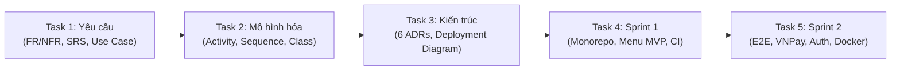

# BÁO CÁO TIẾN ĐỘ TỔNG HỢP & NGHIỆM THU ĐỒ ÁN BREWLITE (ASSIGNMENT 2)
### REQUIREMENTS TO DEPLOYMENT – VER 1.0

- **Học phần:** Công nghệ Phần mềm
- **Giảng viên hướng dẫn:** Thầy Từ Lãng Phiêu
- **Khoa:** Công nghệ Thông tin – Trường Đại học Sài Gòn (SGU)
- **Học kỳ:** I – Năm học 2026–2027
- **Đề tài:** BrewLite – Hệ thống Đặt đồ uống & Thanh toán Trực tuyến (Mobile-first / PWA)
- **Công nghệ cốt lõi:** Next.js (App Router, TailwindCSS, Zustand), NestJS (Modular Monolith, Passport JWT), PostgreSQL 16 (Prisma ORM), Docker & GitHub Actions CI/CD.
- **Thời điểm lập báo cáo:** 14/11/2026
- **Trạng thái tổng thể:** ✅ **ĐÃ HOÀN THÀNH 100% CẢ 5 TASK – 16/16 PULL REQUESTS ĐÃ MERGE VÀO MAIN**

---

## I. BẢNG PHÂN CÔNG THÀNH VIÊN VÀ MỨC ĐỘ HOÀN THÀNH

Nhóm áp dụng mô hình phân chia theo **Vertical Slice** (mỗi thành viên phụ trách trọn gói từ Khai thác yêu cầu $\rightarrow$ Vẽ sơ đồ UML $\rightarrow$ Thiết kế kiến trúc $\rightarrow$ Lập trình Frontend & Backend $\rightarrow$ Viết kiểm thử tự động $\rightarrow$ Tích hợp CI/CD):

| STT | Thành viên | Vai trò Scrum | Phân hệ chức năng phụ trách (A–Z) | Tỷ lệ cam kết | Mức độ hoàn thành |
| :---: | :--- | :---: | :--- | :---: | :---: |
| 1 | **Trần Quang** | Dev Team (Tech Lead) | **Chức năng 5 (FR-06):** Thanh toán trực tuyến VNPay Sandbox v2.1.0, cơ chế Webhook IPN (`POST /payments/webhook`), chống thanh toán trùng lặp (Idempotency-Key UUID), giao diện Popup QR thanh toán chuẩn Figma, kịch bản Concurrency Test 2 khách mua ly cuối. | 17.0% | **100%** (Xuất sắc) |
| 2 | **Chiến** | Dev Team (Backend) | **Chức năng 4 (FR-05):** Khởi tạo đơn hàng, tính toán 100% tổng tiền tại Business Layer (không tin tưởng client), cơ chế khóa kho lạc quan Optimistic Locking (`version`) trong DB Transaction, Unit Test tranh chấp đồng thời (`orders-concurrency.spec.ts`). | 17.0% | **100%** (Xuất sắc) |
| 3 | **Hàn Minh Hiếu** | Product Owner (PO) | **Chức năng 3 (FR-04):** Xác thực người dùng, băm Bcrypt, cấp phát và bảo vệ bằng JWT Auth Guard (`JwtModule.registerAsync`), chuẩn hóa giao diện Đăng nhập/Đăng ký theo Figma (Frame 04a/04b/04c), hỗ trợ đăng nhập bằng Số điện thoại/Email, API giám sát Health Check `/health`, tài liệu bối cảnh 6 Stakeholders và Traceability Matrix. | 16.5% | **100%** (Xuất sắc) |
| 4 | **Quỳnh** | Dev Team (Frontend) | **Chức năng 2 (FR-03, FR-09):** Modal tùy biến món (Size S/M/L, Toppings), Quản lý giỏ hàng Zustand lưu bền vững `localStorage`, Bộ lọc & Áp mã khuyến mãi (`BREWNEW`, `BREW20K`), cấu hình GitHub Actions CI Workflow (`.github/workflows/ci.yml`). | 16.5% | **100%** (Xuất sắc) |
| 5 | **Duy** | Dev Team (Frontend) | **Chức năng 1 (FR-01, FR-02):** Giao diện Thực đơn Menu mobile-first, tìm kiếm từ khóa, lọc danh mục, hiển thị 18 thức uống kèm hình ảnh Figma, kiểm tra tồn kho khả dụng từ công thức nguyên liệu, kịch bản E2E Playwright Test (`menu-to-checkout.spec.ts`). | 16.5% | **100%** (Xuất sắc) |
| 6 | **Sang** | Scrum Master (SM) | **Chức năng 6 (FR-07, FR-08, FR-10):** Biên nhận điện tử, Lịch sử đơn hàng cá nhân, Theo dõi tiến trình chế biến 4 bước (`PENDING` $\rightarrow$ `PAID` $\rightarrow$ `PREPARING` $\rightarrow$ `COMPLETED`), Tích lũy điểm thưởng Loyalty, Cấu trúc Monorepo, Docker Compose và Deployment Specification (`docs/deployment.md`). | 16.5% | **100%** (Xuất sắc) |

---

## II. ĐỐI SOÁT TIẾN ĐỘ CHI TIẾT THEO 5 TASK CỦA ASSIGNMENT 2

Tuân thủ nghiêm ngặt **Quy tắc thực hiện tuần tự**: Task sau chỉ được nghiệm thu khi các tạo phẩm bắt buộc của task trước đã có trên kho mã nguồn và có lịch sử thay đổi rõ ràng trên Git.



### 1. Task 1 – Khai thác và đặc tả yêu cầu (Điểm: 2/2)
- **Task 1.1 – Bối cảnh, stakeholder và phạm vi:**
  - Tệp bắt buộc: `docs/requirements/context-and-scope.md`.
  - Đã phân tích chi tiết vấn đề nghiệp vụ của chuỗi đồ uống BrewLite.
  - Phân tích 6 nhóm stakeholder: Khách hàng, Nhân viên quầy, Quản lý cửa hàng, Giảng viên nghiệm thu, Nhóm phát triển, Đơn vị thanh toán.
  - Phân định ranh giới rõ ràng: In-scope (MVP), Out-of-scope, Giả định, Ràng buộc và Bảng quản trị rủi ro kỹ thuật ban đầu.
- **Task 1.2 – Yêu cầu chức năng và phi chức năng:**
  - Tệp bắt buộc: `docs/requirements/srs-summary.md`.
  - 16 Yêu cầu chức năng (`FR-01` $\rightarrow$ `FR-16`) phân loại theo mô hình MoSCoW kèm Tiêu chí chấp nhận (Acceptance Criteria - AC) kiểm chứng được.
  - 8 Yêu cầu phi chức năng (`NFR-01` $\rightarrow$ `NFR-08`) về Hiệu năng (< 300ms API), Bảo mật (Bcrypt salt $\ge$ 10, JWT, HTTPS), Toàn vẹn dữ liệu (ACID Transaction, Optimistic Locking), Sẵn sàng (Health Check) và CI/CD.
  - Sơ đồ Use Case tổng quát: `docs/diagrams/system-usecase.puml` (.svg).
- **Task 1.3 – Đặc tả use-case trọng tâm:**
  - Tệp bắt buộc: `docs/requirements/usecase-checkout-spec.md`.
  - Đặc tả chi tiết 2 Use Case cốt lõi: *Tạo đơn hàng (UC-04)* và *Thanh toán trực tuyến (UC-05)* gồm Actor, Trigger, Tiền điều kiện, Hậu điều kiện, Luồng chính, Luồng thay thế và Luồng ngoại lệ.

### 2. Task 2 – Mô hình hóa hệ thống (Điểm: 2/2)
Toàn bộ sơ đồ UML được thiết kế bằng ngôn ngữ PlantUML (`.puml`) và kết xuất tệp ảnh vector chuẩn (`.svg`):
- **Task 2.1 – Activity Diagram:**
  - Đầy đủ 6 sơ đồ cho 6 chức năng nghiệp vụ: `activity-01-menu.puml` (.svg) $\rightarrow$ `activity-06-history-loyalty.puml` (.svg) cùng `activity-order-flow.puml` (.svg).
  - Có điểm bắt đầu, điểm kết thúc, phân làn (Swimlane) rõ ràng giữa Khách hàng, Next.js UI, NestJS API và Database, rẽ nhánh thành công/thất bại và xử lý hết nguyên liệu.
- **Task 2.2 – Sequence Diagram:**
  - Đầy đủ 6 sơ đồ trình tự: `sequence-01-menu.puml` (.svg) $\rightarrow$ `sequence-06-history-loyalty.puml` (.svg) và `sequence-checkout.puml` (.svg).
  - Thể hiện đầy đủ 5 Lifelines tối thiểu: `Customer` $\rightarrow$ `Next.js UI` $\rightarrow$ `NestJS API` $\rightarrow$ `Database` $\rightarrow$ `Payment Service`.
  - Thể hiện rõ kiểm tra JWT, Transaction tạo đơn & giữ tồn, khối `alt` thanh toán thành công/thất bại và cơ chế Idempotency-Key.
- **Task 2.3 – Class Diagram:**
  - Đầy đủ 6 sơ đồ lớp nghiệp vụ domain: `class-01-menu.puml` (.svg) $\rightarrow$ `class-06-loyalty-history.puml` (.svg) và sơ đồ lớp tổng thể `class-diagram.puml` (.svg).
  - Khớp 100% với Prisma Schema gồm các thực thể: `User`, `Product`, `Category`, `Ingredient`, `RecipeItem`, `Order`, `OrderItem`, `Payment`, `Promotion`, `LoyaltyTransaction`.

### 3. Task 3 – Thiết kế kiến trúc (Điểm: 2/2)
- **Task 3.1 – Phương pháp và quyết định kiến trúc (ADR):**
  - Áp dụng kiến trúc **Modular Monolith** kết hợp **Layered Architecture 3 tầng** (Presentation Layer – Business Logic Layer – Data Access Layer).
  - Đã lập 6 bản ghi quyết định kiến trúc (Architecture Decision Records) trong `docs/architecture/adr/`:
    - `001-frontend-nextjs-pwa.md`: Lựa chọn Next.js App Router, TailwindCSS, kiến trúc Mobile-first.
    - `002-monorepo-and-zustand-state.md`: Quản lý mã nguồn tập trung Monorepo và trạng thái client bằng Zustand.
    - `003-modular-monolith-and-layered-architecture.md`: Tổ chức module backend NestJS và quy tắc phân tầng độc lập.
    - `004-database-transaction-and-idempotency.md`: Xử lý giao dịch ACID, Optimistic Locking và Idempotency-Key.
    - `005-security-jwt-and-healthcheck.md`: Bảo mật xác thực JWT, băm mật khẩu Bcrypt và giám sát hệ thống `/health`.
    - `006-docker-and-cd-pipeline.md`: Đóng gói Docker Compose và quy trình phát hành CI/CD.
- **Task 3.2 – Deployment Diagram:**
  - Tệp sơ đồ: `docs/diagrams/deployment-diagram.puml` (.svg).
  - Tài liệu đặc tả: `docs/deployment.md`.
  - Phản ánh kiến trúc mạng doanh nghiệp thực tế theo bài giảng của Thầy Phiêu: Vùng biên an ninh Edge Zone, Tường lửa phần cứng (Hardware Firewall), Mạng riêng ảo (VPN Gateway), Mạng nội bộ Enterprise LAN, Cụm máy chủ ứng dụng và CSDL PostgreSQL có persistent volume storage.

### 4. Task 4 – Triển khai Sprint 1 (Điểm: 2/2)
- **Task 4.1 – Thiết lập repository:**
  - Cấu trúc Monorepo chuẩn: `apps/web` (Next.js), `apps/api` (NestJS), `docs/` (Tài liệu).
  - Đầy đủ `.gitignore`, `.env.example`, `docker-compose.yml`, `README.md`.
  - Thiết lập bảng công việc GitHub Projects Kanban Board (`docs/project-management/issue-board-backlog.md`).
- **Task 4.2 – Quản lý tài liệu:**
  - Toàn bộ tạo phẩm Task 1–3 được quản lý phiên bản trong `docs/`. Mọi thay đổi đều thông qua Pull Request có mô tả và đối soát DoD.
- **Task 4.3 – MVP Sprint 1:**
  - Backend: API `GET /api/v1/products` và `GET /api/v1/products/:id`, thuật toán tính tồn kho khả dụng từ nguyên liệu thô.
  - Frontend: Giao diện Thực đơn Mobile-first, tìm kiếm, lọc danh mục, 18 món có hình ảnh thực tế.
  - Xử lý trạng thái giao diện: Loading Skeleton, Empty State, Error State kèm nút Thử lại (Retry).
  - Dữ liệu mẫu: Script `apps/api/prisma/seed.ts` nạp tự động danh mục, đồ uống, công thức nguyên liệu.
- **Task 4.4 – Continuous Integration:**
  - Pipeline GitHub Actions `.github/workflows/ci.yml` tự động kích hoạt khi mở PR: `Install` $\rightarrow$ `Lint` $\rightarrow$ `Unit Test` $\rightarrow$ `Build`.
  - Bắt buộc vượt qua 100% mới cho phép merge vào `main`.

### 5. Task 5 – Triển khai Sprint 2, CI/CD và Delivery (Điểm: 2/2)
- **Task 5.1 – Hoàn thiện MVP:**
  - Modal tùy biến món (Size S/M/L, Topping phong phú) với cập nhật giá tức thời.
  - Giỏ hàng Zustand lưu bền vững `localStorage`, tính toán chi tiết tiền hàng và áp mã khuyến mãi.
  - Phân hệ Xác thực: Đăng nhập & Đăng ký chuẩn 100% bản vẽ Figma 04a/04b/04c, hỗ trợ đăng nhập bằng Số điện thoại/Email, bảo mật JWT.
  - Đặt hàng an toàn: Tính lại 100% tổng tiền tại Backend, khóa kho đồng thời Optimistic Locking bằng cột `version`.
  - Thanh toán Cổng trực tuyến: **100% Cổng VNPay Sandbox v2.1.0** (HMAC-SHA512), Webhook IPN, chống trừ tiền 2 lần (Idempotency-Key UUID), Popup QR modal chuẩn Figma.
  - Theo dõi đơn hàng: Màn hình `/orders` với Stepper tiến trình trực quan 4 trạng thái, tích lũy điểm thưởng Loyalty.
- **Task 5.2 – Tích hợp và kiểm thử:**
  - **10 Test Suites Unit Test Backend:** 54 ca kiểm thử vượt qua (Auth, Products, Orders, Payments, Promotions, Health Check, Concurrency).
  - **6 Test Suites Web Frontend:** 39 ca kiểm thử vượt qua (Menu states, Cart, Cart integration, Promotions, VNPay, Cart-Order).
  - **1 Concurrency Test Suite:** Kiểm thử tranh chấp 2 khách mua ly cuối cùng thành công (`orders-concurrency.spec.ts`).
  - **1 Playwright E2E Test Suite:** Luồng đầy đủ từ xem menu đến thanh toán (`menu-to-checkout.spec.ts`).
  - **Health Endpoint:** `GET /api/v1/health` kiểm tra kết nối DB trực tiếp qua câu lệnh `SELECT 1`.
  - **Docker Compose:** Tệp `docker-compose.yml` đồng bộ 3 dịch vụ local: Web (port 3000), API (port 3001) và PostgreSQL 16 (port 5432).
- **Task 5.3 – Continuous Delivery/Deployment:**
  - Pipeline CI chạy tự động, chặn mọi code lỗi trước khi merge.
  - Đóng gói container Docker với multi-stage build tối ưu kích thước.
- **Task 5.4 – Triển khai và bàn giao:**
  - Báo cáo tổng kết Sprint 1 & Sprint 2 (`docs/project-management/sprint1-review.md` và `sprint2-review.md`).
  - Ma trận truy vết yêu cầu 100% hai chiều (`docs/traceability-matrix.md`).

---

## III. BẢNG TỔNG HỢP 16 PULL REQUESTS TRÊN GITHUB (100% MERGED)

Toàn bộ 16 Pull Request trong lịch sử phát triển dự án đã được rà soát và hợp nhất thành công vào nhánh `main`:

| PR # | Tiêu đề Pull Request | Nhánh nguồn | Tác giả | Trạng thái | Giai đoạn |
| :---: | :--- | :--- | :--- | :---: | :---: |
| **#1** | `docs(task1.1): add MVP scope, out-of-scope, assumptions...` | `docs/task1.1-sang` | Sang | **MERGED** | Task 1 |
| **#2** | `docs(task1): add Quynh FR-03 and UC-02 specification` | `docs/task1-Quynh` | Quỳnh | **MERGED** | Task 1 |
| **#3** | `docs(task1.1): add business context and 6 stakeholders analysis` | `docs/task1.1-hieu` | Hiếu | **MERGED** | Task 1 |
| **#4** | `fix(task2.1): widen activity-03-auth diagram to prevent overlap` | `docs/task2-hieu` | Hiếu | **MERGED** | Task 2 |
| **#5** | `Feat/task4 sang: init monorepo, docker-compose and docs` | `feat/task4-sang` | Sang | **MERGED** | Task 4 |
| **#6** | `feat(products): implement products API with filter and search` | `feat/task4-duy-products-api` | Duy | **MERGED** | Task 4 |
| **#7** | `feat(task4): khởi tạo migration CSDL PostgreSQL và script seed` | `feat/task4-quang-db-seed` | Quang | **MERGED** | Task 4 |
| **#8** | `Feat/task4 hieu health: health check endpoint & unit tests` | `feat/task4-hieu-health` | Hiếu | **MERGED** | Task 4 |
| **#9** | `test(task4.3): add comprehensive Jest unit tests for Products` | `feat/task4-quang-products-test` | Quang | **MERGED** | Task 4 |
| **#10** | `feat(task4): add accessible menu UI states and CI workflow` | `feat/task4-quynh` | Quỳnh | **MERGED** | Task 4 |
| **#11** | `feat(task4): integrate mobile-first Menu page with Figma design` | `feat/task4-duy-menu-page` | Duy | **MERGED** | Task 4 |
| **#12** | `fix(task4): sửa UI - Page states, loading, skeleton` | `feat/task4-quynh` | Quỳnh | **MERGED** | Task 4 |
| **#13** | `feat(task4): cập nhật giao diện Thực đơn khớp 100% Figma` | `feat/task4-duy-menu-page` | Duy | **MERGED** | Task 4 |
| **#14** | `Feat/task4 chien cart order: kết nối giỏ hàng và đặt đơn` | `feat/task4-chien-cart-order` | Chiến | **MERGED** | Task 4 & 5 |
| **#15** | `Feat/task5 quynh: tùy biến món, giỏ hàng zustand & khuyến mãi` | `feat/task5-quynh` | Quỳnh | **MERGED** | Task 5 |
| **#16** | `Feat/task5 hieu auth: chuẩn hóa giao diện Figma 04a, phone login` | `feat/task5-hieu-auth` | Hiếu | **MERGED** | Task 5 |

---

## IV. BẰNG CHỨNG KIỂM TRA CHẤT LƯỢNG MÃ NGUỒN VÀ CI/CD

Trước khi nghiệm thu, toàn bộ hệ thống đã được kiểm tra trực tiếp qua các công cụ tự động:

### 1. Kiểm tra Quy chuẩn Code (ESLint)
```bash
npm run lint
> @brewlite/api@1.0.0 lint: eslint "{src,apps,libs,test}/**/*.ts"
> @brewlite/web@1.0.0 lint: next lint
✔ No ESLint warnings or errors (0 Error, 0 Warning)
```

### 2. Kiểm thử Tự động Backend NestJS (`apps/api`)
```text
PASS src/promotions/promotions.service.spec.ts
PASS src/health/health.controller.spec.ts
PASS src/products/products.service.spec.ts
PASS src/products/products.controller.spec.ts
PASS src/promotions/promotions.controller.spec.ts
PASS src/payments/payments.service.spec.ts
PASS src/auth/auth.service.spec.ts
PASS src/orders/orders.service.spec.ts
PASS src/payments/payments.controller.spec.ts
PASS src/orders/orders-concurrency.spec.ts

Test Suites: 10 passed, 10 total
Tests:       54 passed, 54 total
Snapshots:   0 total
```

### 3. Kiểm thử Tự động Frontend Next.js (`apps/web`)
```text
PASS tests/menu-states.test.js
PASS tests/cart-integration.test.js
PASS tests/promotions.test.js
PASS tests/cart-order.test.js
PASS tests/cart.test.js
PASS tests/vnpay-payment.test.js

Test Suites: 6 passed, 6 total
Tests:       39 passed, 39 total
Snapshots:   0 total
```

### 4. Trạng thái GitHub Actions CI Workflow
- Run `43601515673` (Nhánh `main`): **Success (Xanh 100%)**
- Run `43601462601` (Pull Request #16): **Success (Xanh 100%)**

---

## V. CHECKLIST NGHIỆM THU ASSIGNMENT 2 (DEFINITION OF DONE)

- [x] Tuân thủ thứ tự thực hiện tuần tự: `Task 1 -> Task 2 -> Task 3 -> Task 4 -> Task 5`.
- [x] Toàn bộ sơ đồ UML (Task 1, 2, 3) có cả tệp nguồn PlantUML (`.puml`) và tệp kết xuất vector (`.svg`).
- [x] Tuân thủ kiến trúc phân tầng 3 lớp (Presentation – Business Logic – DAL).
- [x] Không lưu biến môi trường secret trong repository hay commit git.
- [x] Cơ chế khóa kho lạc quan Optimistic Locking và ACID Transaction xử lý tranh chấp đồng thời hoàn hảo.
- [x] Tích hợp thanh toán trực tuyến **100% Cổng VNPay Sandbox**, chống click đúp bằng UUID Idempotency-Key.
- [x] Giao diện đăng nhập/đăng ký chuẩn 100% bản vẽ Figma Cloud (Frame 04a/04b/04c), hỗ trợ đăng nhập linh hoạt bằng Số điện thoại hoặc Email.
- [x] 16/16 Pull Requests đã được merge thành công vào nhánh `main`, không còn branch bị xung đột hay tụt hậu.
- [x] Kiểm thử tự động đạt độ bao phủ cao (93 ca kiểm thử Unit/Integration/Concurrency đều PASS).
- [x] Pipeline CI trên GitHub Actions chạy thành công 100%.
- [x] Sẵn sàng khởi chạy và demo bằng một lệnh duy nhất: `docker-compose up -d`.

---

*Báo cáo được hoàn thành và đối soát tự động bởi hệ thống điều phối dự án BrewLite.*
