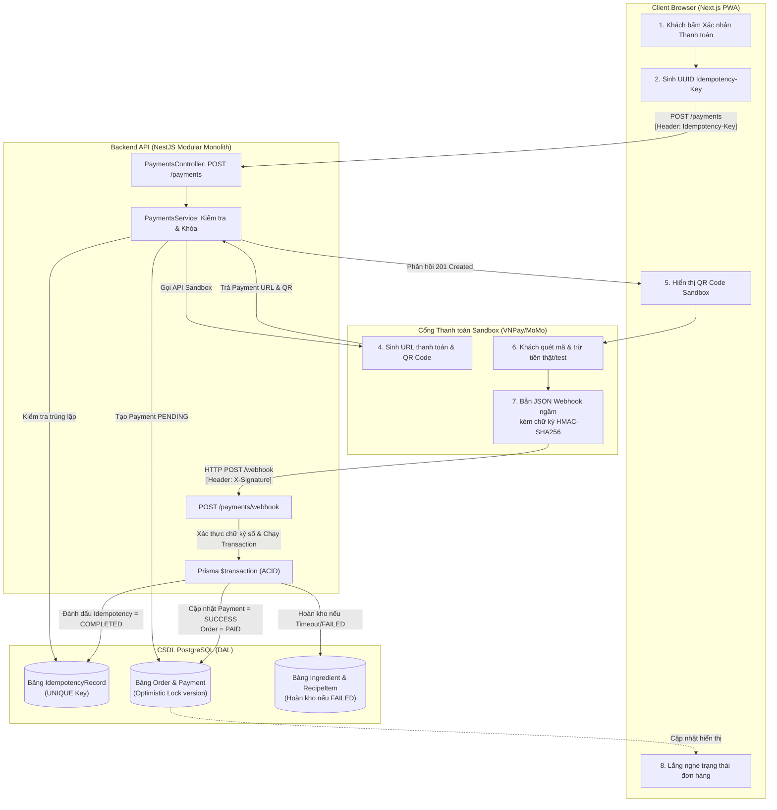

# KIẾN TRÚC HỆ THỐNG BREWLITE – BẢN GHI QUYẾT ĐỊNH KIẾN TRÚC (ADR)

# ADR-004: Cơ chế Quản lý Giao dịch CSDL (Database Transaction), Khóa Lạc quan (Optimistic Locking), Chống Trừ tiền Trùng lặp (Idempotency-Key) và Tích hợp Cổng Thanh toán Sandbox qua Webhook Callback

- **Trạng thái (Status):** Đã chấp thuận (Accepted)
- **Ngày quyết định (Date):** 2026-11-08
- **Tác giả (Author):** Quang (Dev Team – Phụ trách Lõi Backend, Concurrency & Module Thanh toán)
- **Người xem xét & Phê duyệt (Reviewers):** Hàn Minh Hiếu (Product Owner), Sang (Scrum Master)
- **Phân hệ phụ trách:** Chức năng 5 (`FR-06`), Yêu cầu phi chức năng (`NFR-01`, `NFR-02`, `NFR-03`), phối hợp chặt chẽ với Chức năng 4 (`FR-05`)
- **Tài liệu liên quan:**
  - [Đặc tả Yêu cầu SRS Summary (docs/requirements/srs-summary.md)](../../requirements/srs-summary.md)
  - [Đặc tả Use Case Luồng Đặt & Thanh toán (docs/requirements/usecase-checkout-spec.md)](../../requirements/usecase-checkout-spec.md)
  - [Sơ đồ Hoạt động Thanh toán (docs/diagrams/activity-05-payment.svg)](../../diagrams/activity-05-payment.svg)
  - [Sơ đồ Tuần tự Thanh toán (docs/diagrams/sequence-05-payment.svg)](../../diagrams/sequence-05-payment.svg)
  - [Sơ đồ Lớp Thanh toán & Webhook (docs/diagrams/class-05-payment.svg)](../../diagrams/class-05-payment.svg)

---

## 1. Bối cảnh và Vấn đề Kỹ thuật (Context & Problem Statement)

Trong hệ thống đặt đồ uống trực tuyến **BrewLite**, phân hệ **Tạo đơn hàng – Giữ chỗ nguyên liệu – Thanh toán** là chuỗi nghiệp vụ mang tính sống còn và tiềm ẩn rủi ro sai lệch dữ liệu cao nhất, đặc biệt vào các khung giờ cao điểm (Peak Hours: 11h30 – 13h00) khi số lượng truy cập đồng thời tăng đột biến.

Hệ thống phải đối mặt với 4 bài toán kỹ thuật cốt lõi:

1. **Bài toán Tranh chấp tài nguyên đồng thời (Concurrency & Race Condition):**
   - Nhiều khách hàng có thể cùng lúc chọn mua một món đồ uống bán chạy (Best-seller) hoặc các món khác nhau nhưng dùng chung một nguồn nguyên liệu cốt lõi (ví dụ: Sữa tươi thanh trùng, Trà Oolong, Trân châu đen).
   - Nếu hệ thống chỉ kiểm tra tồn kho đơn thuần bằng cách đọc CSDL rồi ghi đè (`Read-Modify-Write`) mà không có cơ chế khóa an toàn, hiện tượng **Bán vượt tồn kho (Over-selling / Negative Stock)** chắc chắn sẽ xảy ra, dẫn đến việc cửa hàng nhận tiền nhưng không đủ nguyên liệu để pha chế cho khách.

2. **Bài toán Tính toàn vẹn giao dịch đa bảng (Atomic Multi-table Mutation):**
   - Một chu trình thanh toán không chỉ cập nhật bản ghi thanh toán mà còn tác động dây chuyền tới ít nhất 5 bảng thực thể CSDL: `Order`, `Payment`, `Ingredient`, `OrderStatusLog`, và `LoyaltyTransaction`.
   - Nếu quá trình thực thi bị gián đoạn giữa chừng (ví dụ: máy chủ sập nguồn, timeout mạng với cổng thanh toán, lỗi kết nối CSDL), dữ liệu sẽ rơi vào trạng thái bất nhất nghiêm trọng (Inconsistent State): tiền đã trừ nhưng đơn hàng vẫn ở trạng thái chờ, hoặc nguyên liệu bị trừ nhưng không có đơn hàng tương ứng.

3. **Bài toán Bấm đúp và Trùng lặp thanh toán (Double Charge & Network Retry):**
   - Do độ trễ mạng Internet trên thiết bị di động, hoặc do người dùng mất kiên nhẫn bấm liên tiếp nhiều lần vào nút *"Xác nhận thanh toán"*, trình duyệt có thể gửi nhiều HTTP request khởi tạo thanh toán giống hệt nhau trong khoảng thời gian vài trăm mili-giây.
   - Tương tự, cổng thanh toán bên thứ ba có thể gửi lại bản tin Webhook đối soát nhiều lần (Retry Mechanism) nếu mạng chập chờn. Nếu hệ thống không có khả năng nhận biết trùng lặp, khách hàng sẽ bị trừ tiền 2 lần cho cùng một đơn hàng.

4. **Bài toán Rủi ro bảo mật từ phía Client (Insecure Client-side Payment Confirmation):**
   - Theo chuẩn bảo mật thanh toán và yêu cầu nghiêm ngặt từ Giảng viên hướng dẫn: **Tuyệt đối không cho phép máy khách (Frontend Next.js) tự ý gửi request báo thành công để cập nhật trạng thái đơn hàng sang `PAID`**.
   - Việc xác nhận đơn hàng thành công phải là quy trình **Server-to-Server** (Máy chủ cổng thanh toán trao đổi trực tiếp ngầm với máy chủ Backend qua Webhook), có cơ chế mã hóa kiểm tra chữ ký số (HMAC Signature Verification) để chống giả mạo gói tin.

---

## 2. Các Lựa chọn Kiến trúc Đã Xem xét (Considered Alternatives)

### 2.1 Cơ chế Đồng bộ và Khóa Kho CSDL (Concurrency Control)

* **Lựa chọn 2.1.1: Khóa bi quan (Pessimistic Locking – `SELECT ... FOR UPDATE`)**
  - *Cơ chế:* Khi một request đọc dữ liệu tồn kho nguyên liệu, CSDL PostgreSQL sẽ khóa chặt dòng bản ghi đó (Row-level Lock). Mọi request khác muốn đọc hoặc ghi vào dòng này bắt buộc phải xếp hàng chờ cho đến khi transaction trước hoàn tất (`COMMIT` hoặc `ROLLBACK`).
  - *Nhược điểm:* Gây suy giảm nghiêm trọng thông lượng xử lý của hệ thống (TPS). Nếu thời gian xử lý kéo dài, các connection trong pool của PostgreSQL sẽ bị chiếm dụng toàn bộ, dẫn đến nghẽn cổ chai (Connection Pool Exhaustion) và tiềm ẩn nguy cơ Deadlock khi nhiều đơn hàng khóa các nguyên liệu chéo nhau.

* **Lựa chọn 2.1.2: Khóa lạc quan (Optimistic Concurrency Control - OCC) qua cột `version` (ĐƯỢC CHỌN)**
  - *Cơ chế:* Cho phép tất cả các request đọc dữ liệu nguyên liệu đồng thời không cần khóa. Mỗi bản ghi nguyên liệu mang một số phiên bản (`version: Int`). Khi cập nhật trừ kho, hệ thống thực thi câu lệnh kèm điều kiện kiểm tra phiên bản:
    $$\text{UPDATE Ingredient SET stock} = \text{stock} - \Delta, \text{version} = \text{version} + 1 \text{ WHERE id} = \text{id AND version} = v_{\text{old}} \text{ AND stock} \ge \Delta$$
  - *Ưu điểm:* Không giữ khóa vật lý trên CSDL, tối đa hóa hiệu năng đọc/ghi đồng thời, loại bỏ hoàn toàn nguy cơ Deadlock. Request nào đến trước sẽ cập nhật thành công và tăng `version`; request đến sau thấy `version` đã thay đổi sẽ bị từ chối ngay lập tức với lỗi `409 Conflict`.

---

### 2.2 Cơ chế Chống Trừ tiền Trùng lặp (Idempotency Mechanism)

* **Lựa chọn 2.2.1: Bộ nhớ đệm phân tán Redis (In-Memory Redis Cache)**
  - *Cơ chế:* Lưu trữ `Idempotency-Key` cùng kết quả giao dịch trên Redis với cơ chế `SETNX` (Set if Not Exists) kèm thời gian sống (TTL).
  - *Nhược điểm:* Tăng độ phức tạp của hạ tầng (phải quản trị thêm cụm Redis bên cạnh PostgreSQL). Khi Redis gặp sự cố hoặc mất điện đột ngột, dữ liệu cache có thể bị mất, làm mất đi tính bền vững (Durability) của cơ chế chống trừ tiền trùng lặp.

* **Lựa chọn 2.2.2: Bảng CSDL RDBMS `IdempotencyRecord` trong PostgreSQL (ĐƯỢC CHỌN)**
  - *Cơ chế:* Thiết kế bảng `IdempotencyRecord` lưu trực tiếp trên PostgreSQL với ràng buộc khóa duy nhất `UNIQUE(idempotencyKey)`.
  - *Ưu điểm:* Tận dụng trọn vẹn đặc tính ACID của PostgreSQL. Thao tác ghi nhận key và cập nhật thanh toán nằm trong cùng một transaction CSDL, đảm bảo tính nhất quán tuyệt đối 100%, không phát sinh thêm chi phí hạ tầng hay rủi ro mất đồng bộ giữa CSDL chính và Cache.

---

### 2.3 Cơ chế Xác thực Kết quả Thanh toán (Payment Callback Strategy)

* **Lựa chọn 2.3.1: Client Redirect Callback (Cổng thanh toán redirect trình duyệt về kèm query param)**
  - *Cơ chế:* Cổng thanh toán chuyển hướng trình duyệt của khách hàng về trang `checkout/success?status=SUCCESS`. Frontend đọc query string và gọi API Backend để cập nhật đơn hàng sang `PAID`.
  - *Rủi ro bảo mật:* Người dùng hoặc kẻ tấn công có thể chỉnh sửa URL trình duyệt, gửi request giả mạo để chiếm đoạt đồ uống mà không thực sự trả tiền. Nếu khách tắt trình duyệt ngay sau khi chuyển tiền, đơn hàng sẽ không bao giờ được cập nhật sang `PAID`.

* **Lựa chọn 2.3.2: Asynchronous Server-to-Server Webhook kèm HMAC-SHA256 (ĐƯỢC CHỌN)**
  - *Cơ chế:* Máy chủ Cổng thanh toán Sandbox gửi một HTTP POST request ngầm (Background Webhook Callback) trực tiếp đến máy chủ Backend của BrewLite tại endpoint `POST /api/v1/payments/webhook`.
  - *Bảo mật:* Gói tin đính kèm chữ ký điện tử `X-Signature` được tạo từ thuật toán băm bảo mật HMAC-SHA256 với khóa bí mật (`SECRET_KEY`). Backend giải mã, đối soát chữ ký số và xác thực số tiền trước khi mở Transaction chuyển trạng thái đơn hàng.

---

## 3. Quyết định Kiến trúc (Architectural Decisions)

Hệ thống BrewLite chính thức thông qua **4 quyết định kiến trúc cốt lõi** cho Chức năng 5 và luồng Đặt & Thanh toán:



---

### Quyết định 1: Đảm bảo Tính Toàn vẹn Dữ liệu bằng Prisma Interactive Transaction (`$transaction`)

Mọi thao tác thay đổi trạng thái thanh toán và số lượng kho nguyên liệu bắt buộc phải được đóng gói bên trong một **Interactive Database Transaction** của Prisma ORM.

1. **Mức độ cô lập (Isolation Level):** Sử dụng mức cô lập mặc định của PostgreSQL là `Read Committed`, kết hợp điều kiện kiểm tra phiên bản ở tầng ứng dụng.
2. **Quy tắc Rollback:** Nếu bất kỳ câu lệnh con nào trong chuỗi giao dịch thất bại (ví dụ: không đủ nguyên liệu, xung đột version, hoặc lỗi ghi log), toàn bộ transaction sẽ lập tức bị hủy bỏ (`ROLLBACK`), đưa CSDL trở về trạng thái nguyên vẹn trước đó mà không để lại dữ liệu rác.

```typescript
// Trích xuất logic mẫu tại apps/api/src/payments/payments.service.ts
await this.prisma.$transaction(async (tx) => {
  // 1. Cập nhật bản ghi thanh toán
  const payment = await tx.payment.update({
    where: { id: paymentId },
    data: {
      status: PaymentStatus.SUCCESS,
      transactionRef: payload.transactionRef,
      paidAt: new Date(),
    },
  });

  // 2. Chuyển trạng thái đơn hàng sang PAID
  const order = await tx.order.update({
    where: { id: payment.orderId },
    data: { status: OrderStatus.PAID },
  });

  // 3. Tích lũy điểm thưởng Loyalty cho khách hàng
  const pointsEarned = Math.floor(Number(order.finalAmount) / 10000);
  await tx.loyaltyTransaction.create({
    data: {
      userId: order.userId,
      orderId: order.id,
      points: pointsEarned,
      type: LoyaltyTransactionType.EARN,
    },
  });

  await tx.user.update({
    where: { id: order.userId },
    data: { loyaltyPoints: { increment: pointsEarned } },
  });
});
```

---

### Quyết định 2: Kiểm soát Tranh chấp Đồng thời bằng Khóa Lạc quan (Optimistic Concurrency Control)

1. **Cấu trúc trường `version`:** Cả hai bảng `Product` và `Ingredient` đều được trang bị một trường số nguyên `version: Int @default(0)`.
2. **Nguyên tắc Khóa:** Khi trừ nguyên liệu pha chế cho đơn hàng:
   - Hệ thống đọc bản ghi kèm số `version` hiện tại.
   - Khi thực hiện `UPDATE`, hệ thống gắn mệnh đề điều kiện `WHERE id = :id AND version = :currentVersion AND stockQuantity >= :requiredAmount`.
   - Cập nhật đồng thời tăng `version = version + 1`.
3. **Xử lý xung đột (Conflict Handling):**
   - Nếu `count == 0` (do có một giao dịch khác vừa trừ kho thành công trước đó làm tăng `version`, hoặc số lượng tồn kho không còn đủ), câu lệnh không làm thay đổi dòng nào.
   - NestJS Backend phát hiện điều này và ném ngay `ConflictException` (HTTP 409 Conflict): *"Nguyên liệu pha chế cho đồ uống vừa hết hoặc có xung đột đơn hàng. Vui lòng thử lại!"*.
   - Transaction lập tức Rollback, giải phóng tài nguyên ngay lập tức mà không gây tắc nghẽn hệ thống.

---

### Quyết định 3: Chống Trừ tiền Trùng lặp bằng Bảng `IdempotencyRecord` và Header `Idempotency-Key`

1. **Sinh mã tại Client:** Mỗi khi trang `checkout/page.tsx` chuẩn bị gửi yêu cầu thanh toán, ứng dụng Next.js tự động tạo một chuỗi định danh duy nhất theo chuẩn **UUID v4** (ví dụ: `9b1deb4d-3b7d-4bad-9bdd-2b0d7b3dcb6d`) và truyền lên qua HTTP Request Header:
   $$\text{Header: } \texttt{Idempotency-Key: <UUID-v4>}$$
2. **Cấu trúc Bảng `IdempotencyRecord` trong CSDL PostgreSQL:**
   ```prisma
   model IdempotencyRecord {
     id             String            @id @default(uuid())
     key            String            @unique // Khóa Idempotency-Key do Client gửi
     requestHash    String            // SHA-256 hash của body request để phát hiện sửa đổi payload
     status         IdempotencyStatus @default(IN_PROGRESS) // IN_PROGRESS, COMPLETED, FAILED
     responseStatus Int?              // HTTP Status code phản hồi (ví dụ: 200, 201)
     responseBody   Json?             // Nội dung JSON đã trả về trước đó
     createdAt      DateTime          @default(now())
     expiresAt      DateTime          // Hết hạn sau 24 giờ (TTL)
   }
   ```
3. **Quy trình Xử lý 3 Giai đoạn (Three-phase Idempotent Protocol):**
   - **Giai đoạn 1 (Check & Lock):** Tìm kiếm `key` trong bảng `IdempotencyRecord`:
     - Nếu `key` đã tồn tại với trạng thái `COMPLETED`: Trả về ngay lập tức dữ liệu đã lưu trong `responseBody` với HTTP Status `responseStatus` đã lưu (Cached Response). Tuyệt đối không trừ tiền hay gọi lại Sandbox Gateway.
     - Nếu `key` đã tồn tại với trạng thái `IN_PROGRESS`: Trả về `409 Conflict` kèm thông điệp: *"Giao dịch thanh toán đang được xử lý, vui lòng không bấm liên tục!"*.
     - Nếu `key` chưa tồn tại: Chèn một bản ghi mới với `status: IN_PROGRESS`.
   - **Giai đoạn 2 (Execution):** Tiến hành tạo Payment, gọi Cổng Sandbox và nhận mã QR.
   - **Giai đoạn 3 (Commit & Finalize):** Cập nhật `IdempotencyRecord` sang `status: COMPLETED` cùng toàn bộ nội dung phản hồi.

---

### Quyết định 4: Tích hợp Cổng Thanh toán Sandbox 2 Bước qua Webhook và Xác thực Chữ ký Số (HMAC-SHA256)

1. **Bước 1 – Khởi tạo Thanh toán (Initiate Payment):**
   - Client gọi `POST /api/v1/payments`.
   - Backend tạo bản ghi `Payment` với trạng thái ban đầu là `PENDING`.
   - Backend giao tiếp qua HTTP với Cổng Thanh toán Sandbox (Mock Payment Service), nhận lại `paymentUrl` và chuỗi dữ liệu mã QR.
   - Backend phản hồi thông tin mã QR cho Client hiển thị lên màn hình.
   - **Hẹn giờ TTL (Time-To-Live):** Đơn hàng giữ chỗ nguyên liệu trong tối đa **15 phút**. Nếu sau 15 phút chưa nhận được Webhook thanh toán, hệ thống coi như giao dịch quá hạn (Timeout).

2. **Bước 2 – Đối soát Server-to-Server qua Webhook (Webhook Verification):**
   - Cổng Thanh toán Sandbox gửi HTTP POST payload về endpoint công khai:
     $$\texttt{POST /api/v1/payments/webhook}$$
   - **Xác thực Chữ ký số (HMAC-SHA256):**
     - Cổng Sandbox đính kèm chữ ký trong header `X-Signature`.
     - Backend tính toán lại chữ ký từ nội dung `body` nhận được và khóa bí mật chia sẻ trước (`WEBHOOK_SECRET`):
       $$\text{Calculated Signature} = \text{HMAC-SHA256}(\text{RawBody}, \text{WEBHOOK\_SECRET})$$
     - Nếu hai chữ ký không khớp nhau: Từ chối ngay lập tức với mã `401 Unauthorized` (Chống kẻ gian giả mạo gói tin Webhook).
   - **Xử lý Thành công (Payment SUCCESS):**
     - Chuyển `Payment.status = SUCCESS`.
     - Chuyển `Order.status = PAID`.
     - Tự động cộng điểm thưởng thành viên (`LoyaltyTransaction`).
     - Trả về mã phản hồi `200 OK` cho Cổng Sandbox để xác nhận đã xử lý xong (tránh Sandbox tiếp tục gửi lại Webhook retry).
   - **Xử lý Thất bại / Hủy đơn (Payment FAILED / CANCELLED / Timeout):**
     - Chuyển `Payment.status = FAILED`.
     - Chuyển `Order.status = CANCELLED`.
     - **Hoàn trả kho nguyên liệu (Restock Ingredients):** Mở Transaction cộng hoàn lại toàn bộ số lượng nguyên liệu tương ứng với từng món theo công thức `RecipeItem` về bảng `Ingredient`.

---

## 4. Hệ quả và Đánh giá Lợi hại (Consequences & Trade-offs)

### 4.1 Điểm tích cực (Positive Consequences)

1. **Bảo toàn Dữ liệu Tuyệt đối (Zero Data Inconsistency):** Không bao giờ xảy ra tình trạng bán vượt tồn kho (Over-selling), kho âm hoặc sai lệch doanh thu giữa Cổng thanh toán và CSDL nội bộ.
2. **Hiệu năng và Độ mở rộng Cao (High Throughput & Scalability):** Khóa lạc quan (OCC) cho phép CSDL xử lý hàng trăm đơn hàng mỗi giây mà không bị nghẽn connection pool, tận dụng tối đa tài nguyên phần cứng.
3. **An toàn trước Gian lận và Lỗi mạng (Network Resilience):** Header `Idempotency-Key` bảo vệ khách hàng không bao giờ bị trừ tiền 2 lần, bất kể đường truyền mạng di động 4G/5G chập chờn hay khách hàng bấm đúp nút thanh toán.
4. **Tuân thủ Chuẩn mực An toàn Thanh toán (PCI-DSS & Server-to-Server Principle):** Loại bỏ hoàn toàn lỗ hổng Client tự duyệt đơn, đảm bảo mọi giao dịch tiền bạc đều được bảo chứng bằng chữ ký số HMAC-SHA256.

### 4.2 Điểm đánh đổi và Rủi ro (Trade-offs & Mitigations)

| Điểm đánh đổi / Rủi ro | Mức độ | Biện pháp Giảm thiểu Kỹ thuật (Mitigation) |
| :--- | :---: | :--- |
| **Xung đột ở khung giờ cực điểm (High Contention):** Khi 2 khách cùng mua 1 ly cuối cùng, khách thứ hai sẽ nhận lỗi `409 Conflict`. | Trung bình | Giao diện Next.js hiển thị thông báo thân thiện: *"Đồ uống vừa có khách mua trước, xin chọn món khác!"*, đồng thời tự động làm mới giỏ hàng và khóa nút chọn món. |
| **Tăng dung lượng CSDL do bảng `IdempotencyRecord`:** Bảng này liên tục phình to theo thời gian. | Thấp | Thiết lập chỉ mục `B-Tree` trên cột `key` và định kỳ chạy một Cron Job xóa các bản ghi đã quá thời hạn lưu trữ 7 ngày (`WHERE expiresAt < NOW()`). |
| **Độ trễ mạng của Webhook (Webhook Latency):** Sau khi khách quét mã QR xong, cần 1 – 3 giây để Webhook bắn tới Backend. | Thấp | Trang `checkout/page.tsx` sử dụng cơ chế Polling định kỳ 2 giây/lần đến API `GET /api/v1/orders/:id` để cập nhật trạng thái hiển thị mượt mà sang `PAID` ngay khi Webhook xử lý xong. |

---

## 5. Ma trận Truy vết và Tuân thủ (Compliance & Traceability Matrix)

Bản thiết kế kiến trúc ADR-004 đảm bảo tính nhất quán và truy vết trọn vẹn 100% với các yêu cầu và sản phẩm kỹ thuật của hệ thống:

| Thành phần Yêu cầu / Thiết kế | Mã định danh | Mô tả đối chiếu chi tiết trong ADR-004 |
| :--- | :---: | :--- |
| **Yêu cầu Chức năng (SRS)** | `FR-06` | Khởi tạo phiên thanh toán Sandbox, nhận đối soát Webhook Backend, chuyển trạng thái đơn hàng sang `PAID` hoặc `CANCELLED`. |
| **Yêu cầu Phi chức năng (SRS)** | `NFR-01` | Đảm bảo tính toàn vẹn tồn kho đồng thời với Khóa lạc quan (OCC) có thời gian đáp ứng $< 300\text{ms}$. |
| **Yêu cầu Phi chức năng (SRS)** | `NFR-02` | Độ tin cậy và Tính toàn vẹn giao dịch với ACID Prisma `$transaction`, tự động hoàn kho khi hủy đơn. |
| **Yêu cầu Phi chức năng (SRS)** | `NFR-03` | Bảo mật thanh toán hai chiều, xác thực chữ ký số HMAC-SHA256 trên webhook callback. |
| **Sơ đồ Hoạt động (UML)** | `activity-05-payment.svg` | Khớp trọn vẹn luồng rẽ nhánh 3 làn bơi (Khách hàng – NestJS Backend – Cổng Sandbox). |
| **Sơ đồ Tuần tự (UML)** | `sequence-05-payment.svg` | Khớp 5 lifelines và các thông điệp trao đổi giữa Client, Controller, Service, DB và Sandbox Gateway. |
| **Sơ đồ Lớp (UML)** | `class-05-payment.svg` | Hiện thực hóa các thực thể `Payment`, `IdempotencyRecord`, `SandboxPaymentGateway`, `PaymentsService`. |
| **Mã nguồn Backend (NestJS)** | `apps/api/src/payments/*` | Các tệp `payments.controller.ts`, `payments.service.ts`, `process-payment.dto.ts`. |
| **Kiểm thử Tự động (Tests)** | `test/*.spec.ts` | Bộ kiểm thử Integration Test `orders-payments.integration-spec.ts` và kịch bản bắn đồng thời 2 request mua ly cuối cùng. |
