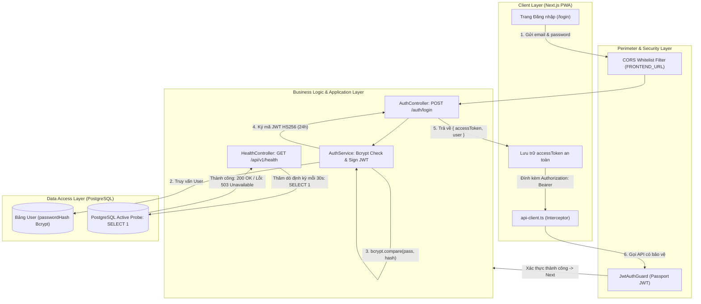

# KIẾN TRÚC HỆ THỐNG BREWLITE – BẢN GHI QUYẾT ĐỊNH KIẾN TRÚC (ADR)

# ADR-005: Cơ chế Xác thực Phân quyền không trạng thái (Stateless JWT), Băm Mật khẩu Thích ứng (Bcrypt), Kiểm soát Nguồn gốc (CORS Whitelist) và Giám sát Sức khỏe Đa tầng (Health Check Probe)

- **Trạng thái (Status):** Đã chấp thuận (Accepted)
- **Ngày quyết định (Date):** 2026-11-08
- **Tác giả (Author):** Hàn Minh Hiếu (Product Owner / Fullstack Dev – Phụ trách Module 3: Xác thực Người dùng & Giám sát Hệ thống)
- **Người xem xét & Phê duyệt (Reviewers):** Sang (Scrum Master), Quang (Backend Lead), Duy (Frontend Lead)
- **Phân hệ phụ trách:** Chức năng 3 (`FR-04`), Yêu cầu phi chức năng (`NFR-02`, `NFR-03`, `NFR-05`), Task 3.1 & Task 5.2
- **Tài liệu liên quan:**
  - [Bối cảnh và Phạm vi Hệ thống (docs/requirements/context-and-scope.md)](../../requirements/context-and-scope.md)
  - [Đặc tả Yêu cầu SRS Summary (docs/requirements/srs-summary.md)](../../requirements/srs-summary.md)
  - [Sơ đồ Hoạt động Xác thực (docs/diagrams/activity-03-auth.svg)](../../diagrams/activity-03-auth.svg)
  - [Sơ đồ Tuần tự Xác thực (docs/diagrams/sequence-03-auth.svg)](../../diagrams/sequence-03-auth.svg)
  - [Sơ đồ Lớp Người dùng & Xác thực (docs/diagrams/class-03-user-auth.svg)](../../diagrams/class-03-user-auth.svg)
  - [Tài liệu Thiết kế Triển khai Hạ tầng (docs/deployment.md)](../../deployment.md)

---

## 1. Bối cảnh và Vấn đề Kỹ thuật (Context & Problem Statement)

Trong hệ thống đặt đồ uống trực tuyến **BrewLite**, phân hệ **Xác thực Người dùng & Giám sát Hệ thống** đóng vai trò là "người gác cổng" (Gatekeeper) cho toàn bộ nền tảng. Các nghiệp vụ trọng yếu như khởi tạo đơn hàng (`POST /orders`), thanh toán qua cổng Sandbox (`POST /payments`), tra cứu biên nhận cá nhân (`GET /orders/my-orders`) và tích lũy điểm thưởng (`LoyaltyTransaction`) đều yêu cầu tính định danh chính xác và phân quyền bảo mật tuyệt đối.

Hệ thống phải giải quyết 4 thách thức kỹ thuật cốt lõi:

1. **Bảo vệ Mật khẩu Người dùng & Chống Tấn công Dò quét (Brute-force / Rainbow Tables):**
   - Mật khẩu khách hàng nếu lưu trữ dạng thô (Plain-text) hoặc băm bằng các thuật toán một chiều thông thường (như MD5, SHA-1, SHA-256 không có muối ngẫu nhiên) sẽ dễ dàng bị giải mã thông qua bảng tra cứu trước (Rainbow Table) hoặc các cuộc tấn công vét cạn (Brute-force) bằng dàn chip GPU tốc độ cao hàng tỷ hash/giây.
   - Hệ thống cần một cơ chế băm mật khẩu có độ phức tạp thích ứng (Adaptive Slow Hashing) và cơ chế đối chiếu thời gian không đổi (Constant-time Comparison) để triệt tiêu hoàn toàn nguy cơ tấn công kênh kề (Timing Attack).

2. **Quản lý Phiên làm việc Không trạng thái (Stateless Session) cho Ứng dụng PWA:**
   - Ứng dụng Client được xây dựng theo hướng Mobile-first PWA bằng Next.js, có thể chạy trên mạng di động 4G/5G chập chờn.
   - Nếu quản lý phiên theo cơ chế truyền thống (Server-side Session lưu trong RAM hoặc Redis), backend sẽ bị ràng buộc trạng thái (Stateful), gây tắc nghẽn khi mở rộng quy mô ngang (Horizontal Scaling) trên nhiều container Docker và tăng tải bộ nhớ của máy chủ API.
   - Do đó, hệ thống cần một cơ chế xác thực phân tán, gọn nhẹ, tự chứa thông tin (Self-contained) và hoàn toàn không trạng thái (Stateless).

3. **Chống Tấn công Giả mạo Nguồn gốc (Cross-Origin Resource Sharing - CORS):**
   - Trình duyệt web của người dùng có thể vô tình truy cập các trang web độc hại bên ngoài. Nếu không thiết lập rào chắn kiểm soát nguồn gốc nghiêm ngặt, kẻ tấn công có thể lợi dụng phiên đăng nhập của người dùng để gửi các request giả mạo (CSRF/CORS Attack) tới API Backend nhằm đánh cắp thông tin cá nhân hoặc tạo đơn hàng trái phép.

4. **Giám sát Sức khỏe Đa tầng (Multi-tier Health Check Probe) phục vụ Tự động hóa CI/CD & Cloud:**
   - Trong môi trường sản xuất (Production) vận hành trên nền tảng Cloud PaaS (Render / Railway / VPS Docker), hệ thống điều phối container và quy trình CI/CD cần một cơ chế tự động thăm dò (Health Probe) để nhận biết:
     - Khi nào ứng dụng NestJS đã khởi động xong và sẵn sàng nhận request (Readiness Probe).
     - Khi nào kết nối xuống CSDL PostgreSQL bị đứt gãy hoặc timeout để kích hoạt tự khởi động lại container (Liveness Probe) hoặc tự động Rollback phiên bản khi triển khai thất bại.

---

## 2. Các Phương án Kỹ thuật được Cân nhắc & Đánh giá (Options Considered & Trade-offs)

### 2.1 Thuật toán Băm Mật khẩu (Password Hashing Strategy)

* **Lựa chọn 2.1.1: Thuật toán Băm truyền thống (SHA-256 / SHA-512 đơn thuần)**
  - *Cơ chế:* Băm chuỗi mật khẩu qua hàm băm mật mã tiêu chuẩn `crypto.createHash('sha256')`.
  - *Nhược điểm:* Tốc độ tính toán của SHA-256 quá nhanh (hàng trăm triệu phép tính mỗi giây trên CPU/GPU phổ thông). Kẻ tấn công có thể dễ dàng chạy từ điển để giải mã mật khẩu người dùng. Nếu không có chuỗi muối (Salt) ngẫu nhiên cho từng bản ghi, các mật khẩu giống nhau sẽ cho ra chuỗi băm giống nhau, hoàn toàn bất lực trước tấn công Rainbow Table.

* **Lựa chọn 2.1.2: Thuật toán Băm Thích ứng `Bcrypt` với Salt Rounds >= 10 (ĐƯỢC CHỌN)**
  - *Cơ chế:* Sử dụng thuật toán băm mật khẩu `Bcrypt` dựa trên cấu trúc mã hóa Blowfish. Mỗi lần băm, Bcrypt tự động sinh một chuỗi muối ngẫu nhiên 128-bit (Salt) và nhúng trực tiếp vào chuỗi kết quả theo định dạng `$2b$[cost]$[salt][hash]`.
  - *Độ phức tạp tính toán (Work Factor):* Nhóm quyết định thiết lập hệ số `saltRounds = 10` ($2^{10} = 1024$ vòng lặp tính toán).
  - *Ưu điểm:* Làm chậm có chủ đích quá trình băm mật khẩu (~70ms trên CPU máy chủ tiêu chuẩn). Khoảng thời gian này là vô hình đối với người dùng thật khi đăng nhập (1 request), nhưng lại là bức tường ngăn chặn bất khả thi đối với hacker khi muốn thử hàng triệu mật khẩu. Hàm `bcrypt.compare()` thực thi so sánh thời gian không đổi, chống lại các cuộc tấn công Timing Attack.

---

### 2.2 Cơ chế Quản lý Phiên làm việc (Session Management Mechanism)

* **Lựa chọn 2.2.1: Server-side Session lưu trong RAM hoặc Redis Cache Store**
  - *Cơ chế:* Khi khách hàng đăng nhập thành công, máy chủ sinh `Session ID`, lưu trữ dữ liệu người dùng trong bộ nhớ RAM hoặc Redis, rồi gửi Session ID về trình duyệt qua HTTP Cookie (`Set-Cookie`).
  - *Nhược điểm:* Khi tải hệ thống tăng cao cần scale lên nhiều container Docker Backend, các container bắt buộc phải kết nối chung vào một cụm Redis tập trung hoặc phải cấu hình cơ chế cân bằng tải dính (Sticky Sessions). Khi Redis gặp sự cố, toàn bộ người dùng trong hệ thống sẽ bị văng phiên làm việc đột ngột.

* **Lựa chọn 2.2.2: Stateless JSON Web Token (RFC 7519) ký bằng HS256 (ĐƯỢC CHỌN)**
  - *Cơ chế:* Sử dụng chuẩn công nghiệp `JWT (JSON Web Token)`. Sau khi xác thực thông tin đăng nhập thành công, Backend tạo một Access Token tự chứa dữ liệu (Self-contained) gồm: mã định danh người dùng (`sub`), email (`email`), và vai trò quyền hạn (`role: CUSTOMER | STAFF | ADMIN`).
  - *Ưu điểm:* Máy chủ API hoàn toàn không trạng thái (Stateless), không cần lưu trữ bất kỳ session nào trong RAM hay Database. Mỗi khi nhận request, middleware `JwtAuthGuard` chỉ cần dùng khóa bí mật `JWT_SECRET` để giải mã chữ ký điện tử. Điều này giúp hệ thống đạt khả năng scale ngang không giới hạn (Horizontal Scalability) trên môi trường Cloud PaaS.

---

### 2.3 Cơ chế Thăm dò Sức khỏe Hệ thống (Health Check Probe)

* **Lựa chọn 2.3.1: Ping Tĩnh trả về mã HTTP 200 OK thuần túy**
  - *Cơ chế:* Xây dựng một route `GET /health` trả về ngay lập tức `{ status: "ok" }`.
  - *Nhược điểm:* Endpoint này chỉ kiểm tra được tiến trình Node.js còn chạy hay không, hoàn toàn mù mờ trước tình trạng kết nối CSDL PostgreSQL. Thực tế nếu Database bị treo, quá tải pool kết nối, hoặc network nội bộ bị đứt, endpoint tĩnh vẫn trả về 200 OK. Điều này khiến bộ cân bằng tải tiếp tục đẩy request của khách vào container bị lỗi, dẫn đến hàng loạt lỗi 500 sập hệ thống.

* **Lựa chọn 2.3.2: Endpoint Đa tầng `GET /api/v1/health` với Active Database Probe (ĐƯỢC CHỌN)**
  - *Cơ chế:* `HealthController` gửi một truy vấn kiểm tra kết nối CSDL thực tế xuống PostgreSQL qua Prisma ORM:
    $$\text{await this.prisma.\$queryRaw}\text{`SELECT 1`}$$
  - *Ưu điểm:* Kiểm tra toàn diện cả 2 tầng: Tầng ứng dụng NestJS API và Tầng kết nối CSDL PostgreSQL. Nếu kết nối CSDL bình thường trong ngưỡng cho phép (< 50ms), trả về `HTTP 200 OK`. Nếu CSDL gặp sự cố hoặc timeout, hệ thống lập tức bắt ngoại lệ và trả về `HTTP 503 Service Unavailable`. Đây là tín hiệu chuẩn xác để Cloud PaaS / Docker tự động khởi động lại container hoặc kích hoạt kịch bản Rollback trong pipeline CD (Task 5.3).

---

## 3. Quyết định Kiến trúc Chi tiết (Architectural Decisions)

Hệ thống **BrewLite** chính thức phê chuẩn và áp dụng đồng bộ 4 quyết định kỹ thuật sau:



### 3.1 Cấu hình Băm Mật khẩu Bcrypt (`AuthService`)
- Khi người dùng đăng ký (`POST /api/v1/auth/register`), hệ thống băm mật khẩu trước khi lưu vào CSDL:
  ```typescript
  const salt = await bcrypt.genSalt(10);
  const passwordHash = await bcrypt.hash(dto.password, salt);
  ```
- Khi đăng nhập (`POST /api/v1/auth/login`), hệ thống đối chiếu qua hàm an toàn:
  ```typescript
  const isMatch = await bcrypt.compare(dto.password, user.passwordHash);
  if (!isMatch) {
    throw new UnauthorizedException('Email hoặc mật khẩu không chính xác');
  }
  ```
- **Quy tắc tuyệt đối:** Không bao giờ trả về trường `passwordHash` trong bất kỳ response JSON nào gửi về Client.

### 3.2 Cấu trúc Payload và Ký phát hành JSON Web Token
- Payload Access Token tuân thủ định dạng chuẩn:
  ```json
  {
    "sub": "b2f6b8c4-9d1e-4f2a-8b1c-3e5f7a9d0b2e",
    "email": "customer@brewlite.vn",
    "role": "CUSTOMER",
    "iat": 1731070800,
    "exp": 1731157200
  }
  ```
- **Thời hạn sống (TTL):** Cấu hình `expiresIn: '24h'` thông qua biến môi trường `JWT_EXPIRES_IN`.
- **Khóa ký:** Ký bằng thuật toán `HS256` với khóa bí mật `JWT_SECRET` (chuỗi 64 ký tự hex ngẫu nhiên sinh từ lệnh `openssl rand -hex 32`), được quản lý nghiêm ngặt qua Cloud Environment Secret, tuyệt đối không commit lên Git.
- **Tầng bảo vệ (Guards):** Sử dụng `Passport-JWT` kết hợp NestJS ExecutionContext để tạo `JwtAuthGuard`. Tự động trích xuất token từ Header `Authorization: Bearer <token>`, thẩm định chữ ký và inject thông tin người dùng vào `request.user`.

### 3.3 Cấu hình CORS Whitelist Chặt chẽ (`main.ts`)
- Tại điểm khởi chạy ứng dụng backend NestJS, thiết lập bộ lọc nguồn gốc chỉ chấp thuận các domain Frontend hợp lệ:
  ```typescript
  app.enableCors({
    origin: [
      process.env.FRONTEND_URL || 'http://localhost:3000',
      'https://brewlite.onrender.com'
    ],
    methods: ['GET', 'POST', 'PUT', 'PATCH', 'DELETE', 'OPTIONS'],
    allowedHeaders: ['Content-Type', 'Authorization', 'Idempotency-Key'],
    credentials: true,
  });
  ```

### 3.4 Hiện thực Endpoint Giám sát Đa tầng (`HealthController`)
- Endpoint `GET /api/v1/health` được mở công khai (Public Route, bỏ qua `JwtAuthGuard`) để phục vụ các hệ thống giám sát tự động:
  ```typescript
  @Controller('health')
  export class HealthController {
    constructor(private readonly prisma: PrismaService) {}

    @Get()
    async checkHealth(@Res() res: Response) {
      try {
        const startTime = Date.now();
        await this.prisma.$queryRaw`SELECT 1`;
        const latency = Date.now() - startTime;

        return res.status(HttpStatus.OK).json({
          status: 'ok',
          database: 'connected',
          latencyMs: latency,
          uptime: process.uptime(),
          timestamp: new Date().toISOString(),
        });
      } catch (error) {
        return res.status(HttpStatus.SERVICE_UNAVAILABLE).json({
          status: 'error',
          database: 'disconnected',
          error: error.message,
          timestamp: new Date().toISOString(),
        });
      }
    }
  }
  ```

---

## 4. Ưu điểm, Nhược điểm và Đánh đổi (Trade-offs & Mitigations)

### 4.1 Ưu điểm mang lại
- **Khả năng mở rộng không giới hạn (Stateless Scalability):** Việc loại bỏ hoàn toàn server-side session giúp máy chủ backend NestJS trở thành các node xử lý độc lập, cho phép scale-out ngang tức thì mà không gặp rào cản đồng bộ bộ nhớ.
- **Bảo mật đạt chuẩn công nghiệp:** Triệt tiêu hoàn toàn nguy cơ rò rỉ mật khẩu thô và tấn công từ điển nhờ `Bcrypt (cost 10)`; ngăn chặn truy cập giả mạo nguồn gốc từ trình duyệt nhờ `CORS Whitelist`.
- **Tương thích hoàn hảo với Next.js PWA:** Client di động lưu token an toàn và tự động đính kèm qua Axios Interceptor, mang lại trải nghiệm liền mạch cho người dùng ngay cả khi chuyển vùng mạng.
- **Tự động hóa Kiểm thử Khói (Smoke Testing) & Zero-Downtime CD:** Endpoint `/health` cung cấp điểm chốt chặn chính xác cho pipeline CI/CD kiểm tra kết nối DB trước khi switch traffic sang phiên bản mới.

### 4.2 Nhược điểm & Giải pháp Giảm thiểu (Mitigation Strategies)
- **Vấn đề Thu hồi Token Tức thời (Instant Token Revocation):** Do JWT là self-contained, khi một token đã phát hành thì không thể hủy ngay lập tức trước khi hết hạn (24h) trừ khi có danh sách đen (Blacklist).
  - *Giải pháp:* Trong phạm vi đồ án MVP, thiết lập thời hạn sống hợp lý 24h và bảo mật token cẩn thận ở Client. Khi mở rộng hệ thống thương mại, nhóm sẽ bổ sung cơ chế Refresh Token xoay vòng (Rotating Refresh Token) lưu trữ trên Redis Blacklist.
- **Tải CPU khi Băm Mật khẩu:** Hàm băm Bcrypt chiếm dụng CPU trong ~70ms cho mỗi lượt tính toán. Nếu kẻ tấn công gửi hàng nghìn request đăng nhập cùng lúc, CPU máy chủ có thể bị nghẽn (CPU Starvation).
  - *Giải pháp:* Ngưỡng `saltRounds = 10` là điểm cân bằng vàng giữa an toàn mật mã và hiệu năng máy chủ. Kết hợp áp dụng giới hạn tần suất gọi API (Rate Limiting với `@nestjs/throttler`: tối đa 10 request/phút cho các route `/auth/*`).

---

## 5. Ma trận Đối chiếu Truy vết Mã nguồn (Traceability & Implementation Mapping)

Bảng đối chiếu đảm bảo khả năng truy vết 100% giữa thiết kế kiến trúc và mã nguồn triển khai thực tế:

| Thành phần Thiết kế Kiến trúc | Đường dẫn Tệp Mã nguồn Triển khai | Vai trò & Trách nhiệm Kỹ thuật |
| :--- | :--- | :--- |
| **Logic Băm Mật khẩu & Ký JWT** | `apps/api/src/auth/auth.service.ts` | Băm Bcrypt `saltRounds = 10`, đối chiếu mật khẩu, ký mã JWT HS256 với thời hạn 24h. |
| **Bộ định tuyến Xác thực API** | `apps/api/src/auth/auth.controller.ts` | Tiếp nhận và điều phối các endpoint `POST /auth/register`, `POST /auth/login`, `GET /auth/me`. |
| **Data Transfer Objects (DTO)** | `apps/api/src/auth/dto/*.dto.ts` | Validate tính hợp lệ của dữ liệu đầu vào: định dạng Email, độ dài mật khẩu tối thiểu 6 ký tự. |
| **Chiến lược Giải mã Token** | `apps/api/src/auth/jwt.strategy.ts` | Trích xuất Bearer token từ Request Header, thẩm định chữ ký số qua `JWT_SECRET`. |
| **Lớp Bảo vệ Phân quyền (Guard)** | `apps/api/src/auth/guards/jwt-auth.guard.ts` | Chặn đứng request không hợp lệ (trả về 401 Unauthorized) trước khi chạm vào Business Layer. |
| **Endpoint Thăm dò Sức khỏe** | `apps/api/src/health/health.controller.ts` | Thực thi `SELECT 1` kiểm tra kết nối CSDL PostgreSQL, trả về 200 OK hoặc 503 Service Unavailable. |
| **Cấu hình CORS & Global Filter** | `apps/api/src/main.ts` | Thiết lập Whitelist domain Frontend, gắn `ValidationPipe` toàn cục. |
| **Client Axios Interceptor** | `apps/web/src/lib/api-client.ts` | Tự động đọc token và đính kèm vào Header `Authorization: Bearer <token>` trên mỗi request. |
| **Giao diện Đăng nhập / Đăng ký** | `apps/web/src/app/(auth)/login/page.tsx`<br>`apps/web/src/app/(auth)/register/page.tsx` | Màn hình PWA Mobile-first cho phép người dùng điền thông tin và phản hồi lỗi tức thì. |
| **Unit Tests AuthService** | `apps/api/src/auth/auth.service.spec.ts` | Kiểm thử ca băm mật khẩu, so khớp mật khẩu đúng/sai, sinh payload JWT hợp lệ. |
| **Unit Tests HealthController** | `apps/api/src/health/health.controller.spec.ts` | Kiểm thử ca kết nối DB thành công (200 OK) và ca ngắt kết nối DB giả lập (503 Unavailable). |
