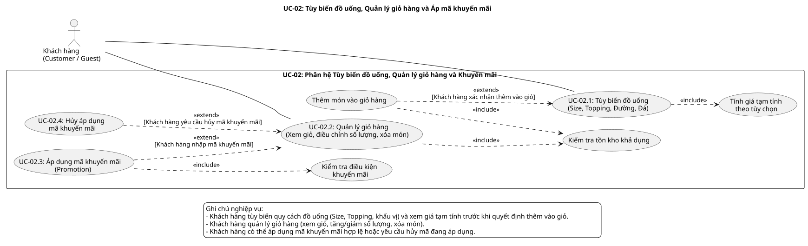

# BREWLITE – TÓM TẮT ĐẶC TẢ YÊU CẦU PHẦN MỀM (SRS SUMMARY)

- **Học phần:** Công nghệ Phần mềm (SWE 2026)
- **Đề tài:** BrewLite – Requirements to Deployment (Ver 1.0)
- **Tài liệu:** `docs/requirements/srs-summary.md`
- **Giai đoạn:** Task 1.2 – Yêu cầu chức năng và Phi chức năng (Software Requirements Specification)
- **Thành viên phụ trách:** **2. Quỳnh (Dev Team)**
- **Phân hệ chức năng:** **Chức năng 2 (FR-03, FR-09): Tùy biến Món (Size/Topping), Quản lý Giỏ hàng & Áp mã Khuyến mãi (`Promotion`)**
- **Nguồn căn cứ & Truy vết:** Kế thừa từ `docs/phancong.docx` (Mục 2.1 – 2.8), `docs/requirements/context-and-scope.md` (MVP-02), liên kết chặt chẽ với Chức năng 1 (Duy – Menu), Chức năng 4 (Chiến – Đặt đơn hàng & Khóa kho), Chức năng 5 (Quang – Thanh toán).

---

## 1. Tổng quan Phân hệ Chức năng 2 & Bối cảnh Kiến trúc

### 1.1 Mục tiêu và Phạm vi Nghiệp vụ
Phân hệ Chức năng 2 là cầu nối trực tiếp giữa quá trình duyệt sản phẩm trên Thực đơn (Menu) và quy trình Khởi tạo Đơn hàng (Checkout). Phân hệ đảm bảo khách hàng có trải nghiệm đặt đồ uống mượt mà, trực quan theo chuẩn ứng dụng di động (Mobile-first / PWA), đồng thời duy trì tính toàn vẹn của dữ liệu giỏ hàng qua các phiên làm việc của trình duyệt.

Phân hệ bao gồm 2 nhóm yêu cầu chức năng trọng tâm:
1. **FR-03 – Tùy biến món đồ uống & Quản lý giỏ hàng:** Cho phép khách hàng tùy biến kích cỡ (`Size`), chọn các loại `Topping`, điều chỉnh lượng đường/đá; quản lý giỏ hàng phía Client bằng **Zustand** (đồng bộ bền vững với `localStorage`), tự động gộp dòng sản phẩm có cùng tổ hợp cấu hình, tăng/giảm số lượng và kiểm soát tồn kho khả dụng.
2. **FR-09 – Kiểm tra và Áp dụng mã khuyến mãi (`Promotion`):** Cho phép khách hàng nhập mã Voucher giảm giá tại trang giỏ hàng; gọi API phía Backend NestJS (`POST /api/v1/promotions/validate`) để đối soát điều kiện hiệu lực từ CSDL có thẩm quyền và hiển thị giá trị giảm giá dự kiến tức thời.

### 1.2 Nguyên tắc Kiến trúc Cốt lõi: Client Price Non-Authority
Nhằm ngăn chặn triệt để các hành vi gian lận sửa đổi giá tiền tại Client (ví dụ: thông qua DevTools hoặc can thiệp payload HTTP), hệ thống tuân thủ nghiêm ngặt nguyên tắc:
- **Client-Side (Next.js & Zustand):** Chỉ thực hiện tính toán giá tạm tính (**Preview Price**) và số tiền giảm giá dự kiến (**Preview Discount**) phục vụ phản hồi giao diện người dùng tức thời (UI Optimistic Feedback).
- **Server-Side (NestJS Business Logic Layer):** Khi khách hàng tiến hành bấm Đặt hàng (chuyển giao sang **UC-04 / FR-05**), máy chủ hoàn toàn **bỏ qua** các trường giá tiền do Client gửi lên. Backend độc lập 100% truy vấn đơn giá gốc từ bảng `Product`, phụ thu size, giá `Topping` và điều kiện `Promotion` từ CSDL PostgreSQL bên trong một Database Transaction duy nhất (`prisma.$transaction`).

```text
+----------------------------------------------------------------------------------------------------+
|                      CHỨC NĂNG 2: CLIENT-SIDE INTERACTION & LOCAL PREVIEW (Quỳnh)                  |
|                                                                                                    |
|  [Menu] ---> Mở Modal Tùy Biến (Size/Topping/Đường/Đá) ---> Tính Giá Tạm Tính (Preview)             |
|        ---> Zustand Store (useCartStore) ---> Đồng bộ localStorage ---> Cập nhật Cart Badge       |
|        ---> Trang Giỏ hàng (/cart) ---> Nhập Voucher ---> POST /api/v1/promotions/validate        |
|             (Backend kiểm tra điều kiện & tính tiền giảm dự kiến - KHÔNG trừ lượt dùng)             |
+----------------------------------------------------------------------------------------------------+
                                                  |
                                                  v [Chuyển giao sang UC-04 / FR-05]
+----------------------------------------------------------------------------------------------------+
|                     CHỨC NĂNG 4: SERVER-AUTHORITATIVE RE-CALCULATION & LOCK (Chiến)                 |
|                                                                                                    |
|  POST /api/v1/orders ---> Validate DTO ---> Tính lại 100% tiền tại Business Layer                   |
|                      ---> prisma.$transaction: Trừ kho nguyên liệu Ingredient (Optimistic Lock)   |
|                      ---> Ghi nhận usedCount Voucher & Tạo Order (PENDING)                          |
+----------------------------------------------------------------------------------------------------+
```

---

## 2. Đặc tả Yêu cầu Chức năng FR-03: Tùy biến món & Quản lý giỏ hàng

### 2.1 Mô tả Nghiệp vụ FR-03
Khách hàng (bao gồm cả khách vãng lai `Guest` chưa đăng nhập và khách hàng thành viên `Customer`) có thể tùy chọn quy cách pha chế cho từng món đồ uống (Size, Topping, tỷ lệ Đường, tỷ lệ Đá), thêm món vào giỏ hàng, cập nhật số lượng, xóa món hoặc làm rỗng giỏ hàng. Dữ liệu giỏ hàng được quản lý tập trung ở Client bằng Zustand Store và tự động lưu vào `localStorage` của trình duyệt.

### 2.2 Danh mục Yêu cầu chi tiết & Phân loại MoSCoW

| Mã Yêu cầu | Mô tả chi tiết yêu cầu có thể kiểm chứng | Mức ưu tiên MoSCoW | Ghi chú kỹ thuật / Ràng buộc |
| :--- | :--- | :--- | :--- |
| **FR-03.1** | Hệ thống cho phép mở modal tùy biến món (`ProductCustomizationModal`) khi người dùng bấm vào một sản phẩm bất kỳ trên Menu đang ở trạng thái kinh doanh (`isAvailable == true`) và còn khả năng phục vụ (`stock > 0` hoặc nguyên liệu khả dụng > 0). | **Must Have** | Món có `stock == 0` bị vô hiệu hóa nút đặt hàng từ Chức năng 1 (FR-01). |
| **FR-03.2** | Hệ thống cung cấp tùy chọn Kích cỡ (Size): Hỗ trợ tối thiểu 3 size chuẩn gồm **Size S** (Phụ thu: +0đ), **Size M** (Phụ thu: +6.000đ) và **Size L** (Phụ thu: +10.000đ). Mặc định chọn Size S khi vừa mở modal. | **Must Have** | Phụ thu Size áp dụng theo quy định phân công đồ án. |
| **FR-03.3** | Hệ thống cho phép người dùng chọn không hoặc nhiều loại `Topping` đi kèm (Trân châu trắng, Kem cheese, Thạch đào,...). Đơn giá của từng loại Topping được tải trực tiếp từ cơ sở dữ liệu. | **Must Have** | Danh sách Topping được hiển thị kèm đơn giá rõ ràng. |
| **FR-03.4** | Hệ thống hỗ trợ tùy chọn tỷ lệ Đường (0%, 30%, 50%, 70%, 100% - mặc định 100%) và tỷ lệ Đá (0%, 30%, 50%, 70%, 100% - mặc định 100%) cho các món thuộc danh mục trà/cà phê hỗ trợ gia giảm. | **Should Have** | Cấu hình đường/đá tham gia vào cấu trúc khóa phân biệt dòng giỏ hàng. |
| **FR-03.5** | Giao diện modal tùy biến phải tự động tính toán lại và hiển thị **Đơn giá tạm tính tức thời (Real-time Preview Price)** ngay khi người dùng thay đổi Size, thêm/bớt Topping hoặc điều chỉnh số lượng. | **Must Have** | Thời gian phản hồi cập nhật giá trên UI `< 50ms`. |
| **FR-03.6** | Khi người dùng nhấn "Thêm vào giỏ hàng", hệ thống tự động sinh khóa tổng hợp (`itemKey`) dựa trên tổ hợp: `productId`, `size`, danh sách `toppingIds` đã sắp xếp và cấu hình đường/đá. | **Must Have** | Đảm bảo tính nhất quán không phụ thuộc vào thứ tự bấm chọn Topping. |
| **FR-03.7** | Cơ chế gộp dòng giỏ hàng thông minh (Smart Aggregation): Nếu giỏ hàng đã có sản phẩm có cùng `itemKey`, hệ thống thực hiện cộng dồn số lượng (`quantity = quantity + addedQuantity`). Nếu khác `itemKey`, tạo một dòng `CartItem` mới riêng biệt trong giỏ hàng. | **Must Have** | Tránh phân mảnh các dòng sản phẩm có cùng quy cách trong giỏ. |
| **FR-03.8** | Hệ thống cho phép người dùng xem danh sách giỏ hàng (`/cart`), tăng (`+`) hoặc giảm (`-`) số lượng từng dòng, hoặc xóa trực tiếp dòng sản phẩm ra khỏi giỏ. | **Must Have** | Số lượng trên mỗi dòng phải là số nguyên dương $\ge 1$. |
| **FR-03.9** | Khi người dùng giảm số lượng của một dòng sản phẩm từ 1 về 0, hệ thống bắt buộc hiển thị hộp thoại xác nhận (`ConfirmModal`) trước khi loại bỏ sản phẩm khỏi giỏ hàng. | **Must Have** | Ngăn ngừa thao tác chạm nhầm trên màn hình cảm ứng di động. |
| **FR-03.10** | Kiểm soát tồn kho tại Client: Tổng số lượng ly của cùng một sản phẩm (`productId`) trên tất cả các dòng trong giỏ hàng không được vượt quá số lượng tồn kho khả dụng hiện tại (`availableStock`). Hệ thống tự động vô hiệu hóa nút `+` và cảnh báo khi đạt ngưỡng tối đa. | **Must Have** | Cảnh báo: "Chỉ còn X sản phẩm trong kho". |
| **FR-03.11** | Bền vững hóa trạng thái giỏ hàng (State Persistence): Giỏ hàng sử dụng thư viện **Zustand** kết hợp middleware `persist` lưu vào `localStorage`. Dữ liệu giỏ hàng, cấu hình tùy biến và số lượng phải được khôi phục nguyên vẹn khi người dùng tải lại trang (F5) hoặc mở lại tab trình duyệt. | **Must Have** | Xử lý an toàn khi `localStorage` bị lỗi hoặc đầy bộ nhớ. |
| **FR-03.12** | Cập nhật huy hiệu giỏ hàng (Cart Badge Indicator): Biểu tượng giỏ hàng trên thanh điều hướng (Navbar/Header) hiển thị huy hiệu tổng số ly đồ uống ($\sum \text{item.quantity}$) theo thời gian thực. | **Must Have** | Tự động ẩn huy hiệu khi giỏ hàng trống (`count == 0`). |
| **FR-03.13** | Thông báo trạng thái giao diện (Toast Notification): Hiển thị thông báo nhẹ (Toast) khi thêm món thành công vào giỏ hàng hoặc xóa sản phẩm khỏi giỏ. | **Could Have** | Tăng cường phản hồi xúc giác/thị giác cho người dùng. |
| **FR-03.14** | Không đồng bộ giỏ hàng giữa nhiều thiết bị (Cross-device Sync) hoặc giữ chỗ tồn kho (Cart Reservation) trong phiên bản MVP. | **Won't Have** | Giỏ hàng lưu cục bộ ở Client; việc khóa kho chỉ thực hiện khi tạo đơn (FR-05). |

### 2.3 Bảng Quy tắc Nghiệp vụ FR-03 (Business Rules)

| Mã Quy tắc | Nội dung Quy tắc Nghiệp vụ | Công thức / Chi tiết Ràng buộc |
| :--- | :--- | :--- |
| **BR-03.1** | **Công thức tính Đơn giá & Thành tiền dòng:**<br>Đơn giá tạm tính của một ly đồ uống bằng giá gốc của sản phẩm cộng với phụ thu kích cỡ và tổng phụ thu của tất cả các Topping được chọn. Thành tiền của một dòng bằng đơn giá nhân với số lượng đặt. | $$\text{unitPrice} = \text{basePrice} + \text{sizePrice} + \sum_{t \in \text{selectedToppings}} \text{toppingPrice}_t$$<br>$$\text{lineSubtotal} = \text{unitPrice} \times \text{quantity}$$<br>$$\text{cartSubtotal} = \sum_{i \in \text{CartItems}} \text{lineSubtotal}_i$$<br>*(Đơn vị tính: VNĐ, số nguyên không âm)* |
| **BR-03.2** | **Quy tắc Sinh Khóa Định danh Dòng (`itemKey`):**<br>Để phân biệt hoặc gộp các dòng sản phẩm, `itemKey` được băm/tạo chuỗi chuẩn hóa từ ID sản phẩm, ID kích cỡ, danh sách ID topping được sắp xếp tăng dần theo bảng chữ cái và mức đường/đá. | $$\text{itemKey} = \text{MD5}(\text{productId} + \text{"\_"} + \text{sizeId} + \text{"\_"} + \text{sort}(\text{toppingIds}).\text{join}(\text{","}) + \text{"\_"} + \text{sugar} + \text{"\_"} + \text{ice})$$<br>Việc chọn thứ tự Topping khác nhau nhưng cùng tập hợp ID sẽ cho ra cùng một `itemKey`. |
| **BR-03.3** | **Ràng buộc Tồn kho Khả dụng đối với Món:**<br>Một món đồ uống có thể xuất hiện trên nhiều dòng giỏ hàng (khác size/topping). Tổng số lượng đặt của món đó trên toàn bộ giỏ hàng không được vượt quá số ly tối đa phục vụ được (`availableStock`). | $$\sum_{k \in \text{CartItems}, k.\text{productId} == P} k.\text{quantity} \le P.\text{availableStock}$$<br>Nếu chạm ngưỡng, vô hiệu hóa nút tăng số lượng trên giao diện. |
| **BR-03.4** | **Phục hồi và Khử lỗi Trạng thái Bền vững (Hydratation Resilience):**<br>Khi ứng dụng Next.js khởi tạo tại Client, Zustand nạp dữ liệu từ `localStorage`. Nếu cấu trúc dữ liệu bị lỗi cú pháp JSON hoặc trường dữ liệu không hợp lệ, hệ thống tự động làm sạch (`resetState`) về giỏ hàng rỗng an toàn mà không làm sập ứng dụng (No White Screen of Death). | Dữ liệu lưu trữ bao gồm: `{ items: CartItem[], appliedPromotion: Promotion \| null, version: number }`. |
| **BR-03.5** | **Trạng thái Giỏ hàng Rỗng:**<br>Khi giỏ hàng không có sản phẩm nào (`items.length == 0`), giao diện giỏ hàng hiển thị trạng thái `Empty Cart` (kèm hình minh họa và nút "Khám phá Menu"), đồng thời vô hiệu hóa nút "Tiến hành Đặt hàng" và khung nhập mã khuyến mãi. | Ngăn chặn việc gửi yêu cầu thanh toán cho giỏ hàng rỗng. |
| **BR-03.6** | **Quy định Giá trị Số lượng:**<br>Số lượng của mỗi dòng `CartItem` luôn là số nguyên dương $\ge 1$. Giao diện không cho phép nhập số âm, số thập phân hoặc ký tự đặc biệt. | Giá trị mặc định khi vừa thêm món là `quantity = 1`. |
| **BR-03.7** | **Khóa tương tác khi sản phẩm ngừng bán:**<br>Nếu một sản phẩm đã thêm vào giỏ hàng từ trước nhưng sau đó bị quản trị viên đổi trạng thái thành `isAvailable = false`, khi mở lại giỏ hàng, dòng sản phẩm đó sẽ bị gắn cờ cảnh báo "Sản phẩm tạm ngưng kinh doanh" và chặn chuyển bước thanh toán đến khi khách hàng xóa dòng đó. | Đảm bảo tính nhất quán với dữ liệu CSDL. |
| **BR-03.8** | **Không độc quyền Giữ hàng từ Giỏ (Non-blocking Cart):**<br>Việc thêm món vào giỏ hàng không làm giảm số lượng tồn kho trong CSDL PostgreSQL. Tồn kho chỉ được trừ chính thức và có bảo đảm khi giao dịch tạo đơn hàng hoàn tất ở FR-05. | Khách hàng khác vẫn có quyền đặt mua sản phẩm đó cho đến khi có người thanh toán/khóa kho thành công. |

### 2.4 Tiêu chí Nghiệm thu FR-03 (Acceptance Criteria – AC)

> **Bộ Fixture Dữ liệu Mẫu để Kiểm thử:**
> - Sản phẩm A (Cà phê sữa đá): `basePrice = 29.000đ`, `stock = 5`, `isAvailable = true`.
> - Kích cỡ: Size S (+0đ), Size M (+6.000đ), Size L (+10.000đ).
> - Topping: Thạch cà phê T1 (+6.000đ), Kem Cheese T2 (+10.000đ).

| Mã AC | Điều kiện tiền đề (Given) | Hành động kích hoạt (When) | Kết quả kỳ vọng (Then) | Truy vết |
| :--- | :--- | :--- | :--- | :--- |
| **AC-03.01** | Khách hàng ở trang Menu, sản phẩm A còn hàng (`stock = 5`). | Bấm vào sản phẩm A. | Hệ thống mở `ProductCustomizationModal`, mặc định chọn Size S, không Topping, số lượng 1; giá hiển thị là 29.000đ. | FR-03.1, FR-03.2 |
| **AC-03.02** | Đang mở modal sản phẩm A (Size S, 29.000đ). | Chọn Size M (+6.000đ) và chọn Topping T1 (+6.000đ). | Giá tạm tính trên modal cập nhật tức thời thành 41.000đ (29.000 + 6.000 + 6.000); thành tiền là 41.000đ. | FR-03.2, FR-03.5 |
| **AC-03.03** | Khách hàng đang chọn sản phẩm A (Size M, Topping T1, giá 41.000đ). | Bấm nút "Thêm vào giỏ hàng". | Modal đóng lại; giỏ hàng Zustand ghi nhận 1 `CartItem` mới; Cart Badge trên Navbar hiển thị số 1; lưu vào `localStorage`. | FR-03.6, FR-03.11, FR-03.12 |
| **AC-03.04** | Giỏ hàng đang có: Sản phẩm A, Size M, Topping T1 (SL: 1). | Khách hàng mở lại sản phẩm A, chọn Size M, Topping T1, SL: 2 rồi bấm "Thêm vào giỏ hàng". | Giỏ hàng không tạo dòng mới mà tự động gộp dòng: Sản phẩm A (Size M, T1) có số lượng tăng lên thành 3; Cart Badge hiển thị 3. | FR-03.7, BR-03.2 |
| **AC-03.05** | Giỏ hàng đang có: Sản phẩm A, Size M, Topping T1+T2. | Khách hàng thêm sản phẩm A, Size M, Topping T2+T1 (thứ tự chọn đảo ngược). | Hệ thống nhận diện cùng tập hợp Topping, gộp dòng vào sản phẩm hiện có thay vì tạo dòng mới. | FR-03.7, BR-03.2 |
| **AC-03.06** | Giỏ hàng đang có: Sản phẩm A, Size M, Topping T1 (SL: 1). | Khách hàng thêm sản phẩm A, Size L, Topping T1 (SL: 1). | Giỏ hàng tách thành 2 dòng riêng biệt: Dòng 1 (Size M, 41.000đ), Dòng 2 (Size L, 45.000đ); Cart Badge hiển thị 2. | FR-03.7 |
| **AC-03.07** | Sản phẩm A có `stock = 5`. Giỏ hàng đang có tổng cộng 5 ly sản phẩm A trên các dòng. | Khách hàng nhấn nút `+` trên bất kỳ dòng sản phẩm A nào. | Nút `+` bị khóa; hệ thống hiển thị thông báo cảnh báo: "Chỉ còn 5 sản phẩm trong kho"; số lượng không đổi. | FR-03.10, BR-03.3 |
| **AC-03.08** | Giỏ hàng có 1 dòng sản phẩm với số lượng bằng 1. | Khách hàng nhấn nút `-` (giảm số lượng). | Hệ thống hiển thị hộp thoại xác nhận: "Bạn có chắc chắn muốn xóa món này khỏi giỏ hàng?". | FR-03.9 |
| **AC-03.09** | Hộp thoại xác nhận xóa món đang hiển thị. | Khách hàng chọn "Xác nhận xóa". | Dòng sản phẩm bị gỡ khỏi giỏ hàng; Cart Badge giảm tương ứng; nếu giỏ hết món, hiển thị giao diện Giỏ hàng rỗng. | FR-03.8, FR-03.9 |
| **AC-03.10** | Giỏ hàng có 3 sản phẩm với tổng tiền tạm tính 150.000đ. | Người dùng nhấn phím F5 (Tải lại trang) hoặc đóng tab và mở lại. | Trạng thái giỏ hàng được phục hồi 100% từ `localStorage`: đầy đủ 3 món, đúng size/topping, số lượng và tổng tạm tính 150.000đ. | FR-03.11, BR-03.4 |
| **AC-03.11** | Giỏ hàng đang trống (`items.length == 0`). | Người dùng truy cập trang `/cart`. | Màn hình hiển thị trạng thái `Empty Cart`, nút "Tiến hành Đặt hàng" bị ẩn hoặc vô hiệu hóa; có nút điều hướng về `/menu`. | BR-03.5 |
| **AC-03.12** | Dữ liệu giỏ hàng trong `localStorage` bị can thiệp lỗi cú pháp (chuỗi JSON hỏng). | Người dùng mở trang web BrewLite. | Zustand bắt lỗi phân tích cú pháp (JSON parse error), tự động khởi tạo lại giỏ hàng rỗng, không xảy ra hiện tượng Crash giao diện. | BR-03.4, FR-03.11 |

---

## 3. Đặc tả Yêu cầu Chức năng FR-09: Kiểm tra và Áp mã Khuyến mãi (`Promotion`)

### 3.1 Mô tả Nghiệp vụ FR-09
Tại trang giỏ hàng (`/cart`), khách hàng có thể nhập mã khuyến mãi (Promo Code / Voucher) để nhận ưu đãi giảm giá cho đơn hàng. Hệ thống gửi yêu cầu kiểm tra tới máy chủ API Backend NestJS (`POST /api/v1/promotions/validate`). Máy chủ chịu trách nhiệm xác thực mã dựa trên dữ liệu trong PostgreSQL và phản hồi mức giảm giá hợp lệ.

### 3.2 Danh mục Yêu cầu chi tiết & Phân loại MoSCoW

| Mã Yêu cầu | Mô tả chi tiết yêu cầu có thể kiểm chứng | Mức ưu tiên MoSCoW | Ghi chú kỹ thuật / Ràng buộc |
| :--- | :--- | :--- | :--- |
| **FR-09.1** | Giao diện Giỏ hàng cung cấp ô nhập mã khuyến mãi và nút "Áp dụng". Khách hàng có thể nhập chuỗi ký tự mã (ví dụ: `BREWLITE20`, `FREESHIP`). | **Must Have** | Mã được chuẩn hóa tự động viết hoa (Uppercase, Trim khoảng trắng). |
| **FR-09.2** | Khi người dùng nhấn "Áp dụng", Client gửi yêu cầu HTTP `POST /api/v1/promotions/validate` kèm theo mã `code` và giá trị `cartSubtotal` hiện tại lên Backend NestJS. | **Must Have** | Trạng thái nút chuyển sang `Loading` để chống bấm gửi lặp nhiều lần. |
| **FR-09.3** | Backend kiểm tra tính hợp lệ của mã khuyến mãi dựa trên 5 tiêu chí: (1) Mã tồn tại trong bảng `Promotion`; (2) Cột `isActive == true`; (3) Thời điểm hiện tại nằm trong khoảng $[\text{startDate}, \text{endDate}]$; (4) Số lượt đã dùng $\text{usedCount} < \text{usageLimit}$; (5) Giá trị tạm tính $\text{cartSubtotal} \ge \text{minOrderValue}$. | **Must Have** | Kiểm tra hoàn toàn tại Business Logic Layer (`PromotionsService`). |
| **FR-09.4** | Hệ thống hỗ trợ 2 loại hình chiết khấu chuẩn: **Giảm theo tỷ lệ phần trăm (`PERCENTAGE`)** kèm theo mức giảm tối đa (`maxDiscountAmount`), và **Giảm theo số tiền cố định (`FIXED_AMOUNT`)**. | **Must Have** | Đảm bảo tính linh hoạt cho các chiến dịch Marketing F&B. |
| **FR-09.5** | Nếu mã hợp lệ, API trả về mã thành công `HTTP 200 OK` kèm số tiền được giảm (`discountAmount`). Giao diện Client hiển thị số tiền giảm và tính lại tổng tiền dự kiến sau giảm. | **Must Have** | $$\text{finalTotal} = \max(0, \text{cartSubtotal} - \text{discountAmount})$$. |
| **FR-09.6** | Nếu mã không hợp lệ, API trả về lỗi `HTTP 400 Bad Request` kèm thông báo nguyên nhân cụ thể (ví dụ: "Mã khuyến mãi không tồn tại", "Mã đã hết hạn", "Đơn hàng chưa đạt giá trị tối thiểu 100.000đ"). Giao diện hiển thị cảnh báo đỏ và không áp dụng giảm giá. | **Must Have** | Thông điệp lỗi thân thiện, rõ ràng, giúp khách hàng hiểu rõ lý do. |
| **FR-09.7** | Hệ thống cho phép người dùng chủ động hủy áp dụng mã khuyến mãi bằng cách bấm nút "Hủy mã" / biểu tượng X. Khi đó, mức giảm giá đưa về 0đ và tổng tiền trở về bằng tạm tính ban đầu. | **Must Have** | Trả lại trạng thái giỏ hàng tự do cho khách hàng. |
| **FR-09.8** | Cơ chế tự động hủy hợp lệ mã (Auto Invalidation): Nếu người dùng giảm số lượng hoặc xóa món làm `cartSubtotal` tụt xuống dưới mức `minOrderValue` của mã đang áp dụng, hệ thống tự động gỡ bỏ mã và cảnh báo lý do cho khách hàng. | **Must Have** | Tránh lỗ hổng lách điều kiện đơn hàng tối thiểu. |
| **FR-09.9** | Nguyên tắc Không tiêu hao lượt dùng khi Kiểm tra (Validation Idempotency): Việc gọi API kiểm tra mã khuyến mãi tuyệt đối không tăng cột `usedCount` của mã; lượt dùng chỉ được tăng chính thức khi đơn hàng được tạo thành công tại FR-05. | **Must Have** | Tránh mất lượt của khách hàng khi chỉ mới xem trước giỏ hàng. |
| **FR-09.10** | Nguyên tắc một mã khuyến mãi duy nhất: Trong phạm vi MVP, mỗi giỏ hàng chỉ được áp dụng tối đa 1 mã khuyến mãi tại một thời điểm; không hỗ trợ cộng dồn (Stacking) nhiều voucher. Nếu áp mã mới thành công, mã cũ tự động bị thay thế. | **Must Have** | Quy chuẩn kiểm soát ngân sách khuyến mãi MVP. |

### 3.3 Bảng Quy tắc Nghiệp vụ FR-09 (Business Rules)

| Mã Quy tắc | Nội dung Quy tắc Nghiệp vụ | Công thức / Ràng buộc Kỹ thuật |
| :--- | :--- | :--- |
| **BR-09.1** | **Nguyên tắc Một Mã Duy nhất (Exclusive Voucher Rule):**<br>Tại mọi thời điểm, giỏ hàng chỉ duy trì trạng thái của tối đa một mã khuyến mãi hợp lệ. Nhập mã mới thành công sẽ ghi đè mã hiện tại. Giỏ hàng trống không được phép áp dụng mã. | Không áp dụng cơ chế cộng dồn Coupon / Voucher trong MVP. |
| **BR-09.2** | **Điều kiện Hiệu lực Đa yếu tố của Voucher:**<br>Một mã khuyến mãi chỉ được coi là hợp lệ khi thỏa mãn đồng thời tất cả các điều kiện sau tại thời điểm kiểm tra của máy chủ: | 1. $\text{Promotion}.\text{isActive} == \text{true}$<br>2. $\text{startDate} \le \text{serverNow} \le \text{endDate}$ (Dùng giờ máy chủ)<br>3. $\text{usedCount} < \text{usageLimit}$<br>4. $\text{cartSubtotal} \ge \text{minOrderValue}$ |
| **BR-09.3** | **Công thức Tính Mức Giảm giá Chiết khấu:**<br>Số tiền giảm giá được tính toán chính xác theo loại hình cấu hình trong CSDL và không bao giờ vượt quá tạm tính của giỏ hàng: | • Với `PERCENTAGE`:<br>$$\text{discount} = \min\left( \text{cartSubtotal} \times \frac{\text{discountValue}}{100}, \text{maxDiscountAmount} \text{ (nếu có)} \right)$$<br>• Với `FIXED_AMOUNT`:<br>$$\text{discount} = \min(\text{discountValue}, \text{cartSubtotal})$$<br>• Thành tiền dự kiến:<br>$$\text{previewTotal} = \max(0, \text{cartSubtotal} - \text{discount})$$ |
| **BR-09.4** | **Quy tắc Tự động Vô hiệu hóa (Auto Invalidation on Cart Mutation):**<br>Bất kỳ thay đổi nào trên giỏ hàng (thêm món, bớt món, đổi size/topping) đều kích hoạt kiểm tra lại điều kiện `minOrderValue`. Nếu $\text{newSubtotal} < \text{minOrderValue}$, mã tự động bị hủy và thông báo cho người dùng. | Bảo vệ tính toàn vẹn của chính sách khuyến mãi. |
| **BR-09.5** | **Bảo vệ Tính Độc lập của Lượt dùng (Read-only Validation):**<br>Endpoint `POST /api/v1/promotions/validate` chỉ là một hàm thuần túy đọc và tính toán (Read-only Calculation), không làm thay đổi trạng thái của bảng `Promotion` trong CSDL. | Tuyệt đối không thực hiện câu lệnh `UPDATE "Promotion" SET "usedCount" = ...` tại endpoint này. |
| **BR-09.6** | **Xử lý Mã Không Phân biệt Chữ hoa / Chữ thường:**<br>Chuỗi ký tự mã khuyến mãi được xử lý không phân biệt hoa thường khi so khớp CSDL (`ILIKE` hoặc lưu chữ in hoa chuẩn hóa). Mọi khoảng trắng thừa ở đầu/cuối chuỗi đều bị loại bỏ (`trim`). | Tăng độ tiện dụng cho người dùng khi gõ mã trên điện thoại di động. |
| **BR-09.7** | **Kháng lỗi Mạng và Dữ liệu Cũ (Stale Response Protection):**<br>Nếu người dùng liên tục thay đổi giỏ hàng trong khi một yêu cầu kiểm tra mã đang được gửi, phản hồi trả về từ yêu cầu cũ phải bị loại bỏ nếu phiên bản giỏ hàng không còn khớp. | Sử dụng cơ chế AbortController hoặc so sánh version giỏ hàng. |

### 3.4 Tiêu chí Nghiệm thu FR-09 (Acceptance Criteria – AC)

> **Bộ Fixture Dữ liệu Mẫu Voucher để Kiểm thử:**
> - Voucher `BREWLITE20`: Loại `PERCENTAGE`, `discountValue = 20%`, `minOrderValue = 100.000đ`, `maxDiscountAmount = 30.000đ`, `usageLimit = 100`, `usedCount = 10`, hạn sử dụng hợp lệ.
> - Voucher `GIAM50K`: Loại `FIXED_AMOUNT`, `discountValue = 50.000đ`, `minOrderValue = 120.000đ`, `usageLimit = 50`, `usedCount = 50` (Đã hết lượt).
> - Voucher `EXPIRED`: Đã quá hạn ngày kết thúc (`endDate < now`).

| Mã AC | Điều kiện tiền đề (Given) | Hành động kích hoạt (When) | Kết quả kỳ vọng (Then) | Truy vết |
| :--- | :--- | :--- | :--- | :--- |
| **AC-09.01** | Giỏ hàng có tạm tính 120.000đ. | Nhập mã `BREWLITE20` và bấm "Áp dụng". | Gửi `POST /api/v1/promotions/validate`; trả về `200 OK`; tiền giảm là 24.000đ ($120.000 \times 20\%$); tổng dự kiến là 96.000đ. | FR-09.1–5, BR-09.3 |
| **AC-09.02** | Giỏ hàng có tạm tính 200.000đ. | Nhập mã `BREWLITE20` và bấm "Áp dụng". | $200.000 \times 20\% = 40.000đ > \text{maxDiscountAmount}$ (30.000đ); tiền giảm áp dụng đúng mức trần 30.000đ; tổng dự kiến là 170.000đ. | FR-09.4, BR-09.3 |
| **AC-09.03** | Giỏ hàng có tạm tính 80.000đ ($< \text{minOrderValue}$ 100.000đ). | Nhập mã `BREWLITE20` và bấm "Áp dụng". | API trả về lỗi `HTTP 400 Bad Request`; giao diện hiển thị: "Đơn hàng tối thiểu phải từ 100.000đ để sử dụng mã này"; tiền giảm là 0đ. | FR-09.6, BR-09.2 |
| **AC-09.04** | Giỏ hàng có tạm tính 150.000đ. | Nhập mã `GIAM50K` (đã đạt giới hạn `usedCount == usageLimit`). | API trả về lỗi `HTTP 400 Bad Request`; hiển thị: "Mã khuyến mãi đã hết lượt sử dụng"; không giảm giá. | FR-09.6, BR-09.2 |
| **AC-09.05** | Giỏ hàng có tạm tính 150.000đ. | Nhập mã `EXPIRED`. | API trả về lỗi `HTTP 400 Bad Request`; hiển thị: "Mã khuyến mãi đã hết hạn sử dụng"; không giảm giá. | FR-09.6, BR-09.2 |
| **AC-09.06** | Giỏ hàng có tạm tính 150.000đ. | Nhập mã không tồn tại `MA_KHONG_CO`. | API trả về lỗi `HTTP 400 Bad Request`; hiển thị: "Mã khuyến mãi không hợp lệ hoặc không tồn tại". | FR-09.6 |
| **AC-09.07** | Giỏ hàng đang áp dụng mã `BREWLITE20` thành công (giảm 24.000đ). | Khách hàng bấm nút "Hủy mã" (hoặc biểu tượng X). | Mã bị gỡ bỏ khỏi giỏ hàng; tiền giảm trở về 0đ; tổng tiền dự kiến bằng đúng tạm tính 120.000đ. | FR-09.7 |
| **AC-09.08** | Giỏ hàng có tạm tính 110.000đ và đang áp dụng mã `BREWLITE20` (đạt mức tối thiểu 100.000đ). | Khách hàng giảm bớt 1 món đồ uống làm tạm tính tụt xuống còn 75.000đ. | Hệ thống tự động vô hiệu hóa mã `BREWLITE20`; hiển thị cảnh báo: "Mã khuyến mãi đã bị hủy do đơn hàng không còn đủ giá trị tối thiểu". | FR-09.8, BR-09.4 |
| **AC-09.09** | Khách hàng nhập `  brewlite20  ` (chữ thường kèm khoảng trắng thừa). | Bấm "Áp dụng". | Hệ thống tự động trim khoảng trắng và chuyển thành chữ in hoa `BREWLITE20`; API xác thực thành công như bình thường. | BR-09.6 |
| **AC-09.10** | Khách hàng gọi kiểm tra mã `BREWLITE20` thành công 10 lần liên tục tại giỏ hàng. | Kiểm tra CSDL bảng `Promotion`. | Giá trị cột `usedCount` của `BREWLITE20` vẫn giữ nguyên là 10, không bị tăng lên. | FR-09.9, BR-09.5 |

---

## 4. Sơ đồ Use Case Phân hệ Chức năng 2 (UC-02 Diagram)

### 4.1 Bảng Phân tích Actor và Ranh giới Hệ thống
- **Actor chính:** Khách hàng (`Customer / Guest`) – Người dùng cuối tương tác trực tiếp với giao diện đặt đồ uống trên ứng dụng web (cả khách vãng lai và thành viên).
- **Ranh giới Hệ thống (System Boundary):** `UC-02: Phân hệ Tùy biến đồ uống, Quản lý giỏ hàng và Khuyến mãi`. Đóng vai trò là phạm vi bao bọc toàn bộ các Use Case thành phần thuộc Chức năng 2.

### 4.2 Sơ đồ Use Case (PlantUML & SVG Rendering)
- Tệp định nghĩa PlantUML: [`docs/diagrams/uc-02-cart-promotion.puml`](../diagrams/uc-02-cart-promotion.puml)
- Tệp ảnh đồ họa Vector (Chuẩn đơn sắc Monochrome): [`docs/diagrams/uc-02-cart-promotion.svg`](../diagrams/uc-02-cart-promotion.svg)



### 4.3 Bảng Thành phần Use Case và Quan hệ Nghiệp vụ

| Thành phần Use Case | Tên Use Case / Hành động | Kiểu Quan hệ | Ý nghĩa Nghiệp vụ & Điều kiện |
| :--- | :--- | :--- | :--- |
| **System Boundary** | **UC-02: Phân hệ Tùy biến đồ uống, Quản lý giỏ hàng và Khuyến mãi** | Boundary Box | Ranh giới phân hệ bao gồm toàn bộ các chức năng cấu hình món, giỏ hàng và mã ưu đãi. |
| **UC-02.1** | **Tùy biến đồ uống (Size, Topping, Đường, Đá)** | Primary Use Case | Khách hàng tương tác trực tiếp: chọn kích cỡ, thành phần topping và khẩu vị cho đồ uống. |
| -- | *Tính giá tạm tính theo tùy chọn* | `<<include>>` (thuộc UC-02.1) | Bắt buộc tính toán lại đơn giá tức thời trên modal khi khách hàng thay đổi tùy chọn. |
| **Thêm món** | **Thêm món vào giỏ hàng** | `<<extend>>` (vào UC-02.1) | Mở rộng sau khi tùy biến món khi [Khách hàng xác nhận thêm vào giỏ]. Tách riêng để phân biệt rõ hành động tùy biến và hành động bỏ vào giỏ. |
| -- | *Kiểm tra tồn kho khả dụng* | `<<include>>` (thuộc Thêm món & UC-02.2) | Bắt buộc kiểm tra số lượng đặt không vượt quá lượng tồn kho khả dụng. |
| **UC-02.2** | **Quản lý giỏ hàng (Xem giỏ, điều chỉnh số lượng, xóa món)** | Primary Use Case | Khách hàng tương tác trực tiếp: duyệt danh sách món trong giỏ, tăng/giảm số lượng hoặc xóa dòng món. |
| **UC-02.3** | **Áp dụng mã khuyến mãi (`Promotion`)** | `<<extend>>` (vào UC-02.2) | Điểm mở rộng từ giỏ hàng khi [Khách hàng nhập mã khuyến mãi]. |
| -- | *Kiểm tra điều kiện khuyến mãi* | `<<include>>` (thuộc UC-02.3) | Bắt buộc đối soát điều kiện thời hạn, lượt dùng và giá trị đơn tối thiểu. |
| **UC-02.4** | **Hủy áp dụng mã khuyến mãi** | `<<extend>>` (vào UC-02.2) | Điểm mở rộng từ giỏ hàng khi [Khách hàng yêu cầu hủy mã khuyến mãi]. |

---

## 5. Ma trận Truy vết Yêu cầu Chức năng (Requirements Traceability Matrix)

Bảng đối chiếu đảm bảo sự nhất quán 100% từ Bối cảnh/Phạm vi ban đầu đến Thiết kế, Sơ đồ, Mã nguồn và Kịch bản kiểm thử:

| Mục tiêu Phạm vi MVP | Mã Yêu cầu FR | Quy tắc Nghiệp vụ (BR) | Tiêu chí Nghiệm thu (AC) | Mã Use Case | Tệp Mã nguồn Phụ trách (Sprint 2) |
| :--- | :--- | :--- | :--- | :--- | :--- |
| **MVP-02: Tùy biến món** | FR-03.1, FR-03.2, FR-03.3, FR-03.4, FR-03.5 | BR-03.1, BR-03.6 | AC-03.01, AC-03.02 | UC-02.1 | `apps/web/src/components/ProductCustomizationModal.tsx` |
| **MVP-02: Quản lý giỏ hàng Zustand** | FR-03.6, FR-03.7, FR-03.8, FR-03.9, FR-03.11, FR-03.12 | BR-03.2, BR-03.4, BR-03.5 | AC-03.03, AC-03.04, AC-03.05, AC-03.06, AC-03.08, AC-03.09, AC-03.10, AC-03.11, AC-03.12 | UC-02.2 | `apps/web/src/store/useCartStore.ts`, `apps/web/src/app/cart/page.tsx` |
| **MVP-02: Khống chế tồn kho tại Client** | FR-03.10 | BR-03.3, BR-03.8 | AC-03.07 | UC-02.2 | `apps/web/src/store/useCartStore.ts`, `ProductCustomizationModal.tsx` |
| **MVP-02: Áp mã khuyến mãi Promotion** | FR-09.1, FR-09.2, FR-09.3, FR-09.4, FR-09.5, FR-09.6, FR-09.7, FR-09.8, FR-09.9, FR-09.10 | BR-09.1, BR-09.2, BR-09.3, BR-09.4, BR-09.5, BR-09.6, BR-09.7 | AC-09.01, AC-09.02, AC-09.03, AC-09.04, AC-09.05, AC-09.06, AC-09.07, AC-09.08, AC-09.09, AC-09.10 | UC-02.3, UC-02.4 | `apps/api/src/promotions/promotions.controller.ts`, `apps/api/src/promotions/promotions.service.ts` |
