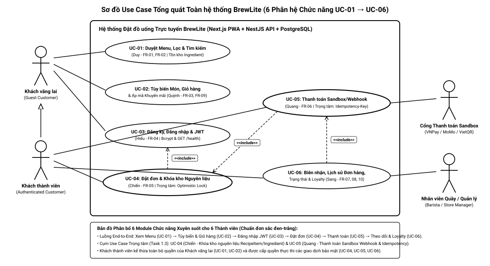
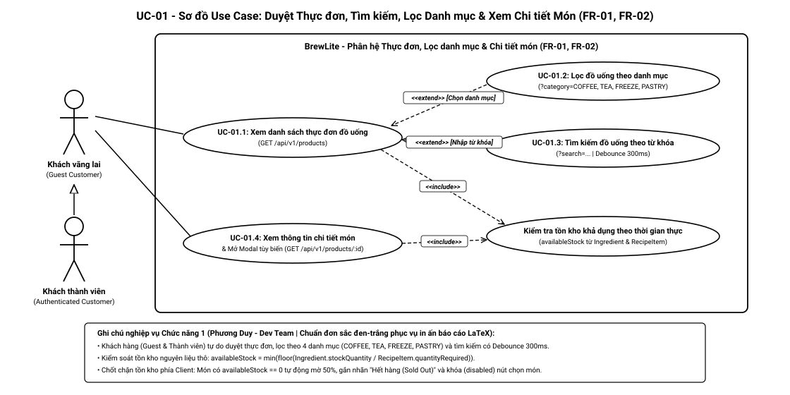
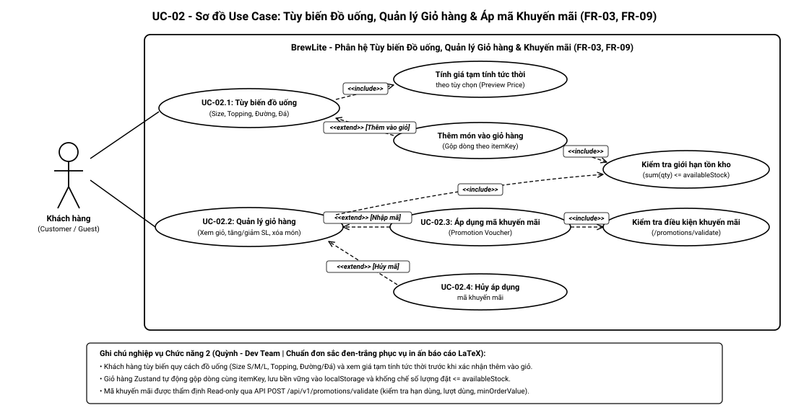
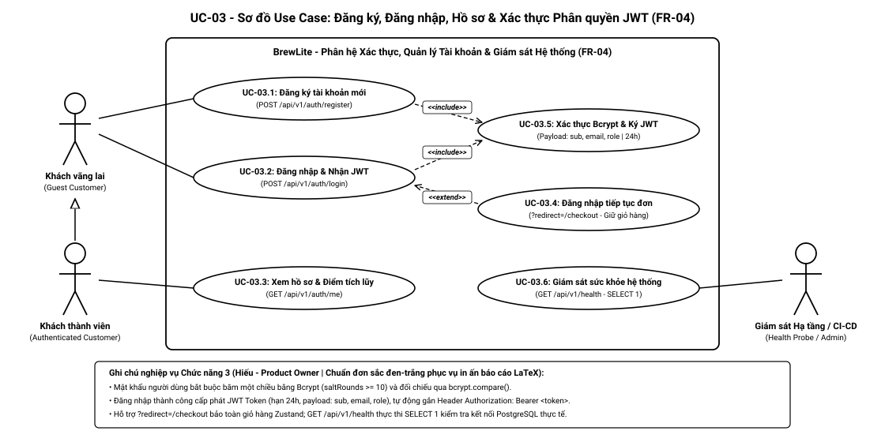
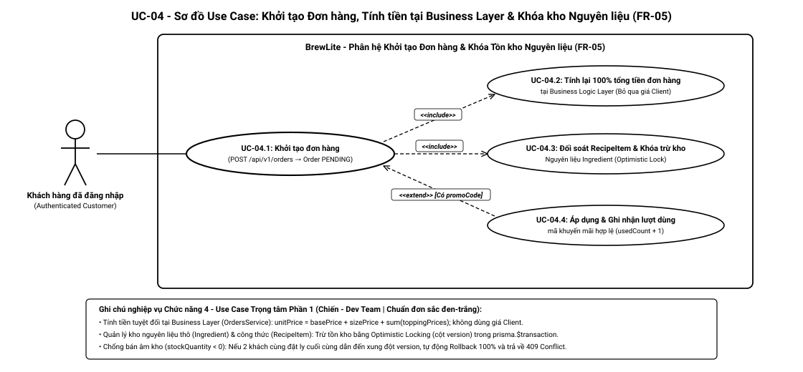
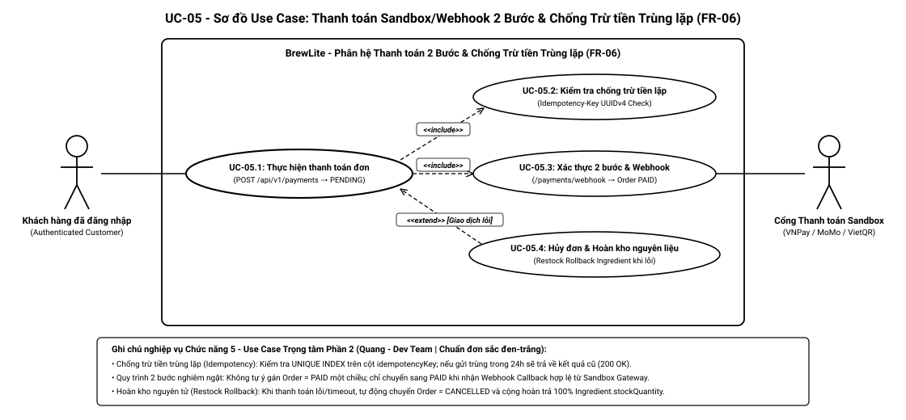
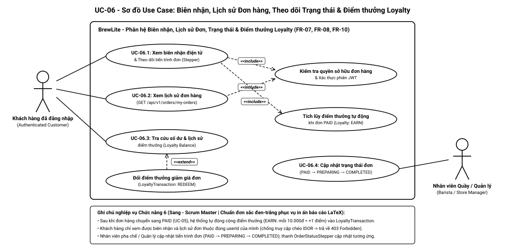

# BREWLITE – ĐẶC TẢ YÊU CẦU PHẦN MỀM TỔNG HỢP (SRS SUMMARY – TASK 1.2)

- **Học phần:** Công nghệ Phần mềm (CO3001 – SWE 2026–2027)
- **Đề tài:** BrewLite – Hệ thống Đặt đồ uống Trực tuyến (Mobile-first / PWA)
- **Tài liệu:** `docs/requirements/srs-summary.md`
- **Giai đoạn:** Task 1.2 – Yêu cầu chức năng (`FR-01` → `FR-10`), Yêu cầu phi chức năng (`NFR-01` → `NFR-05`), Phân loại MoSCoW, Quy tắc nghiệp vụ (BR), Tiêu chí nghiệm thu (AC) & Sơ đồ Use Case Tổng quát
- **Nhóm thực hiện (6 Thành viên – Mô hình Vertical Slice):**
  1. **Phương Duy (Dev Team):** Chức năng 1 (`FR-01`, `FR-02` – Thực đơn, Tìm kiếm, Lọc danh mục & Tồn kho nguyên liệu `Ingredient`/`RecipeItem`).
  2. **Quỳnh (Dev Team):** Chức năng 2 (`FR-03`, `FR-09` – Tùy biến đồ uống Size/Topping, Giỏ hàng `Zustand` & Thẩm định Khuyến mãi `Promotion`).
  3. **Trần Trung Hiếu (Product Owner):** Chức năng 3 (`FR-04` – Đăng ký, Đăng nhập, Hồ sơ, Xác thực `JWT`/`Bcrypt` & Giám sát `GET /api/v1/health`).
  4. **Chiến (Dev Team):** Chức năng 4 (`FR-05` – Khởi tạo đơn hàng, Tính tiền tại Business Layer & Khóa kho nguyên liệu đồng thời `Optimistic Lock`).
  5. **Quang (Dev Team):** Chức năng 5 (`FR-06` & `NFR-01..05` – Thanh toán Sandbox/Webhook 2 bước, Chống trừ tiền trùng lặp `Idempotency-Key` & Hoàn kho tự động).
  6. **Sang (Scrum Master):** Chức năng 6 (`FR-07`, `FR-08`, `FR-10` – Biên nhận điện tử, Lịch sử đơn, `OrderStatusStepper`, Điểm thưởng `LoyaltyTransaction` & Sơ đồ Use Case Tổng quát `system-usecase`).
- **Liên kết tài liệu truy vết:**
  - [Bối cảnh, Stakeholder và Phạm vi (Task 1.1)](./context-and-scope.md)
  - [Đặc tả Chi tiết Use Case (Task 1.3)](./usecase-checkout-spec.md)
  - [Sơ đồ Use Case Tổng quát Toàn hệ thống (PUML)](../diagrams/system-usecase.puml) | [Ảnh Vector SVG](../diagrams/system-usecase.svg)

---

## 1. Bản đồ Phân bổ 6 Module Chức năng Toàn hệ thống BrewLite

Hệ thống BrewLite được thiết kế theo mô hình **Vertical Slice** cho 6 thành viên, bao phủ trọn vẹn toàn bộ luồng nghiệp vụ End-to-End từ lúc khách hàng xem thực đơn cho đến khi hoàn tất thanh toán, nhận biên nhận và tích điểm thành viên:

| Module | Mã FR | Tên Phân hệ Chức năng | Thành viên phụ trách | Mức ưu tiên (MoSCoW) | Phạm vi Sprint |
| :---: | :---: | :--- | :---: | :---: | :---: |
| **1** | `FR-01`, `FR-02` | Hiển thị Thực đơn (Menu), Tìm kiếm theo từ khóa, Lọc theo Danh mục & Hiển thị Tồn kho Khả dụng theo Nguyên liệu (`Ingredient` / `RecipeItem`) | **1. Duy** | **Must** | Sprint 1 (MVP) |
| **2** | `FR-03`, `FR-09` | Tùy biến Đồ uống (`Size`/`Topping`/Đường/Đá), Quản lý Giỏ hàng (`Zustand` + `localStorage`) & Thẩm định Mã Khuyến mãi (`Promotion`) | **2. Quỳnh** | **Must** | Sprint 2 |
| **3** | `FR-04` | Đăng ký, Đăng nhập, Quản lý Hồ sơ, Xác thực Phân quyền `JWT` (`Bcrypt`) & Giám sát Sức khỏe Hệ thống (`GET /api/v1/health`) | **3. Hiếu (PO)** | **Must** | Sprint 1 (Health) / Sprint 2 (Auth) |
| **4** | `FR-05` | Khởi tạo Đơn hàng (`POST /api/v1/orders`), Tính lại 100% Giá tại Business Layer & Khóa Tồn kho Nguyên liệu Đồng thời (`Optimistic Lock`) | **4. Chiến** | **Must** | Sprint 2 |
| **5** | `FR-06`, `NFR-01..05` | Thanh toán Sandbox/Webhook 2 bước (`POST /api/v1/payments` & `/webhook`), Chống Trừ tiền Trùng lặp (`Idempotency-Key`) & Hoàn kho Tự động | **5. Quang** | **Must** | Sprint 2 |
| **6** | **`FR-07`, `FR-08`, `FR-10`** | **Biên nhận Điện tử, Lịch sử Đơn hàng (`/orders/my-orders`), Theo dõi & Cập nhật Trạng thái Đơn (`OrderStatusStepper`) & Điểm thưởng (`LoyaltyTransaction`)** | **6. Sang (SM)** | **Must** | **Sprint 2** |

---

## 2. Sơ đồ Use Case Tổng quát Toàn hệ thống (`system-usecase`)

Đáp ứng yêu cầu mục 5 của **Task 1.2** trong đề bài Assignment 2 (*"Sơ đồ use-case tổng quát của toàn hệ thống"*), sơ đồ dưới đây tổng hợp đầy đủ 4 tác nhân chính/phụ và 6 cụm Use Case cốt lõi (`UC-01` đến `UC-06`) theo chuẩn đơn sắc đen-trắng phục vụ in ấn báo cáo kỹ thuật LaTeX:



- **Tệp nguồn PlantUML:** [`docs/diagrams/system-usecase.puml`](../diagrams/system-usecase.puml)
- **Tệp ảnh kết xuất SVG:** [`docs/diagrams/system-usecase.svg`](../diagrams/system-usecase.svg)

---

## 3. PHÂN HỆ CHỨC NĂNG 1 (DUY): FR-01 – XEM THỰC ĐƠN & CHI TIẾT SẢN PHẨM

### 3.1 Mô tả Chi tiết (Description)
- **Mã yêu cầu:** `FR-01`
- **Tên yêu cầu:** Xem danh sách thực đơn (Menu) đồ uống và Xem chi tiết thông tin sản phẩm.
- **Đối tượng sử dụng (Actor):** Khách hàng (Bao gồm cả khách vãng lai `Guest` chưa đăng nhập và khách hàng thành viên đã có tài khoản).
- **Mô tả nghiệp vụ:** 
  - Hệ thống cung cấp giao diện thực đơn trực quan theo định hướng Mobile-first / PWA. Khách hàng khi truy cập vào ứng dụng có thể duyệt qua danh sách các món đồ uống hiện có của quán.
  - Mỗi sản phẩm trên thực đơn hiển thị các trường thông tin cơ bản: Hình ảnh minh họa chất lượng cao (tối ưu nén webp/jpg), Tên món, Mô tả tóm tắt, Đơn giá gốc (`basePrice`, đơn vị VNĐ), Danh mục sản phẩm, và Nhãn trạng thái tồn kho khả dụng (**Còn hàng** hoặc **Hết hàng / Sold Out**).
  - Khi người dùng bấm vào một thẻ sản phẩm còn hàng, hệ thống hỗ trợ xem thông tin chi tiết đầy đủ (mô tả hương vị, nguyên liệu đặc trưng) và chuyển tiếp mở Modal tùy biến (chọn Size, mức đá/đường, thêm Topping của Chức năng 2).
- **Xử lý các trạng thái giao diện (UI States):**
  - **Trạng thái đang tải (Loading State):** Hiển thị khung xương xám (Skeleton Shimmer) mô phỏng vị trí các thẻ món trong thời gian chờ API phản hồi, chống giật vỡ bố cục (Layout Shift).
  - **Trạng thái rỗng (Empty State):** Khi cơ sở dữ liệu chưa có sản phẩm nào đang kích hoạt.
  - **Trạng thái lỗi kết nối (Error State):** Bắt lỗi mạng hoặc mã lỗi 500/503 từ API, hiển thị thông báo lỗi thân thiện kèm nút *"Thử lại (Retry)"* để người dùng tải lại trang mà không cần F5 trình duyệt.
  - **Trạng thái hết hàng (Sold Out State):** Tự động làm mờ thẻ sản phẩm (opacity 50%), gắn huy hiệu *"Hết hàng"*, và vô hiệu hóa (`disabled`) nút chọn món.

---

### 3.2 Phân loại Mức độ Ưu tiên theo MoSCoW

| Mã Yêu Cầu | Nội Dung Yêu Cầu Kiểm Chứng Được | Mức Ưu Tiên (MoSCoW) | Ghi Chú Nghiệp Vụ |
| :---: | :--- | :---: | :--- |
| **FR-01.1** | Hiển thị danh sách các món đồ uống đang kích hoạt (`isActive = true`) kèm tên, hình ảnh minh họa và đơn giá gốc. | **Must** | Yêu cầu cốt lõi bắt buộc của MVP |
| **FR-01.2** | Hiển thị nhãn trạng thái tồn kho khả dụng; tự động làm mờ thẻ món và khóa nút chọn khi tồn kho tính ra bằng 0. | **Must** | Chốt chặn tồn kho Client (Task 10.3) |
| **FR-01.3** | Xử lý trọn vẹn 3 trạng thái giao diện người dùng: Skeleton Loading, Empty State và Error State có nút Thử lại. | **Must** | Bắt buộc theo tiêu chuẩn đánh giá đồ án |
| **FR-01.4** | Xem thông tin chi tiết món đồ uống (mô tả đầy đủ thành phần hương vị, hình ảnh lớn). | **Must** | Phục vụ bước chọn món |
| **FR-01.5** | Tối ưu hóa tải lười hình ảnh (Lazy Loading) và lưu cache dữ liệu danh mục phía Client. | **Should** | Tối ưu tốc độ tải trang trên di động |
| **FR-01.6** | Gắn nhãn huy hiệu nổi bật: "Bán chạy (Best Seller)" hoặc "Món mới (New)". | **Could** | Tùy chọn làm thêm nếu kịp tiến độ Sprint |
| **FR-01.7** | Đánh giá số sao, bình luận review của khách hàng hoặc tính toán hàm lượng calo chi tiết cho từng ly nước. | **Won't** | Không thực hiện trong phạm vi MVP Assignment 2 |

---

### 3.3 Các Quy tắc Nghiệp vụ Cốt lõi (Business Rules - BR)

| Mã Quy Tắc | Nội Dung Quy Tắc Nghiệp Vụ |
| :---: | :--- |
| **BR-01.1** | **Điều kiện hiển thị sản phẩm:** Chỉ những sản phẩm có cờ `isActive = true` trong cơ sở dữ liệu mới được hiển thị lên giao diện thực đơn. Những sản phẩm tạm ngưng bán hoặc bị ẩn (`isActive = false`) phải được lọc bỏ ngay từ câu truy vấn SQL/Prisma tại tầng Data Access Layer. |
| **BR-01.2** | **Công thức tính tồn kho từ nguyên liệu thô:** Cơ sở dữ liệu không quản lý tồn kho theo số ly pha sẵn. Tồn kho khả dụng của sản phẩm ($\text{availableStock}$) được tính toán theo thời gian thực dựa trên số lượng tồn kho của các nguyên vật liệu thô cấu thành (`Ingredient.stockQuantity`) chia cho định mức yêu cầu trong công thức pha chế (`RecipeItem.quantityRequired`):<br>$$\text{availableStock} = \min_{i \in \text{Ingredients}} \left( \left\lfloor \frac{\text{Ingredient}_i\text{.stockQuantity}}{\text{RecipeItem}_i\text{.quantityRequired}} \right\rfloor \right)$$<br>*Ví dụ thực tế:* Để pha 1 ly "Cà phê sữa đá" cần định lượng: 15g hạt cà phê, 25ml sữa đặc, và 1 ly nhựa. Nếu trong kho còn: 150g hạt cà phê (pha được 10 ly), 500ml sữa đặc (pha được 20 ly), nhưng chỉ còn 8 cái ly nhựa $\rightarrow$ Tồn kho khả dụng tối đa chỉ là $\min(10, 20, 8) = 8$ ly. |
| **BR-01.3** | **Xác định trạng thái Còn hàng / Hết hàng:** Món được xác định là "Còn hàng" khi $\text{availableStock} > 0$. Khi $\text{availableStock} = 0$ (do thiếu hụt bất kỳ nguyên liệu bắt buộc nào theo công thức), món ngay lập tức được xác định là "Hết hàng". |
| **BR-01.4** | **Chốt chặn tồn kho phía Client (Task 10.3):** Khi sản phẩm rơi vào trạng thái "Hết hàng" ($\text{availableStock} = 0$), giao diện phía Client phải tự động phản ứng: giảm độ mờ thẻ sản phẩm (opacity 50%), hiển thị nhãn badge *"Hết hàng (Sold Out)"*, và vô hiệu hóa (`disabled`) nút chọn món/thêm vào giỏ hàng nhằm triệt tiêu nguy cơ người dùng đặt hàng ảo. |
| **BR-01.5** | **Quy chuẩn đơn giá hiển thị:** Đơn giá gốc (`basePrice`) hiển thị trên thực đơn là số nguyên dương tính theo đơn vị Đồng (VNĐ, kiểu dữ liệu `Decimal` trong CSDL), chưa bao gồm các khoản phụ thu kích cỡ (Size M/L) và các topping đi kèm. |

---

### 3.4 Tiêu chí Nghiệm thu (Acceptance Criteria - AC)

| Mã AC | Điều Kiện Tiên Quyết (Given) | Hành Động Kích Hoạt (When) | Kết Quả Kỳ Vọng Hệ Thống (Then) | Ánh Xạ FR / BR |
| :---: | :--- | :--- | :--- | :---: |
| **AC-01.01** | CSDL đã nạp sẵn 8–10 món đồ uống mẫu; Backend API đang chạy bình thường. | Khách hàng mở trang `/menu` trên trình duyệt điện thoại. | Giao diện hiển thị đầy đủ danh sách món kèm ảnh minh họa, tên món và giá gốc rõ ràng. Thời gian phản hồi API $< 300\text{ms}$. | FR-01.1<br>BR-01.1 |
| **AC-01.02** | Khách hàng vừa truy cập trang `/menu` và dữ liệu đang được tải từ máy chủ. | Trình duyệt đang chờ phản hồi từ API `GET /api/v1/products`. | Màn hình hiển thị các khối khung xương xám (Skeleton Shimmer) nhấp nháy tại đúng vị trí các card món ăn, không xảy ra hiện tượng chớp nháy trắng hay giật khung hình. | FR-01.3 |
| **AC-01.03** | Một món đồ uống có nguyên liệu thô trong kho không đủ định lượng pha chế ($\text{availableStock} = 0$). | Giao diện Menu kết xuất danh sách thẻ sản phẩm. | Thẻ của món đó tự động bị làm mờ (opacity 50%), xuất hiện nhãn *"Hết hàng"*, nút bấm chọn món chuyển sang trạng thái disabled (không thể bấm chuột hay chạm cảm ứng). | FR-01.2<br>BR-01.2<br>BR-01.4 |
| **AC-01.04** | Thiết bị người dùng bị mất kết nối Internet hoặc Backend API trả về lỗi 500/503. | Quá trình gọi API tải thực đơn thất bại. | Giao diện bắt lỗi và hiển thị component `ErrorState` ("Không thể tải thực đơn. Vui lòng kiểm tra kết nối mạng") kèm nút bấm *"Thử lại (Retry)"*. Bấm nút sẽ kích hoạt gọi lại API. | FR-01.3 |
| **AC-01.05** | Khách hàng đang duyệt thực đơn và bấm vào một sản phẩm đang ở trạng thái còn hàng. | Khách hàng click/chạm vào thẻ món ăn. | Hệ thống mở xem thông tin chi tiết món và kích hoạt chuyển giao dữ liệu sang Modal tùy biến Size/Topping (`ProductCustomizationModal`). | FR-01.4<br>BR-01.3 |
| **AC-01.06** | Cơ sở dữ liệu chưa có bất kỳ sản phẩm nào được kích hoạt (`isActive = true`). | Khách hàng mở trang `/menu`. | Giao diện hiển thị component `EmptyState` thông báo: *"Thực đơn hiện đang được cập nhật, vui lòng quay lại sau"*. | FR-01.3<br>BR-01.1 |

---

## 4. PHÂN HỆ CHỨC NĂNG 1 (DUY): FR-02 – TÌM KIẾM ĐỒ UỐNG & LỌC THEO DANH MỤC

### 4.1 Mô tả Chi tiết (Description)
- **Mã yêu cầu:** `FR-02`
- **Tên yêu cầu:** Tìm kiếm đồ uống và Lọc sản phẩm theo danh mục.
- **Đối tượng sử dụng (Actor):** Khách hàng (Bao gồm cả khách vãng lai `Guest` và khách hàng thành viên).
- **Mô tả nghiệp vụ:**
  - Hệ thống hỗ trợ người dùng nhanh chóng tìm thấy món đồ uống mong muốn thông qua 2 cơ chế tương tác linh hoạt:
    1. **Thanh tab danh mục (Category Tabs / Filter):** Thanh trượt ngang trên giao diện điện thoại chứa các nhóm món: **"Tất cả" (Mặc định)**, **"Cà phê"** (`COFFEE`), **"Trà trái cây"** (`TEA`), **"Đá xay"** (`FREEZE`), và **"Bánh ngọt"** (`PASTRY`). Khi người dùng bấm chọn một tab, danh sách sản phẩm tức thời lọc lại chỉ hiển thị các món thuộc danh mục đó.
    2. **Thanh tìm kiếm theo từ khóa (Search Bar):** Ô nhập văn bản cho phép khách hàng gõ tên món (ví dụ: "cà phê", "sen", "đào", "matcha"). Hệ thống hỗ trợ tìm kiếm không phân biệt chữ hoa/chữ thường (Case-insensitive) và hỗ trợ cả tiếng Việt có dấu lẫn không dấu.
  - **Kết hợp bộ lọc (Filter Intersection):** Người dùng có thể vừa chọn danh mục vừa nhập từ khóa tìm kiếm (Ví dụ: Đang ở tab "Cà phê" và gõ "sữa" $\rightarrow$ Chỉ hiển thị các món Cà phê có chữ "sữa").
  - **Xử lý kết quả rỗng (Empty Search State):** Khi từ khóa tìm kiếm hoặc danh mục không có sản phẩm nào thỏa mãn, hệ thống không báo lỗi mạng mà hiển thị component `EmptyState` ("Không tìm thấy đồ uống phù hợp") kèm nút bấm tiện ích *"Xóa bộ lọc (Clear Filter)"* để đặt lại về trạng thái ban đầu.

---

### 4.2 Phân loại Mức độ Ưu tiên theo MoSCoW

| Mã Yêu Cầu | Nội Dung Yêu Cầu Kiểm Chứng Được | Mức Ưu Tiên (MoSCoW) | Ghi Chú Nghiệp Vụ |
| :---: | :--- | :---: | :--- |
| **FR-02.1** | Lọc danh sách món theo danh mục (Tất cả, Cà phê, Trà trái cây, Đá xay, Bánh ngọt). | **Must** | Bắt buộc cho trải nghiệm duyệt Menu |
| **FR-02.2** | Tìm kiếm đồ uống theo từ khóa tên món không phân biệt hoa thường và dấu tiếng Việt. | **Must** | Bắt buộc giúp khách tìm món nhanh |
| **FR-02.3** | Kết hợp đồng thời điều kiện lọc danh mục và từ khóa tìm kiếm (phép giao logic AND). | **Must** | Tránh sai lệch kết quả lọc |
| **FR-02.4** | Hiển thị giao diện EmptyState và nút "Xóa bộ lọc" khi không có kết quả phù hợp. | **Must** | Xử lý trải nghiệm rỗng thân thiện |
| **FR-02.5** | Áp dụng cơ chế Debounce (trì hoãn 300ms) khi nhập từ khóa tìm kiếm phía Client. | **Should** | Giảm thiểu gửi request liên tục lên server |
| **FR-02.6** | Đồng bộ trạng thái lọc và từ khóa lên URL query params (`?category=...&search=...`). | **Should** | Hỗ trợ lưu lịch sử duyệt và tải lại trang |
| **FR-02.7** | Gợi ý từ khóa tìm kiếm phổ biến hoặc tự động hoàn thành từ khóa (Auto-complete). | **Could** | Tùy chọn mở rộng nếu còn thời gian |
| **FR-02.8** | Bộ lọc nâng cao đa tiêu chí theo khoảng giá (Slider) hoặc độ ngọt/calo (ngoài MVP). | **Won't** | Không thực hiện trong phạm vi Assignment 2 |

---

### 4.3 Các Quy tắc Nghiệp vụ Cốt lõi (Business Rules - BR)

| Mã Quy Tắc | Nội Dung Quy Tắc Nghiệp Vụ |
| :---: | :--- |
| **BR-02.1** | **Quy tắc lọc theo danh mục:**<br>• Khi tham số danh mục là rỗng hoặc "Tất cả" (`category = ALL`), hệ thống truy vấn toàn bộ các món đang bán (`isActive = true`).<br>• Khi người dùng chọn một danh mục cụ thể (`category \in \{\text{COFFEE, TEA, FREEZE, PASTRY}\}`), hệ thống chỉ trả về các sản phẩm có `Product.category` trùng khớp chính xác với giá trị được chọn. |
| **BR-02.2** | **Quy tắc tìm kiếm từ khóa:** Từ khóa tìm kiếm (`search`) được chuẩn hóa tự động: cắt bỏ khoảng trắng thừa ở hai đầu chuỗi (`trim()`), chuyển đổi về chữ thường và so khớp chuỗi con (`contains` / `ILIKE`) trên trường `Product.name`. Từ khóa phải hỗ trợ cả trường hợp có dấu tiếng Việt chuẩn và không dấu (ví dụ: gõ "ca phe" hay "cà phê" đều tìm ra sản phẩm). |
| **BR-02.3** | **Quy tắc kết hợp điều kiện (Logic AND):** Khi người dùng vừa chọn danh mục cụ thể vừa nhập từ khóa tìm kiếm, điều kiện truy vấn áp dụng phép giao logic đồng thời:<br>$$\text{Sản phẩm hiển thị} = \{ p \in \text{Products} \mid p\text{.isActive} = \text{true} \land p\text{.category} = \text{SelectedCategory} \land p\text{.name} \text{ chứa } \text{Keyword} \}$$ |
| **BR-02.4** | **Quy tắc xử lý kết quả rỗng & Khôi phục bộ lọc:** Khi tập kết quả trả về có độ dài bằng 0 (`products.length == 0`):<br>• Hệ thống không được hiển thị màn hình lỗi máy chủ (ErrorState).<br>• Hệ thống hiển thị component `EmptyState` với thông điệp: *"Không tìm thấy đồ uống phù hợp với bộ lọc hiện tại"*, kèm nút bấm *"Xóa bộ lọc"*.<br>• Khi người dùng bấm *"Xóa bộ lọc"*, hệ thống tự động reset tab danh mục về "Tất cả", xóa trắng ô tìm kiếm, và tải lại danh sách đầy đủ. |

---

### 4.4 Tiêu chí Nghiệm thu (Acceptance Criteria - AC)

| Mã AC | Điều Kiện Tiên Quyết (Given) | Hành Động Kích Hoạt (When) | Kết Quả Kỳ Vọng Hệ Thống (Then) | Ánh Xạ FR / BR |
| :---: | :--- | :--- | :--- | :---: |
| **AC-02.01** | Khách hàng đang ở màn hình Menu hiển thị danh sách tất cả các món. | Bấm chọn vào tab danh mục "Cà phê". | Danh sách sản phẩm lập tức cập nhật, chỉ hiển thị các món thuộc danh mục Cà phê (ví dụ: Cà phê đen, Cà phê sữa, Bạc xỉu); tab "Cà phê" được highlight sáng màu biểu thị đang chọn. | FR-02.1<br>BR-02.1 |
| **AC-02.02** | Khách hàng đang ở màn hình Menu. | Nhập từ khóa "sen" vào thanh tìm kiếm. | Sau khoảng trễ debounce 300ms, danh sách sản phẩm lọc lại và chỉ hiển thị món "Trà sen vàng", không bị giật trang hay mất trạng thái giao diện. | FR-02.2<br>BR-02.2 |
| **AC-02.03** | Khách hàng đang chọn tab "Trà trái cây". | Nhập từ khóa "đào" vào ô tìm kiếm. | Hệ thống lọc đồng thời cả 2 điều kiện: Chỉ hiển thị các món vừa thuộc nhóm Trà trái cây vừa có chữ "đào" trong tên (ví dụ: "Trà đào hồng đài"). | FR-02.3<br>BR-02.3 |
| **AC-02.04** | Khách hàng nhập từ khóa không khớp với bất kỳ món nào (ví dụ: "xyz123"). | Nhập xong từ khóa tìm kiếm. | Màn hình hiển thị component `EmptyState` với dòng chữ *"Không tìm thấy đồ uống phù hợp"* kèm nút bấm *"Xóa bộ lọc"*. | FR-02.4<br>BR-02.4 |
| **AC-02.05** | Màn hình đang ở trạng thái rỗng `EmptyState` do từ khóa không khớp. | Khách hàng click vào nút *"Xóa bộ lọc"*. | Ô tìm kiếm được xóa trắng, tab danh mục tự động nhảy về "Tất cả", và danh sách thực đơn ban đầu được khôi phục hiển thị đầy đủ ngay lập tức. | FR-02.4<br>BR-02.4 |
| **AC-02.06** | Khách hàng gõ liên tục chuỗi ký tự nhanh vào ô tìm kiếm (ví dụ: gõ "m-a-t-c-h-a"). | Đang gõ bàn phím liên tục. | Cơ chế Debounce 300ms chỉ phát ra đúng 1 request API cuối cùng sau khi khách hàng dừng gõ 300ms, không spam gửi 6 request liên tiếp lên Backend. | FR-02.5 |


### 4.5 Sơ đồ Use Case Phân hệ Chức năng 1 (`uc-01-menu`)



- **Tệp nguồn PlantUML:** [`docs/diagrams/uc-01-menu.puml`](../diagrams/uc-01-menu.puml)
- **Tệp ảnh kết xuất SVG:** [`docs/diagrams/uc-01-menu.svg`](../diagrams/uc-01-menu.svg)

---

## 5. PHÂN HỆ CHỨC NĂNG 2 (QUỲNH): YÊU CẦU CHỨC NĂNG FR-03 & FR-09

### 5.0 Tổng quan Phân hệ Chức năng 2 & Bối cảnh Kiến trúc

#### 5.0.1 Mục tiêu và Phạm vi Nghiệp vụ
Phân hệ Chức năng 2 là cầu nối trực tiếp giữa quá trình duyệt sản phẩm trên Thực đơn (Menu) và quy trình Khởi tạo Đơn hàng (Checkout). Phân hệ đảm bảo khách hàng có trải nghiệm đặt đồ uống mượt mà, trực quan theo chuẩn ứng dụng di động (Mobile-first / PWA), đồng thời duy trì tính toàn vẹn của dữ liệu giỏ hàng qua các phiên làm việc của trình duyệt.

Phân hệ bao gồm 2 nhóm yêu cầu chức năng trọng tâm:
1. **FR-03 – Tùy biến món đồ uống & Quản lý giỏ hàng:** Cho phép khách hàng tùy biến kích cỡ (`Size`), chọn các loại `Topping`, điều chỉnh lượng đường/đá; quản lý giỏ hàng phía Client bằng **Zustand** (đồng bộ bền vững với `localStorage`), tự động gộp dòng sản phẩm có cùng tổ hợp cấu hình, tăng/giảm số lượng và kiểm soát tồn kho khả dụng.
2. **FR-09 – Kiểm tra và Áp dụng mã khuyến mãi (`Promotion`):** Cho phép khách hàng nhập mã Voucher giảm giá tại trang giỏ hàng; gọi API phía Backend NestJS (`POST /api/v1/promotions/validate`) để đối soát điều kiện hiệu lực từ CSDL có thẩm quyền và hiển thị giá trị giảm giá dự kiến tức thời.

#### 5.0.2 Nguyên tắc Kiến trúc Cốt lõi: Client Price Non-Authority
Nhằm ngăn chặn triệt để các hành vi gian lận sửa đổi giá tiền tại Client (ví dụ: thông qua DevTools hoặc can thiệp payload HTTP), hệ thống tuân thủ nghiêm ngặt nguyên tắc:
- **Client-Side (Next.js & Zustand):** Chỉ thực hiện tính toán giá tạm tính (**Preview Price**) và số tiền giảm giá dự kiến (**Preview Discount**) phục vụ phản hồi giao diện người dùng tức thời (UI Optimistic Feedback).
- **Server-Side (NestJS Business Logic Layer):** Khi khách hàng tiến hành bấm Đặt hàng (chuyển giao sang **UC-04 / FR-05**), máy chủ hoàn toàn **bỏ qua** các trường giá tiền do Client gửi lên. Backend độc lập 100% truy vấn đơn giá gốc từ bảng `Product`, phụ thu size, giá `Topping` và điều kiện `Promotion` từ CSDL PostgreSQL bên trong một Database Transaction duy nhất (`prisma.$transaction`).

```text
+----------------------------------------------------------------------------------------------------+
|                      CHỨC NĂNG 2: CLIENT-SIDE INTERACTION & LOCAL PREVIEW (Quỳnh)                  |
|                                                                                                    |
|  [Menu] ---> Mở Modal Tùy Biến (Size/Topping/Đường/Đá) ---> Tính Giá Tạm Tính (Preview)             |
|        ---> Zustand Store (useCartStore) ---> Đồng bộ localStorage ---> Cập nhật Cart Badge       |
|        ---> Trang Giỏ hàng (/cart) ---> Nhập Voucher ---> POST /api/v1/promotions/validate        |
|             (Backend kiểm tra điều kiện & tính tiền giảm dự kiến - KHÔNG trừ lượt dùng)             |
+----------------------------------------------------------------------------------------------------+
                                                  |
                                                  v [Chuyển giao sang UC-04 / FR-05]
+----------------------------------------------------------------------------------------------------+
|                     CHỨC NĂNG 4: SERVER-AUTHORITATIVE RE-CALCULATION & LOCK (Chiến)                 |
|                                                                                                    |
|  POST /api/v1/orders ---> Validate DTO ---> Tính lại 100% tiền tại Business Layer                   |
|                      ---> prisma.$transaction: Trừ kho nguyên liệu Ingredient (Optimistic Lock)   |
|                      ---> Ghi nhận usedCount Voucher & Tạo Order (PENDING)                          |
+----------------------------------------------------------------------------------------------------+
```

---

### 5.1 Đặc tả Yêu cầu Chức năng FR-03: Tùy biến món & Quản lý giỏ hàng

#### 5.1.1 Mô tả Nghiệp vụ FR-03
Khách hàng (bao gồm cả khách vãng lai `Guest` chưa đăng nhập và khách hàng thành viên `Customer`) có thể tùy chọn quy cách pha chế cho từng món đồ uống (Size, Topping, tỷ lệ Đường, tỷ lệ Đá), thêm món vào giỏ hàng, cập nhật số lượng, xóa món hoặc làm rỗng giỏ hàng. Dữ liệu giỏ hàng được quản lý tập trung ở Client bằng Zustand Store và tự động lưu vào `localStorage` của trình duyệt.

#### 5.1.2 Danh mục Yêu cầu chi tiết & Phân loại MoSCoW

| Mã Yêu cầu | Mô tả chi tiết yêu cầu có thể kiểm chứng | Mức ưu tiên MoSCoW | Ghi chú kỹ thuật / Ràng buộc |
| :--- | :--- | :--- | :--- |
| **FR-03.1** | Hệ thống cho phép mở modal tùy biến món (`ProductCustomizationModal`) khi người dùng bấm vào một sản phẩm bất kỳ trên Menu đang ở trạng thái kinh doanh (`isAvailable == true`) và còn khả năng phục vụ (`stock > 0` hoặc nguyên liệu khả dụng > 0). | **Must Have** | Món có `stock == 0` bị vô hiệu hóa nút đặt hàng từ Chức năng 1 (FR-01). |
| **FR-03.2** | Hệ thống cung cấp tùy chọn Kích cỡ (Size): Hỗ trợ tối thiểu 3 size chuẩn gồm **Size S** (Phụ thu: +0đ), **Size M** (Phụ thu: +6.000đ) và **Size L** (Phụ thu: +10.000đ). Mặc định chọn Size S khi vừa mở modal. | **Must Have** | Phụ thu Size áp dụng theo quy định phân công đồ án. |
| **FR-03.3** | Hệ thống cho phép người dùng chọn không hoặc nhiều loại `Topping` đi kèm (Trân châu trắng, Kem cheese, Thạch đào,...). Đơn giá của từng loại Topping được tải trực tiếp từ cơ sở dữ liệu. | **Must Have** | Danh sách Topping được hiển thị kèm đơn giá rõ ràng. |
| **FR-03.4** | Hệ thống hỗ trợ tùy chọn tỷ lệ Đường (0%, 30%, 50%, 70%, 100% - mặc định 100%) và tỷ lệ Đá (0%, 30%, 50%, 70%, 100% - mặc định 100%) cho các món thuộc danh mục trà/cà phê hỗ trợ gia giảm. | **Should Have** | Cấu hình đường/đá tham gia vào cấu trúc khóa phân biệt dòng giỏ hàng. |
| **FR-03.5** | Giao diện modal tùy biến phải tự động tính toán lại và hiển thị **Đơn giá tạm tính tức thời (Real-time Preview Price)** ngay khi người dùng thay đổi Size, thêm/bớt Topping hoặc điều chỉnh số lượng. | **Must Have** | Thời gian phản hồi cập nhật giá trên UI `< 50ms`. |
| **FR-03.6** | Khi người dùng nhấn "Thêm vào giỏ hàng", hệ thống tự động sinh khóa tổng hợp (`itemKey`) dựa trên tổ hợp: `productId`, `size`, danh sách `toppingIds` đã sắp xếp và cấu hình đường/đá. | **Must Have** | Đảm bảo tính nhất quán không phụ thuộc vào thứ tự bấm chọn Topping. |
| **FR-03.7** | Cơ chế gộp dòng giỏ hàng thông minh (Smart Aggregation): Nếu giỏ hàng đã có sản phẩm có cùng `itemKey`, hệ thống thực hiện cộng dồn số lượng (`quantity = quantity + addedQuantity`). Nếu khác `itemKey`, tạo một dòng `CartItem` mới riêng biệt trong giỏ hàng. | **Must Have** | Tránh phân mảnh các dòng sản phẩm có cùng quy cách trong giỏ. |
| **FR-03.8** | Hệ thống cho phép người dùng xem danh sách giỏ hàng (`/cart`), tăng (`+`) hoặc giảm (`-`) số lượng từng dòng, hoặc xóa trực tiếp dòng sản phẩm ra khỏi giỏ. | **Must Have** | Số lượng trên mỗi dòng phải là số nguyên dương $\ge 1$. |
| **FR-03.9** | Khi người dùng giảm số lượng của một dòng sản phẩm từ 1 về 0, hệ thống bắt buộc hiển thị hộp thoại xác nhận (`ConfirmModal`) trước khi loại bỏ sản phẩm khỏi giỏ hàng. | **Must Have** | Ngăn ngừa thao tác chạm nhầm trên màn hình cảm ứng di động. |
| **FR-03.10** | Kiểm soát tồn kho tại Client: Tổng số lượng ly của cùng một sản phẩm (`productId`) trên tất cả các dòng trong giỏ hàng không được vượt quá số lượng tồn kho khả dụng hiện tại (`availableStock`). Hệ thống tự động vô hiệu hóa nút `+` và cảnh báo khi đạt ngưỡng tối đa. | **Must Have** | Cảnh báo: "Chỉ còn X sản phẩm trong kho". |
| **FR-03.11** | Bền vững hóa trạng thái giỏ hàng (State Persistence): Giỏ hàng sử dụng thư viện **Zustand** kết hợp middleware `persist` lưu vào `localStorage`. Dữ liệu giỏ hàng, cấu hình tùy biến và số lượng phải được khôi phục nguyên vẹn khi người dùng tải lại trang (F5) hoặc mở lại tab trình duyệt. | **Must Have** | Xử lý an toàn khi `localStorage` bị lỗi hoặc đầy bộ nhớ. |
| **FR-03.12** | Cập nhật huy hiệu giỏ hàng (Cart Badge Indicator): Biểu tượng giỏ hàng trên thanh điều hướng (Navbar/Header) hiển thị huy hiệu tổng số ly đồ uống ($\sum \text{item.quantity}$) theo thời gian thực. | **Must Have** | Tự động ẩn huy hiệu khi giỏ hàng trống (`count == 0`). |
| **FR-03.13** | Thông báo trạng thái giao diện (Toast Notification): Hiển thị thông báo nhẹ (Toast) khi thêm món thành công vào giỏ hàng hoặc xóa sản phẩm khỏi giỏ. | **Could Have** | Tăng cường phản hồi xúc giác/thị giác cho người dùng. |
| **FR-03.14** | Không đồng bộ giỏ hàng giữa nhiều thiết bị (Cross-device Sync) hoặc giữ chỗ tồn kho (Cart Reservation) trong phiên bản MVP. | **Won't Have** | Giỏ hàng lưu cục bộ ở Client; việc khóa kho chỉ thực hiện khi tạo đơn (FR-05). |

#### 5.1.3 Bảng Quy tắc Nghiệp vụ FR-03 (Business Rules)

| Mã Quy tắc | Nội dung Quy tắc Nghiệp vụ | Công thức / Chi tiết Ràng buộc |
| :--- | :--- | :--- |
| **BR-03.1** | **Công thức tính Đơn giá & Thành tiền dòng:**<br>Đơn giá tạm tính của một ly đồ uống bằng giá gốc của sản phẩm cộng với phụ thu kích cỡ và tổng phụ thu của tất cả các Topping được chọn. Thành tiền của một dòng bằng đơn giá nhân với số lượng đặt. | $$\text{unitPrice} = \text{basePrice} + \text{sizePrice} + \sum_{t \in \text{selectedToppings}} \text{toppingPrice}_t$$<br>$$\text{lineSubtotal} = \text{unitPrice} \times \text{quantity}$$<br>$$\text{cartSubtotal} = \sum_{i \in \text{CartItems}} \text{lineSubtotal}_i$$<br>*(Đơn vị tính: VNĐ, số nguyên không âm)* |
| **BR-03.2** | **Quy tắc Sinh Khóa Định danh Dòng (`itemKey`):**<br>Để phân biệt hoặc gộp các dòng sản phẩm, `itemKey` được băm/tạo chuỗi chuẩn hóa từ ID sản phẩm, ID kích cỡ, danh sách ID topping được sắp xếp tăng dần theo bảng chữ cái và mức đường/đá. | $$\text{itemKey} = \text{MD5}(\text{productId} + \text{"\_"} + \text{sizeId} + \text{"\_"} + \text{sort}(\text{toppingIds}).\text{join}(\text{","}) + \text{"\_"} + \text{sugar} + \text{"\_"} + \text{ice})$$<br>Việc chọn thứ tự Topping khác nhau nhưng cùng tập hợp ID sẽ cho ra cùng một `itemKey`. |
| **BR-03.3** | **Ràng buộc Tồn kho Khả dụng đối với Món:**<br>Một món đồ uống có thể xuất hiện trên nhiều dòng giỏ hàng (khác size/topping). Tổng số lượng đặt của món đó trên toàn bộ giỏ hàng không được vượt quá số ly tối đa phục vụ được (`availableStock`). | $$\sum_{k \in \text{CartItems}, k.\text{productId} == P} k.\text{quantity} \le P.\text{availableStock}$$<br>Nếu chạm ngưỡng, vô hiệu hóa nút tăng số lượng trên giao diện. |
| **BR-03.4** | **Phục hồi và Khử lỗi Trạng thái Bền vững (Hydratation Resilience):**<br>Khi ứng dụng Next.js khởi tạo tại Client, Zustand nạp dữ liệu từ `localStorage`. Nếu cấu trúc dữ liệu bị lỗi cú pháp JSON hoặc trường dữ liệu không hợp lệ, hệ thống tự động làm sạch (`resetState`) về giỏ hàng rỗng an toàn mà không làm sập ứng dụng (No White Screen of Death). | Dữ liệu lưu trữ bao gồm: `{ items: CartItem[], appliedPromotion: Promotion \| null, version: number }`. |
| **BR-03.5** | **Trạng thái Giỏ hàng Rỗng:**<br>Khi giỏ hàng không có sản phẩm nào (`items.length == 0`), giao diện giỏ hàng hiển thị trạng thái `Empty Cart` (kèm hình minh họa và nút "Khám phá Menu"), đồng thời vô hiệu hóa nút "Tiến hành Đặt hàng" và khung nhập mã khuyến mãi. | Ngăn chặn việc gửi yêu cầu thanh toán cho giỏ hàng rỗng. |
| **BR-03.6** | **Quy định Giá trị Số lượng:**<br>Số lượng của mỗi dòng `CartItem` luôn là số nguyên dương $\ge 1$. Giao diện không cho phép nhập số âm, số thập phân hoặc ký tự đặc biệt. | Giá trị mặc định khi vừa thêm món là `quantity = 1`. |
| **BR-03.7** | **Khóa tương tác khi sản phẩm ngừng bán:**<br>Nếu một sản phẩm đã thêm vào giỏ hàng từ trước nhưng sau đó bị quản trị viên đổi trạng thái thành `isAvailable = false`, khi mở lại giỏ hàng, dòng sản phẩm đó sẽ bị gắn cờ cảnh báo "Sản phẩm tạm ngưng kinh doanh" và chặn chuyển bước thanh toán đến khi khách hàng xóa dòng đó. | Đảm bảo tính nhất quán với dữ liệu CSDL. |
| **BR-03.8** | **Không độc quyền Giữ hàng từ Giỏ (Non-blocking Cart):**<br>Việc thêm món vào giỏ hàng không làm giảm số lượng tồn kho trong CSDL PostgreSQL. Tồn kho chỉ được trừ chính thức và có bảo đảm khi giao dịch tạo đơn hàng hoàn tất ở FR-05. | Khách hàng khác vẫn có quyền đặt mua sản phẩm đó cho đến khi có người thanh toán/khóa kho thành công. |

#### 5.1.4 Tiêu chí Nghiệm thu FR-03 (Acceptance Criteria – AC)

> **Bộ Fixture Dữ liệu Mẫu để Kiểm thử:**
> - Sản phẩm A (Cà phê sữa đá): `basePrice = 29.000đ`, `stock = 5`, `isAvailable = true`.
> - Kích cỡ: Size S (+0đ), Size M (+6.000đ), Size L (+10.000đ).
> - Topping: Thạch cà phê T1 (+6.000đ), Kem Cheese T2 (+10.000đ).

| Mã AC | Điều kiện tiền đề (Given) | Hành động kích hoạt (When) | Kết quả kỳ vọng (Then) | Truy vết |
| :--- | :--- | :--- | :--- | :--- |
| **AC-03.01** | Khách hàng ở trang Menu, sản phẩm A còn hàng (`stock = 5`). | Bấm vào sản phẩm A. | Hệ thống mở `ProductCustomizationModal`, mặc định chọn Size S, không Topping, số lượng 1; giá hiển thị là 29.000đ. | FR-03.1, FR-03.2 |
| **AC-03.02** | Đang mở modal sản phẩm A (Size S, 29.000đ). | Chọn Size M (+6.000đ) và chọn Topping T1 (+6.000đ). | Giá tạm tính trên modal cập nhật tức thời thành 41.000đ (29.000 + 6.000 + 6.000); thành tiền là 41.000đ. | FR-03.2, FR-03.5 |
| **AC-03.03** | Khách hàng đang chọn sản phẩm A (Size M, Topping T1, giá 41.000đ). | Bấm nút "Thêm vào giỏ hàng". | Modal đóng lại; giỏ hàng Zustand ghi nhận 1 `CartItem` mới; Cart Badge trên Navbar hiển thị số 1; lưu vào `localStorage`. | FR-03.6, FR-03.11, FR-03.12 |
| **AC-03.04** | Giỏ hàng đang có: Sản phẩm A, Size M, Topping T1 (SL: 1). | Khách hàng mở lại sản phẩm A, chọn Size M, Topping T1, SL: 2 rồi bấm "Thêm vào giỏ hàng". | Giỏ hàng không tạo dòng mới mà tự động gộp dòng: Sản phẩm A (Size M, T1) có số lượng tăng lên thành 3; Cart Badge hiển thị 3. | FR-03.7, BR-03.2 |
| **AC-03.05** | Giỏ hàng đang có: Sản phẩm A, Size M, Topping T1+T2. | Khách hàng thêm sản phẩm A, Size M, Topping T2+T1 (thứ tự chọn đảo ngược). | Hệ thống nhận diện cùng tập hợp Topping, gộp dòng vào sản phẩm hiện có thay vì tạo dòng mới. | FR-03.7, BR-03.2 |
| **AC-03.06** | Giỏ hàng đang có: Sản phẩm A, Size M, Topping T1 (SL: 1). | Khách hàng thêm sản phẩm A, Size L, Topping T1 (SL: 1). | Giỏ hàng tách thành 2 dòng riêng biệt: Dòng 1 (Size M, 41.000đ), Dòng 2 (Size L, 45.000đ); Cart Badge hiển thị 2. | FR-03.7 |
| **AC-03.07** | Sản phẩm A có `stock = 5`. Giỏ hàng đang có tổng cộng 5 ly sản phẩm A trên các dòng. | Khách hàng nhấn nút `+` trên bất kỳ dòng sản phẩm A nào. | Nút `+` bị khóa; hệ thống hiển thị thông báo cảnh báo: "Chỉ còn 5 sản phẩm trong kho"; số lượng không đổi. | FR-03.10, BR-03.3 |
| **AC-03.08** | Giỏ hàng có 1 dòng sản phẩm với số lượng bằng 1. | Khách hàng nhấn nút `-` (giảm số lượng). | Hệ thống hiển thị hộp thoại xác nhận: "Bạn có chắc chắn muốn xóa món này khỏi giỏ hàng?". | FR-03.9 |
| **AC-03.09** | Hộp thoại xác nhận xóa món đang hiển thị. | Khách hàng chọn "Xác nhận xóa". | Dòng sản phẩm bị gỡ khỏi giỏ hàng; Cart Badge giảm tương ứng; nếu giỏ hết món, hiển thị giao diện Giỏ hàng rỗng. | FR-03.8, FR-03.9 |
| **AC-03.10** | Giỏ hàng có 3 sản phẩm với tổng tiền tạm tính 150.000đ. | Người dùng nhấn phím F5 (Tải lại trang) hoặc đóng tab và mở lại. | Trạng thái giỏ hàng được phục hồi 100% từ `localStorage`: đầy đủ 3 món, đúng size/topping, số lượng và tổng tạm tính 150.000đ. | FR-03.11, BR-03.4 |
| **AC-03.11** | Giỏ hàng đang trống (`items.length == 0`). | Người dùng truy cập trang `/cart`. | Màn hình hiển thị trạng thái `Empty Cart`, nút "Tiến hành Đặt hàng" bị ẩn hoặc vô hiệu hóa; có nút điều hướng về `/menu`. | BR-03.5 |
| **AC-03.12** | Dữ liệu giỏ hàng trong `localStorage` bị can thiệp lỗi cú pháp (chuỗi JSON hỏng). | Người dùng mở trang web BrewLite. | Zustand bắt lỗi phân tích cú pháp (JSON parse error), tự động khởi tạo lại giỏ hàng rỗng, không xảy ra hiện tượng Crash giao diện. | BR-03.4, FR-03.11 |

---

### 5.2 Đặc tả Yêu cầu Chức năng FR-09: Kiểm tra và Áp mã Khuyến mãi (`Promotion`)

#### 5.2.1 Mô tả Nghiệp vụ FR-09
Tại trang giỏ hàng (`/cart`), khách hàng có thể nhập mã khuyến mãi (Promo Code / Voucher) để nhận ưu đãi giảm giá cho đơn hàng. Hệ thống gửi yêu cầu kiểm tra tới máy chủ API Backend NestJS (`POST /api/v1/promotions/validate`). Máy chủ chịu trách nhiệm xác thực mã dựa trên dữ liệu trong PostgreSQL và phản hồi mức giảm giá hợp lệ.

#### 5.2.2 Danh mục Yêu cầu chi tiết & Phân loại MoSCoW

| Mã Yêu cầu | Mô tả chi tiết yêu cầu có thể kiểm chứng | Mức ưu tiên MoSCoW | Ghi chú kỹ thuật / Ràng buộc |
| :--- | :--- | :--- | :--- |
| **FR-09.1** | Giao diện Giỏ hàng cung cấp ô nhập mã khuyến mãi và nút "Áp dụng". Khách hàng có thể nhập chuỗi ký tự mã (ví dụ: `BREWLITE20`, `FREESHIP`). | **Must Have** | Mã được chuẩn hóa tự động viết hoa (Uppercase, Trim khoảng trắng). |
| **FR-09.2** | Khi người dùng nhấn "Áp dụng", Client gửi yêu cầu HTTP `POST /api/v1/promotions/validate` kèm theo mã `code` và giá trị `cartSubtotal` hiện tại lên Backend NestJS. | **Must Have** | Trạng thái nút chuyển sang `Loading` để chống bấm gửi lặp nhiều lần. |
| **FR-09.3** | Backend kiểm tra tính hợp lệ của mã khuyến mãi dựa trên 5 tiêu chí: (1) Mã tồn tại trong bảng `Promotion`; (2) Cột `isActive == true`; (3) Thời điểm hiện tại nằm trong khoảng $[\text{startDate}, \text{endDate}]$; (4) Số lượt đã dùng $\text{usedCount} < \text{usageLimit}$; (5) Giá trị tạm tính $\text{cartSubtotal} \ge \text{minOrderValue}$. | **Must Have** | Kiểm tra hoàn toàn tại Business Logic Layer (`PromotionsService`). |
| **FR-09.4** | Hệ thống hỗ trợ 2 loại hình chiết khấu chuẩn: **Giảm theo tỷ lệ phần trăm (`PERCENTAGE`)** kèm theo mức giảm tối đa (`maxDiscountAmount`), và **Giảm theo số tiền cố định (`FIXED_AMOUNT`)**. | **Must Have** | Đảm bảo tính linh hoạt cho các chiến dịch Marketing F&B. |
| **FR-09.5** | Nếu mã hợp lệ, API trả về mã thành công `HTTP 200 OK` kèm số tiền được giảm (`discountAmount`). Giao diện Client hiển thị số tiền giảm và tính lại tổng tiền dự kiến sau giảm. | **Must Have** | $$\text{finalTotal} = \max(0, \text{cartSubtotal} - \text{discountAmount})$$. |
| **FR-09.6** | Nếu mã không hợp lệ, API trả về lỗi `HTTP 400 Bad Request` kèm thông báo nguyên nhân cụ thể (ví dụ: "Mã khuyến mãi không tồn tại", "Mã đã hết hạn", "Đơn hàng chưa đạt giá trị tối thiểu 100.000đ"). Giao diện hiển thị cảnh báo đỏ và không áp dụng giảm giá. | **Must Have** | Thông điệp lỗi thân thiện, rõ ràng, giúp khách hàng hiểu rõ lý do. |
| **FR-09.7** | Hệ thống cho phép người dùng chủ động hủy áp dụng mã khuyến mãi bằng cách bấm nút "Hủy mã" / biểu tượng X. Khi đó, mức giảm giá đưa về 0đ và tổng tiền trở về bằng tạm tính ban đầu. | **Must Have** | Trả lại trạng thái giỏ hàng tự do cho khách hàng. |
| **FR-09.8** | Cơ chế tự động hủy hợp lệ mã (Auto Invalidation): Nếu người dùng giảm số lượng hoặc xóa món làm `cartSubtotal` tụt xuống dưới mức `minOrderValue` của mã đang áp dụng, hệ thống tự động gỡ bỏ mã và cảnh báo lý do cho khách hàng. | **Must Have** | Tránh lỗ hổng lách điều kiện đơn hàng tối thiểu. |
| **FR-09.9** | Nguyên tắc Không tiêu hao lượt dùng khi Kiểm tra (Validation Idempotency): Việc gọi API kiểm tra mã khuyến mãi tuyệt đối không tăng cột `usedCount` của mã; lượt dùng chỉ được tăng chính thức khi đơn hàng được tạo thành công tại FR-05. | **Must Have** | Tránh mất lượt của khách hàng khi chỉ mới xem trước giỏ hàng. |
| **FR-09.10** | Nguyên tắc một mã khuyến mãi duy nhất: Trong phạm vi MVP, mỗi giỏ hàng chỉ được áp dụng tối đa 1 mã khuyến mãi tại một thời điểm; không hỗ trợ cộng dồn (Stacking) nhiều voucher. Nếu áp mã mới thành công, mã cũ tự động bị thay thế. | **Must Have** | Quy chuẩn kiểm soát ngân sách khuyến mãi MVP. |

#### 5.2.3 Bảng Quy tắc Nghiệp vụ FR-09 (Business Rules)

| Mã Quy tắc | Nội dung Quy tắc Nghiệp vụ | Công thức / Ràng buộc Kỹ thuật |
| :--- | :--- | :--- |
| **BR-09.1** | **Nguyên tắc Một Mã Duy nhất (Exclusive Voucher Rule):**<br>Tại mọi thời điểm, giỏ hàng chỉ duy trì trạng thái của tối đa một mã khuyến mãi hợp lệ. Nhập mã mới thành công sẽ ghi đè mã hiện tại. Giỏ hàng trống không được phép áp dụng mã. | Không áp dụng cơ chế cộng dồn Coupon / Voucher trong MVP. |
| **BR-09.2** | **Điều kiện Hiệu lực Đa yếu tố của Voucher:**<br>Một mã khuyến mãi chỉ được coi là hợp lệ khi thỏa mãn đồng thời tất cả các điều kiện sau tại thời điểm kiểm tra của máy chủ: | 1. $\text{Promotion}.\text{isActive} == \text{true}$<br>2. $\text{startDate} \le \text{serverNow} \le \text{endDate}$ (Dùng giờ máy chủ)<br>3. $\text{usedCount} < \text{usageLimit}$<br>4. $\text{cartSubtotal} \ge \text{minOrderValue}$ |
| **BR-09.3** | **Công thức Tính Mức Giảm giá Chiết khấu:**<br>Số tiền giảm giá được tính toán chính xác theo loại hình cấu hình trong CSDL và không bao giờ vượt quá tạm tính của giỏ hàng: | • Với `PERCENTAGE`:<br>$$\text{discount} = \min\left( \text{cartSubtotal} \times \frac{\text{discountValue}}{100}, \text{maxDiscountAmount} \text{ (nếu có)} \right)$$<br>• Với `FIXED_AMOUNT`:<br>$$\text{discount} = \min(\text{discountValue}, \text{cartSubtotal})$$<br>• Thành tiền dự kiến:<br>$$\text{previewTotal} = \max(0, \text{cartSubtotal} - \text{discount})$$ |
| **BR-09.4** | **Quy tắc Tự động Vô hiệu hóa (Auto Invalidation on Cart Mutation):**<br>Bất kỳ thay đổi nào trên giỏ hàng (thêm món, bớt món, đổi size/topping) đều kích hoạt kiểm tra lại điều kiện `minOrderValue`. Nếu $\text{newSubtotal} < \text{minOrderValue}$, mã tự động bị hủy và thông báo cho người dùng. | Bảo vệ tính toàn vẹn của chính sách khuyến mãi. |
| **BR-09.5** | **Bảo vệ Tính Độc lập của Lượt dùng (Read-only Validation):**<br>Endpoint `POST /api/v1/promotions/validate` chỉ là một hàm thuần túy đọc và tính toán (Read-only Calculation), không làm thay đổi trạng thái của bảng `Promotion` trong CSDL. | Tuyệt đối không thực hiện câu lệnh `UPDATE "Promotion" SET "usedCount" = ...` tại endpoint này. |
| **BR-09.6** | **Xử lý Mã Không Phân biệt Chữ hoa / Chữ thường:**<br>Chuỗi ký tự mã khuyến mãi được xử lý không phân biệt hoa thường khi so khớp CSDL (`ILIKE` hoặc lưu chữ in hoa chuẩn hóa). Mọi khoảng trắng thừa ở đầu/cuối chuỗi đều bị loại bỏ (`trim`). | Tăng độ tiện dụng cho người dùng khi gõ mã trên điện thoại di động. |
| **BR-09.7** | **Kháng lỗi Mạng và Dữ liệu Cũ (Stale Response Protection):**<br>Nếu người dùng liên tục thay đổi giỏ hàng trong khi một yêu cầu kiểm tra mã đang được gửi, phản hồi trả về từ yêu cầu cũ phải bị loại bỏ nếu phiên bản giỏ hàng không còn khớp. | Sử dụng cơ chế AbortController hoặc so sánh version giỏ hàng. |

#### 5.2.4 Tiêu chí Nghiệm thu FR-09 (Acceptance Criteria – AC)

> **Bộ Fixture Dữ liệu Mẫu Voucher để Kiểm thử:**
> - Voucher `BREWLITE20`: Loại `PERCENTAGE`, `discountValue = 20%`, `minOrderValue = 100.000đ`, `maxDiscountAmount = 30.000đ`, `usageLimit = 100`, `usedCount = 10`, hạn sử dụng hợp lệ.
> - Voucher `GIAM50K`: Loại `FIXED_AMOUNT`, `discountValue = 50.000đ`, `minOrderValue = 120.000đ`, `usageLimit = 50`, `usedCount = 50` (Đã hết lượt).
> - Voucher `EXPIRED`: Đã quá hạn ngày kết thúc (`endDate < now`).

| Mã AC | Điều kiện tiền đề (Given) | Hành động kích hoạt (When) | Kết quả kỳ vọng (Then) | Truy vết |
| :--- | :--- | :--- | :--- | :--- |
| **AC-09.01** | Giỏ hàng có tạm tính 120.000đ. | Nhập mã `BREWLITE20` và bấm "Áp dụng". | Gửi `POST /api/v1/promotions/validate`; trả về `200 OK`; tiền giảm là 24.000đ ($120.000 \times 20\%$); tổng dự kiến là 96.000đ. | FR-09.1–5, BR-09.3 |
| **AC-09.02** | Giỏ hàng có tạm tính 200.000đ. | Nhập mã `BREWLITE20` và bấm "Áp dụng". | $200.000 \times 20\% = 40.000đ > \text{maxDiscountAmount}$ (30.000đ); tiền giảm áp dụng đúng mức trần 30.000đ; tổng dự kiến là 170.000đ. | FR-09.4, BR-09.3 |
| **AC-09.03** | Giỏ hàng có tạm tính 80.000đ ($< \text{minOrderValue}$ 100.000đ). | Nhập mã `BREWLITE20` và bấm "Áp dụng". | API trả về lỗi `HTTP 400 Bad Request`; giao diện hiển thị: "Đơn hàng tối thiểu phải từ 100.000đ để sử dụng mã này"; tiền giảm là 0đ. | FR-09.6, BR-09.2 |
| **AC-09.04** | Giỏ hàng có tạm tính 150.000đ. | Nhập mã `GIAM50K` (đã đạt giới hạn `usedCount == usageLimit`). | API trả về lỗi `HTTP 400 Bad Request`; hiển thị: "Mã khuyến mãi đã hết lượt sử dụng"; không giảm giá. | FR-09.6, BR-09.2 |
| **AC-09.05** | Giỏ hàng có tạm tính 150.000đ. | Nhập mã `EXPIRED`. | API trả về lỗi `HTTP 400 Bad Request`; hiển thị: "Mã khuyến mãi đã hết hạn sử dụng"; không giảm giá. | FR-09.6, BR-09.2 |
| **AC-09.06** | Giỏ hàng có tạm tính 150.000đ. | Nhập mã không tồn tại `MA_KHONG_CO`. | API trả về lỗi `HTTP 400 Bad Request`; hiển thị: "Mã khuyến mãi không hợp lệ hoặc không tồn tại". | FR-09.6 |
| **AC-09.07** | Giỏ hàng đang áp dụng mã `BREWLITE20` thành công (giảm 24.000đ). | Khách hàng bấm nút "Hủy mã" (hoặc biểu tượng X). | Mã bị gỡ bỏ khỏi giỏ hàng; tiền giảm trở về 0đ; tổng tiền dự kiến bằng đúng tạm tính 120.000đ. | FR-09.7 |
| **AC-09.08** | Giỏ hàng có tạm tính 110.000đ và đang áp dụng mã `BREWLITE20` (đạt mức tối thiểu 100.000đ). | Khách hàng giảm bớt 1 món đồ uống làm tạm tính tụt xuống còn 75.000đ. | Hệ thống tự động vô hiệu hóa mã `BREWLITE20`; hiển thị cảnh báo: "Mã khuyến mãi đã bị hủy do đơn hàng không còn đủ giá trị tối thiểu". | FR-09.8, BR-09.4 |
| **AC-09.09** | Khách hàng nhập `  brewlite20  ` (chữ thường kèm khoảng trắng thừa). | Bấm "Áp dụng". | Hệ thống tự động trim khoảng trắng và chuyển thành chữ in hoa `BREWLITE20`; API xác thực thành công như bình thường. | BR-09.6 |
| **AC-09.10** | Khách hàng gọi kiểm tra mã `BREWLITE20` thành công 10 lần liên tục tại giỏ hàng. | Kiểm tra CSDL bảng `Promotion`. | Giá trị cột `usedCount` của `BREWLITE20` vẫn giữ nguyên là 10, không bị tăng lên. | FR-09.9, BR-09.5 |

---

### 5.3 Sơ đồ Use Case Phân hệ Chức năng 2 (UC-02 Diagram)

#### 5.3.1 Bảng Phân tích Actor và Ranh giới Hệ thống
- **Actor chính:** Khách hàng (`Customer / Guest`) – Người dùng cuối tương tác trực tiếp với giao diện đặt đồ uống trên ứng dụng web (cả khách vãng lai và thành viên).
- **Ranh giới Hệ thống (System Boundary):** `UC-02: Phân hệ Tùy biến đồ uống, Quản lý giỏ hàng và Khuyến mãi`. Đóng vai trò là phạm vi bao bọc toàn bộ các Use Case thành phần thuộc Chức năng 2.

#### 5.3.2 Sơ đồ Use Case (PlantUML & SVG Rendering)
- Tệp định nghĩa PlantUML: [`docs/diagrams/uc-02-cart-promotion.puml`](../diagrams/uc-02-cart-promotion.puml)
- Tệp ảnh đồ họa Vector (Chuẩn đơn sắc Monochrome): [`docs/diagrams/uc-02-cart-promotion.svg`](../diagrams/uc-02-cart-promotion.svg)



#### 5.3.3 Bảng Thành phần Use Case và Quan hệ Nghiệp vụ

| Thành phần Use Case | Tên Use Case / Hành động | Kiểu Quan hệ | Ý nghĩa Nghiệp vụ & Điều kiện |
| :--- | :--- | :--- | :--- |
| **System Boundary** | **UC-02: Phân hệ Tùy biến đồ uống, Quản lý giỏ hàng và Khuyến mãi** | Boundary Box | Ranh giới phân hệ bao gồm toàn bộ các chức năng cấu hình món, giỏ hàng và mã ưu đãi. |
| **UC-02.1** | **Tùy biến đồ uống (Size, Topping, Đường, Đá)** | Primary Use Case | Khách hàng tương tác trực tiếp: chọn kích cỡ, thành phần topping và khẩu vị cho đồ uống. |
| -- | *Tính giá tạm tính theo tùy chọn* | `<<include>>` (thuộc UC-02.1) | Bắt buộc tính toán lại đơn giá tức thời trên modal khi khách hàng thay đổi tùy chọn. |
| **Thêm món** | **Thêm món vào giỏ hàng** | `<<extend>>` (vào UC-02.1) | Mở rộng sau khi tùy biến món khi [Khách hàng xác nhận thêm vào giỏ]. Tách riêng để phân biệt rõ hành động tùy biến và hành động bỏ vào giỏ. |
| -- | *Kiểm tra tồn kho khả dụng* | `<<include>>` (thuộc Thêm món & UC-02.2) | Bắt buộc kiểm tra số lượng đặt không vượt quá lượng tồn kho khả dụng. |
| **UC-02.2** | **Quản lý giỏ hàng (Xem giỏ, điều chỉnh số lượng, xóa món)** | Primary Use Case | Khách hàng tương tác trực tiếp: duyệt danh sách món trong giỏ, tăng/giảm số lượng hoặc xóa dòng món. |
| **UC-02.3** | **Áp dụng mã khuyến mãi (`Promotion`)** | `<<extend>>` (vào UC-02.2) | Điểm mở rộng từ giỏ hàng khi [Khách hàng nhập mã khuyến mãi]. |
| -- | *Kiểm tra điều kiện khuyến mãi* | `<<include>>` (thuộc UC-02.3) | Bắt buộc đối soát điều kiện thời hạn, lượt dùng và giá trị đơn tối thiểu. |
| **UC-02.4** | **Hủy áp dụng mã khuyến mãi** | `<<extend>>` (vào UC-02.2) | Điểm mở rộng từ giỏ hàng khi [Khách hàng yêu cầu hủy mã khuyến mãi]. |

---

### 5.4 Ma trận Truy vết Yêu cầu Chức năng 2 (Requirements Traceability Matrix)

Bảng đối chiếu đảm bảo sự nhất quán 100% từ Bối cảnh/Phạm vi ban đầu đến Thiết kế, Sơ đồ, Mã nguồn và Kịch bản kiểm thử:

| Mục tiêu Phạm vi MVP | Mã Yêu cầu FR | Quy tắc Nghiệp vụ (BR) | Tiêu chí Nghiệm thu (AC) | Mã Use Case | Tệp Mã nguồn Phụ trách (Sprint 2) |
| :--- | :--- | :--- | :--- | :--- | :--- |
| **MVP-02: Tùy biến món** | FR-03.1, FR-03.2, FR-03.3, FR-03.4, FR-03.5 | BR-03.1, BR-03.6 | AC-03.01, AC-03.02 | UC-02.1 | `apps/web/src/components/ProductCustomizationModal.tsx` |
| **MVP-02: Quản lý giỏ hàng Zustand** | FR-03.6, FR-03.7, FR-03.8, FR-03.9, FR-03.11, FR-03.12 | BR-03.2, BR-03.4, BR-03.5 | AC-03.03, AC-03.04, AC-03.05, AC-03.06, AC-03.08, AC-03.09, AC-03.10, AC-03.11, AC-03.12 | UC-02.2 | `apps/web/src/store/useCartStore.ts`, `apps/web/src/app/cart/page.tsx` |
| **MVP-02: Khống chế tồn kho tại Client** | FR-03.10 | BR-03.3, BR-03.8 | AC-03.07 | UC-02.2 | `apps/web/src/store/useCartStore.ts`, `ProductCustomizationModal.tsx` |
| **MVP-02: Áp mã khuyến mãi Promotion** | FR-09.1, FR-09.2, FR-09.3, FR-09.4, FR-09.5, FR-09.6, FR-09.7, FR-09.8, FR-09.9, FR-09.10 | BR-09.1, BR-09.2, BR-09.3, BR-09.4, BR-09.5, BR-09.6, BR-09.7 | AC-09.01, AC-09.02, AC-09.03, AC-09.04, AC-09.05, AC-09.06, AC-09.07, AC-09.08, AC-09.09, AC-09.10 | UC-02.3, UC-02.4 | `apps/api/src/promotions/promotions.controller.ts`, `apps/api/src/promotions/promotions.service.ts` |

---

## 6. PHÂN HỆ CHỨC NĂNG 3 (HIẾU – PO): YÊU CẦU CHỨC NĂNG FR-04 (XÁC THỰC JWT, BCRYPT & HEALTH CHECK)

### 6.1 Mô tả nghiệp vụ

**FR-04 – Đăng ký, Đăng nhập, Quản lý Hồ sơ, Xác thực Phân quyền JWT & Giám sát Health Check:**
Cung cấp toàn diện cơ chế định danh, quản lý tài khoản thành viên, băm mật khẩu một chiều an toàn bằng Bcrypt, cấp phát và xác minh chuỗi JSON Web Token (JWT) có chữ ký số cho mọi thao tác nhạy cảm (đặt đơn hàng, thanh toán, xem lịch sử đơn, tích lũy điểm thưởng). Hệ thống hỗ trợ chuyển hướng thông minh bảo toàn giỏ hàng khi người dùng chưa đăng nhập bấm nút thanh toán (`?redirect=/checkout`), đồng thời cung cấp endpoint giám sát sức khỏe đa tầng `GET /api/v1/health` phục vụ tự động hóa kiểm tra kết nối CSDL và hạ tầng triển khai.

### 6.2 Bảng phân loại Yêu cầu và MoSCoW

| Mã | Yêu cầu kiểm thử được | Mức ưu tiên (MoSCoW) |
| :--- | :--- | :---: |
| **FR-04.1** | Cho phép khách hàng đăng ký tài khoản mới với họ tên, email, mật khẩu và số điện thoại; bắt buộc kiểm tra tính duy nhất của email trong CSDL. | **Must** |
| **FR-04.2** | Mật khẩu lưu trữ bắt buộc phải băm bằng thuật toán Bcrypt với hệ số làm chậm `saltRounds >= 10`; tuyệt đối không lưu plain-text. | **Must** |
| **FR-04.3** | Xác thực đăng nhập qua email và mật khẩu bằng phép đối chiếu thời gian không đổi (`bcrypt.compare`); cấp phát JWT `accessToken` có thời hạn sống 24h. | **Must** |
| **FR-04.4** | Token JWT chứa payload chuẩn gồm: mã người dùng (`sub`), `email`, và vai trò phân quyền (`role: CUSTOMER / STAFF / ADMIN`). | **Must** |
| **FR-04.5** | Lớp bảo vệ `JwtAuthGuard` tự động kiểm tra chữ ký số và thời hạn của token trong Header `Authorization: Bearer <token>` cho các API tạo đơn, thanh toán, lịch sử đơn và loyalty. | **Must** |
| **FR-04.6** | Cung cấp endpoint `GET /api/v1/auth/me` trả về thông tin hồ sơ cá nhân và số dư điểm thưởng tích lũy hiện có của người dùng đăng nhập. | **Must** |
| **FR-04.7** | Cung cấp endpoint `GET /api/v1/health` thực hiện kiểm tra kết nối thực tế tới PostgreSQL (`SELECT 1`); trả về `200 OK` khi DB sẵn sàng và `503 Service Unavailable` khi mất kết nối. | **Must** |
| **FR-04.8** | Khi khách vãng lai bấm "Tiến hành Đặt hàng", hệ thống tự động chuyển hướng sang `/login?redirect=/checkout` và quay lại trang checkout sau khi đăng nhập thành công mà không mất giỏ hàng. | **Should** |
| **FR-04.9** | Giao diện tự động xóa token và chuyển hướng về màn hình đăng nhập khi nhận được phản hồi `HTTP 401 Unauthorized` từ Backend. | **Should** |
| **FR-04.10** | Đăng nhập bằng tài khoản mạng xã hội (Google / Facebook OAuth) hoặc xác thực 2 bước (2FA). | **Won't (MVP)** |

### 6.3 Quy tắc nghiệp vụ (Business Rules)

| Mã | Quy tắc nghiệp vụ |
| :--- | :--- |
| **BR-04.1** | **Bảo mật Mật khẩu (Password Security):** Mật khẩu phải có độ dài tối thiểu 6 ký tự. Trước khi ghi xuống CSDL PostgreSQL, chuỗi mật khẩu bắt buộc phải đi qua hàm băm `bcrypt.hash(password, 10)`. |
| **BR-04.2** | **Tính Duy nhất của Danh tính (Unique Identity):** Mỗi địa chỉ email chỉ được liên kết với một tài khoản duy nhất (không phân biệt chữ hoa/thường). Đăng ký trùng email lập tức bị từ chối với mã lỗi HTTP `409 Conflict`. |
| **BR-04.3** | **Phiên làm việc Không trạng thái (Stateless JWT Session):** Máy chủ API không lưu trữ session trong bộ nhớ RAM mà xác thực tính hợp lệ của client hoàn toàn dựa trên chữ ký số của chuỗi JWT ký bằng bí mật `JWT_SECRET`. |
| **BR-04.4** | **Phân quyền và Ngăn chặn Trái phép (Access Control):** Mọi request tới API yêu cầu quyền thành viên (`POST /orders`, `POST /payments`, `GET /orders/my-orders`) nếu thiếu token, token sai chữ ký hoặc hết hạn đều bị `JwtAuthGuard` chặn lại với mã lỗi HTTP `401 Unauthorized`. |
| **BR-04.5** | **Khởi tạo Điểm thưởng (Loyalty Initialization):** Tài khoản mới tạo mặc định có số dư điểm tích lũy `loyaltyPoints = 0` và vai trò `role = 'CUSTOMER'`. |
| **BR-04.6** | **Kiểm tra Sức khỏe CSDL Thực tế (Active DB Probing):** Endpoint `/api/v1/health` bắt buộc phải thực thi một câu lệnh truy vấn nhẹ (`SELECT 1`) xuống PostgreSQL để đo lường độ trễ mạng và xác nhận kết nối CSDL, không trả về trạng thái tĩnh giả lập. |
| **BR-04.7** | **Bảo toàn Ngữ cảnh Giỏ hàng (Cart Context Preservation):** Quá trình đăng nhập/đăng ký trong luồng mua hàng không được phép kích hoạt hành vi xóa dữ liệu trong Zustand Store hoặc `localStorage`. |

### 6.4 Tiêu chí nghiệm thu (Acceptance Criteria)

| Mã | Given (Tiền đề) | When (Hành động) | Then (Kết quả kỳ vọng) | Truy vết |
| :--- | :--- | :--- | :--- | :--- |
| **AC-04.01** | Khách nhập email `hieu.customer@brewlite.com`, mật khẩu `pass1234`, họ tên `Tran Trung Hieu`. | Gửi `POST /api/v1/auth/register`. | Tài khoản được tạo thành công trong bảng `User`; `passwordHash` bắt đầu bằng `\$2b\$10\$`; trả về HTTP `201 Created` kèm `accessToken`. | FR-04.1, FR-04.2, BR-04.1 |
| **AC-04.02** | Email `hieu.customer@brewlite.com` đã có trong CSDL. | Người dùng khác cố đăng ký với email này. | Backend ném `ConflictException`, trả về HTTP `409 Conflict`: "Email đã được sử dụng trong hệ thống"; không tạo thêm bản ghi. | FR-04.1, BR-04.2 |
| **AC-04.03** | Tài khoản tồn tại với mật khẩu đúng `pass1234`. | Gửi `POST /api/v1/auth/login` với đúng thông tin. | `bcrypt.compare` trả về `true`; `JwtService` ký token; trả về HTTP `200 OK` kèm `accessToken` chứa payload `{sub, email, role}`. | FR-04.3, FR-04.4, BR-04.3 |
| **AC-04.04** | Tài khoản tồn tại nhưng người dùng nhập sai mật khẩu hoặc nhập email không tồn tại. | Gửi `POST /api/v1/auth/login`. | Backend từ chối ngay lập tức, trả về HTTP `401 Unauthorized`: "Email hoặc mật khẩu không chính xác"; không tiết lộ chi tiết lỗi cụ thể. | FR-04.3, BR-04.4 |
| **AC-04.05** | Form đăng ký/đăng nhập gửi body rỗng hoặc email sai định dạng (ví dụ `abc@`) hoặc password < 6 ký tự. | Gửi request lên API. | `ValidationPipe` chặn ngay tại Presentation Layer, trả về HTTP `400 Bad Request` kèm danh sách lỗi chi tiết; không gọi vào `AuthService`. | FR-04.1, BR-04.1 |
| **AC-04.06** | Khách hàng có token JWT hợp lệ gọi `GET /api/v1/auth/me` kèm Header `Authorization: Bearer <token>`. | Gửi request. | `JwtAuthGuard` xác thực thành công; trả về HTTP `200 OK` kèm hồ sơ `{id, email, fullName, role, loyaltyPoints}`. | FR-04.4, FR-04.6, BR-04.4 |
| **AC-04.07** | Request gọi `POST /api/v1/orders` nhưng không có header `Authorization` hoặc token bị sửa đổi payload. | Gửi request. | `JwtAuthGuard` chặn request, ném `UnauthorizedException` trả về HTTP `401 Unauthorized`; đơn hàng không được khởi tạo. | FR-04.5, BR-04.4 |
| **AC-04.08** | Khách có 2 món trong giỏ hàng, bấm nút "Thanh toán" khi chưa đăng nhập. | UI kích hoạt chuyển hướng. | Trình duyệt chuyển sang `/login?redirect=/checkout`; sau khi đăng nhập thành công, tự động đưa về `/checkout` với 2 món nguyên vẹn. | FR-04.8, BR-04.7 |
| **AC-04.09** | CSDL PostgreSQL đang chạy bình thường. | Gửi `GET /api/v1/health`. | Backend thực thi `SELECT 1`, trả về HTTP `200 OK` kèm payload `{ status: "ok", checks: { database: { status: "connected" } } }`. | FR-04.7, BR-04.6 |
| **AC-04.10** | Dịch vụ CSDL PostgreSQL bị ngắt kết nối đột ngột hoặc treo mạng. | Gửi `GET /api/v1/health`. | Truy vấn lỗi, trả về HTTP `503 Service Unavailable` kèm `{ status: "degraded", checks: { database: { status: "disconnected" } } }`. | FR-04.7, BR-04.6 |

### 6.5 Sơ đồ Use Case Phân hệ Chức năng 3 (`uc-03-auth`)



- **Tệp nguồn PlantUML:** [`docs/diagrams/uc-03-auth.puml`](../diagrams/uc-03-auth.puml)
- **Tệp ảnh kết xuất SVG:** [`docs/diagrams/uc-03-auth.svg`](../diagrams/uc-03-auth.svg)

---

## 7. PHÂN HỆ CHỨC NĂNG 4 (CHIẾN): YÊU CẦU CHỨC NĂNG FR-05 (KHỞI TẠO ĐƠN, TÍNH TIỀN BUSINESS LAYER & KHÓA KHO NGUYÊN LIỆU)

### 7.1 Mô tả

**FR-05 – Khởi tạo đơn hàng, Tính tiền tại Business Layer & Khóa tồn kho nguyên liệu an toàn (Database Transaction):** Khách hàng đã đăng nhập tài khoản (`Authenticated Customer`) sở hữu JWT Token hợp lệ thực hiện chuyển đổi giỏ hàng thành đơn hàng chính thức thông qua endpoint `POST /api/v1/orders`. Hệ thống BrewLite **chỉ hỗ trợ đặt hàng cho khách hàng đã đăng nhập**, tuyệt đối không hỗ trợ khách vãng lai.

Hệ thống tiếp nhận payload `CreateOrderDto`, thực hiện kiểm tra token qua `JwtAuthGuard`, xác thực dữ liệu đầu vào qua `ValidationPipe` và **tính toán lại 100% tổng tiền đơn hàng tại tầng Business Logic Layer (NestJS OrdersService)** dựa trên đơn giá gốc và phụ thu từ CSDL PostgreSQL (tuyệt đối không tin tưởng hoặc sử dụng các trường giá tiền, tạm tính do Client gửi lên, tuân thủ nghiêm ngặt nguyên lý kiến trúc phân tầng của Thầy Phiêu).

Nhằm khắc phục triệt để *"sai lầm kinh điển"* trong quản lý vận hành F&B (quán đồ uống không bao giờ lưu trữ sẵn ly cà phê thành phẩm trong kho mà quản lý theo nguyên vật liệu pha chế thô), hệ thống quản lý tồn kho theo bảng `Ingredient` (hạt cà phê, sữa đặc, đường, ly nhựa...). Mỗi món đồ uống (`Product`) được định nghĩa cấu thành qua công thức định mức `RecipeItem` (ví dụ: 1 ly Cà phê Đen = 10g hạt cà phê + 1 cái ly nhựa; 1 ly Cà phê Sữa = 10g hạt cà phê + 20ml sữa đặc + 1 cái ly nhựa).

Khi đặt hàng, hệ thống tổng hợp nhu cầu nguyên vật liệu cần tiêu hao từ `RecipeItem` của tất cả các món trong giỏ hàng. Toàn bộ quá trình kiểm tra đủ nguyên liệu, trừ tồn kho nguyên liệu bằng kỹ thuật **Optimistic Locking (dựa trên cột `version` của bảng `Ingredient`)** và tạo đơn hàng được thực thi bên trong một **Database Transaction (`prisma.$transaction`)** duy nhất. Cơ chế này ngăn chặn triệt để hiện tượng bán âm kho (`stockQuantity < 0`) hoặc xung đột đồng thời (Concurrency) khi nhiều khách hàng cùng bấm mua ly cuối cùng trong 1 tích tắc, hoặc khách đặt số lượng vượt quá khả năng pha chế từ nguyên liệu hiện có (ví dụ: kho còn 100g cà phê chỉ pha được tối đa 10 ly, khách đặt 11 ly).

Đơn hàng được khởi tạo với mã chuẩn `#BL-YYYYMMDD-XXXX` ở trạng thái ban đầu là `PENDING` (thời hạn thanh toán 15 phút) cùng các bản ghi chi tiết `OrderItem` và `OrderItemTopping` trước khi chuyển sang bước thanh toán (`FR-06` / `UC-05`).

### 7.2 Yêu cầu và MoSCoW

| Mã | Yêu cầu có thể kiểm tra | MoSCoW |
| :--- | :--- | :--- |
| FR-05.1 | Khởi tạo đơn hàng qua endpoint `POST /api/v1/orders`, bắt buộc Header `Authorization: Bearer <JWT>` hợp lệ. Tiếp nhận payload `CreateOrderDto` gồm danh sách món (`items`: `productId`, `size`, `toppings`, `quantity`) và mã khuyến mãi (`promoCode`, tùy chọn). Hệ thống chỉ cho phép Khách hàng đã đăng nhập (`Authenticated Customer`) tạo đơn; không hỗ trợ khách vãng lai. | Must |
| FR-05.2 | Xác thực DTO nghiêm ngặt bằng `ValidationPipe`: danh sách `items` không được rỗng (`items.length >= 1`), `productId` phải là UUID hợp lệ, số lượng `quantity` phải là số nguyên dương $\ge 1$. | Must |
| FR-05.3 | Tính toán lại 100% tổng tiền tại Business Layer: truy vấn trực tiếp giá gốc (`basePrice`), phụ thu kích cỡ (`sizePrice`), đơn giá các loại topping từ CSDL; tuyệt đối bỏ qua mọi giá tiền gửi từ Client (Server-Authoritative Pricing). | Must |
| FR-05.4 | Thực thi toàn bộ quy trình đối soát định mức công thức, kiểm tra tồn kho nguyên liệu, trừ tồn kho nguyên liệu, tính giá và ghi nhận đơn hàng bên trong một Database Transaction duy nhất (`prisma.$transaction`). Nếu xảy ra bất kỳ lỗi nào, tự động ROLLBACK toàn bộ 100%. | Must |
| FR-05.5 | Áp dụng kỹ thuật Optimistic Locking trên bảng nguyên liệu thô `Ingredient` (dựa trên cột `version` và định mức `RecipeItem`). Kiểm tra đồng thời điều kiện $\text{stockQuantity} \ge \text{requiredQty}$ và $\text{version} = \text{currentVersion}$. Nếu có xung đột phiên bản hoặc thiếu nguyên liệu, kích hoạt Rollback ngay lập tức và trả về HTTP `409 Conflict`. | Must |
| FR-05.6 | Xử lý mã giảm giá (`promoCode`) trong transaction: kiểm tra mã tồn tại, đang kích hoạt, trong thời hạn hiệu lực, còn lượt dùng và tổng tiền trước giảm đạt giá trị đơn tối thiểu (`minOrderValue`). Áp dụng giảm giá và tăng số lượt dùng `usedCount` lên 1 trong cùng transaction. | Must |
| FR-05.7 | Khởi tạo bản ghi `Order` với trạng thái ban đầu `PENDING`, sinh mã đơn chuẩn nghiệp vụ `#BL-YYYYMMDD-XXXX`, hạn thanh toán `paymentDeadline` 15 phút kể từ thời điểm tạo. | Must |
| FR-05.8 | Lưu chi tiết từng dòng món ăn vào bảng `OrderItem` (kèm `unitPrice`, `quantity`, `subtotal`, `size`) và danh sách topping vào `OrderItemTopping` để bảo toàn dữ liệu lịch sử tại thời điểm đặt đơn (Data Snapshotting). | Must |
| FR-05.9 | Trả về HTTP `201 Created` kèm `orderId`, `orderCode`, `finalAmount`, `status` (`PENDING`) và `paymentDeadline` để Client điều hướng ngay sang bước thanh toán và xóa sạch giỏ hàng (`clearCart`). | Must |
| FR-05.10 | Hỗ trợ lưu trường ghi chú đơn hàng (`note`, tối đa 255 ký tự) cho yêu cầu pha chế hoặc chỉ dẫn giao hàng. | Should |
| FR-05.11 | Bắt buộc xác thực tài khoản qua `JwtAuthGuard`: trích xuất `userId` từ JWT token để liên kết đơn hàng với tài khoản khách hàng, phục vụ tra cứu lịch sử đơn và tích điểm Loyalty; chặn mọi request không có token hợp lệ với HTTP `401 Unauthorized`. | Must |
| FR-05.12 | Không lưu thông tin thẻ ngân hàng, không gọi cổng thanh toán thật, không quản trị nhập kho phức tạp trong phạm vi MVP của FR-05 (thanh toán được xử lý độc lập tại FR-06). | Won't (MVP) |

### 7.3 Quy tắc nghiệp vụ (Business Rules)

| Mã | Quy tắc nghiệp vụ |
| :--- | :--- |
| BR-05.1 | **Server-Authoritative Pricing (Tính giá tuyệt đối từ Máy chủ):** Tổng tiền đơn hàng là giá trị có thẩm quyền duy nhất do Business Logic Layer tính toán từ CSDL. Tuyệt đối không sử dụng giá gửi từ Client. Công thức đơn giá dòng: $\text{unitPrice} = \text{basePrice} + \text{sizePrice} + \sum \text{toppingPrices}$; Thành tiền dòng: $\text{itemTotal} = \text{unitPrice} \times \text{quantity}$; Tổng đơn trước giảm: $\text{rawTotal} = \sum \text{itemTotal}$. |
| BR-05.2 | **Atomic Transaction (Tính nguyên tử của Giao dịch):** Toàn bộ thao tác đọc giá, xác thực khuyến mãi, đối soát định mức nguyên liệu theo `RecipeItem`, trừ tồn kho `Ingredient` có kiểm tra phiên bản, tạo `Order` và tạo `OrderItem` phải nằm trong một giao dịch cơ sở dữ liệu duy nhất (`prisma.$transaction`). Không chấp nhận tình trạng ghi nhận đơn mà chưa trừ kho nguyên liệu hoặc trừ kho mà không tạo được đơn. |
| BR-05.3 | **Optimistic Concurrency Control trên Nguyên liệu thô (Chống bán âm kho bằng Optimistic Lock):** Quán cà phê quản lý tồn kho theo nguyên liệu thô (`Ingredient`), mỗi món đồ uống được cấu thành từ các nguyên liệu theo tỷ lệ định mức `RecipeItem` (ví dụ: 1 ly Cà phê Đen = 10g hạt cà phê + 1 cái ly nhựa). Khi khách đặt hàng, hệ thống tổng hợp nhu cầu nguyên liệu cần thiết: $\text{requiredQty} = \sum (\text{itemQuantity} \times \text{recipeQuantity})$. Hệ thống thực thi câu lệnh SQL cập nhật nguyên tử có kiểm tra phiên bản:<br>```sql UPDATE "Ingredient" SET "stockQuantity" = "stockQuantity" - :requiredQty, "version" = "version" + 1 WHERE "id" = :id AND "version" = :currentVersion AND "stockQuantity" >= :requiredQty;```<br>Nếu câu lệnh trả về `affectedRows == 0` (do `version` đã thay đổi bởi giao dịch khác hoặc $\text{stockQuantity} < \text{requiredQty}$), hệ thống ném lỗi xung đột, tự động Rollback 100% transaction và trả về HTTP `409 Conflict`. |
| BR-05.4 | **Promotion Validation in Transaction (Xác thực Khuyến mãi trong Giao dịch):** Mã khuyến mãi (`promoCode`) chỉ được áp dụng nếu: `isActive = true`, `startDate <= now() <= endDate`, `usedCount < maxUsage`, và $\text{rawTotal} \ge \text{minOrderValue}$. Số tiền giảm `discountAmount` không vượt quá mức giảm tối đa (`maxDiscount`) và không vượt quá `rawTotal`. Tổng thanh toán cuối cùng: $\text{finalAmount} = \max(0, \text{rawTotal} - \text{discountAmount})$. Cập nhật `usedCount = usedCount + 1` ngay trong transaction. |
| BR-05.5 | **Order State & Code Convention (Quy ước Mã đơn và Trạng thái):** Mã đơn sinh theo mẫu `#BL-YYYYMMDD-XXXX` (trong đó YYYYMMDD là ngày hiện tại, XXXX là chuỗi 4 chữ số ngẫu nhiên hoặc tăng dần). Đơn mới tạo luôn có trạng thái ban đầu là `PENDING`. |
| BR-05.6 | **Payment Timeout & Restock Rollback (Hạn thanh toán và Thu hồi tồn kho nguyên liệu):** Đơn hàng `PENDING` được gán thời hạn thanh toán `paymentDeadline` là 15 phút. Nếu quá 15 phút chưa thanh toán thành công hoặc thanh toán thất bại tại `FR-06`, đơn hàng chuyển sang `CANCELLED` và hệ thống tự động hoàn trả số lượng tồn kho nguyên liệu (`Restock Rollback` cho từng `Ingredient` theo công thức `RecipeItem`). |
| BR-05.7 | **Data Snapshotting (Đóng băng dữ liệu lịch sử):** Bảng `OrderItem` phải lưu bản sao đơn giá `unitPrice` và thành tiền `subtotal` tại thời điểm đặt đơn. Mọi biến động giá của sản phẩm trong tương lai không được phép làm thay đổi giá trị của đơn hàng đã khởi tạo. |
| BR-05.8 | **Authenticated Actor & Idempotent Submission (Bắt buộc Khách đăng nhập & Chống gửi kép):** Hệ thống chỉ phục vụ Khách hàng đã đăng nhập (`Authenticated Customer`) với JWT hợp lệ. Giao diện Client bắt buộc vô hiệu hóa nút bấm "Đặt hàng" ngay khi yêu cầu đầu tiên được gửi đi, hiển thị trạng thái xử lý (`isSubmitting`) để ngăn chặn việc người dùng bấm nhiều lần sinh ra các đơn hàng trùng lặp. |

### 7.4 Tiêu chí nghiệm thu (Acceptance Criteria)

**Dữ liệu kiểm thử cố định (Test Fixtures):**
- **Nguyên vật liệu thô (`Ingredient`):**
  - Hạt Cà phê Robusta (ID: `I01`, `stockQuantity = 100` gam, `version = 1`).
  - Ly nhựa mang đi (ID: `I02`, `stockQuantity = 50` cái, `version = 1`).
  - Sữa đặc pha chế (ID: `I03`, `stockQuantity = 200` ml, `version = 1`).
- **Định mức công thức (`RecipeItem`):**
  - Món Cà phê Đen Đá (ID: `P01`, `basePrice = 25.000đ`): Định mức gồm 10g Hạt Cà phê (`I01`) + 1 Ly nhựa (`I02`). *(Với 100g Cà phê hiện có trong kho, tối đa chỉ pha chế được 10 ly Cà phê Đen)*.
  - Phụ thu kích cỡ: Size M (`sizePrice = 6.000đ`).
  - Topping Thạch Cà phê (ID: `T01`, `price = 5.000đ`).
- **Mã khuyến mãi:** `BREW10` giảm 10% tối đa 20.000đ cho đơn từ 50.000đ, còn 5 lượt dùng (`usedCount = 0`, `maxUsage = 5`).

| Mã | Given (Tiền đề) | When (Hành động) | Then (Kết quả kỳ vọng) | Truy vết |
| :--- | :--- | :--- | :--- | :--- |
| AC-05.01 | Khách chọn 1 Cà phê Đen Đá size M, 1 Topping T01 (Client hiển thị nhầm hoặc cố tình gửi payload giá 1.000đ). | Gửi `POST /api/v1/orders` kèm JWT hợp lệ. | Backend tính lại đơn giá = 25k + 6k + 5k = 36.000đ; tổng đơn = 36.000đ; bỏ qua hoàn toàn giá Client; tạo đơn `PENDING` thành công. | FR-05.1, FR-05.3, BR-05.1 |
| AC-05.02 | Món P01 cần 10g cà phê `I01` và 1 ly nhựa `I02`. Kho có 100g `I01` (`version = 1`), 50 cái `I02` (`version = 1`). | Khách đặt mua số lượng 10 ly Cà phê Đen. | Transaction thành công: `I01.stockQuantity` giảm còn `0g`, `version` tăng lên `2`; `I02.stockQuantity` giảm còn `40 cái`, `version` tăng lên `2`; đơn hàng mã `#BL-XXXX` được lưu trạng thái `PENDING`. | FR-05.4, FR-05.5, BR-05.3 |
| AC-05.03 | Kho chỉ còn 10g cà phê `I01` (`version = 1`, vừa đủ đúng 1 ly). Hai khách hàng A và B cùng bấm đặt mua 1 ly Cà phê Đen tại cùng thời điểm. | Cả 2 request gửi đồng thời đến `POST /api/v1/orders`. | Khách A nhanh hơn được commit: `I01.stockQuantity` về `0`, `version = 2`. Khách B gặp xung đột `version = 1` không khớp hoặc `stockQuantity < 10g` $\rightarrow$ Câu lệnh Optimistic Lock trả về `affectedRows == 0` $\rightarrow$ Rollback transaction của B, trả về HTTP `409 Conflict` ("Sản phẩm/Nguyên liệu pha chế vừa hết hàng hoặc thay đổi tồn kho, vui lòng kiểm tra lại giỏ hàng"). Không xảy ra âm kho. | FR-05.5, BR-05.3 |
| AC-05.04 | Kho có 100g cà phê `I01` (tối đa pha được 10 ly). Khách đặt mua 11 ly Cà phê Đen (cần 110g cà phê). | Gửi `POST /api/v1/orders`. | Hệ thống đối soát định mức `RecipeItem`, phát hiện thiếu 10g cà phê $\rightarrow$ Rollback transaction, trả về HTTP `409 Conflict` kèm mã lỗi `INSUFFICIENT_INGREDIENT`: "Nguyên liệu pha chế không đủ để đáp ứng số lượng yêu cầu". Tồn kho các nguyên liệu giữ nguyên. | FR-05.4, FR-05.5, BR-05.3 |
| AC-05.05 | Giỏ hàng đạt tạm tính 72.000đ (2 ly 36k); mã `BREW10` hợp lệ, giảm 10%, còn 5 lượt dùng (`usedCount = 0`). | Gửi `POST /api/v1/orders` kèm `promoCode: "BREW10"`. | Giảm giá = 7.200đ; Tổng thanh toán = 64.800đ; `usedCount` của mã tăng lên 1 trong transaction; đơn hàng lưu đúng tổng tiền 64.800đ. | FR-05.6, BR-05.4 |
| AC-05.06 | Mã `BREW10` yêu cầu đơn tối thiểu 50.000đ; giỏ hàng chỉ có 1 ly giá 36.000đ. | Gửi `POST /api/v1/orders` kèm `promoCode: "BREW10"`. | Transaction Rollback, trả về HTTP `400 Bad Request` báo mã không đạt giá trị đơn tối thiểu; không tạo đơn, không trừ kho nguyên liệu. | FR-05.6, BR-05.4 |
| AC-05.07 | Mã khuyến mãi đã hết hạn (`endDate < now()`) hoặc đã đạt trần số lượt (`usedCount == maxUsage`). | Gửi `POST /api/v1/orders` kèm mã này. | Transaction Rollback, trả về HTTP `400 Bad Request` báo mã đã hết hạn hoặc hết lượt; không tạo đơn, tồn kho nguyên liệu giữ nguyên. | FR-05.6, BR-05.4 |
| AC-05.08 | Payload gửi lên có `items: []` (giỏ hàng rỗng) hoặc số lượng `quantity = 0` hoặc số âm. | Gửi `POST /api/v1/orders`. | ValidationPipe chặn ngay tại Presentation Layer, trả về HTTP `400 Bad Request`; không gọi đến tầng Service, không mở Transaction. | FR-05.2 |
| AC-05.09 | Món Cà phê Đen có `isAvailable = false` (quán tạm ngừng phục vụ món này). | Gửi `POST /api/v1/orders`. | Transaction Rollback, trả về HTTP `409 Conflict`: "Món Cà phê Đen hiện đang ngừng bán". Không tạo đơn, không trừ kho. | FR-05.4, BR-05.2 |
| AC-05.10 | Đơn hàng tạo thành công. | Kiểm tra bản ghi trong bảng `Order` và `OrderItem`. | Bảng `Order` có `status = PENDING`, `orderCode` định dạng `#BL-YYYYMMDD-XXXX`, `paymentDeadline` là 15 phút sau; bảng `OrderItem` lưu đúng đơn giá 36.000đ. | FR-05.7, FR-05.8, BR-05.5 |
| AC-05.11 | Khách hàng chưa đăng nhập hoặc không gửi Header `Authorization` hoặc token JWT hết hạn/không hợp lệ. | Gửi `POST /api/v1/orders`. | `JwtAuthGuard` chặn ngay tại Controller, trả về HTTP `401 Unauthorized` ("Yêu cầu đăng nhập để tiến hành đặt hàng"); không tạo đơn, không mở Transaction. | FR-05.1, FR-05.11 |
| AC-05.12 | Sự cố máy chủ ngắt kết nối PostgreSQL đột ngột giữa chừng khi đang insert `OrderItem`. | Giao dịch gặp ngoại lệ CSDL. | Prisma tự động ROLLBACK toàn bộ; không có đơn hàng nào được tạo, tồn kho nguyên liệu `Ingredient` không bị suy giảm; trả về HTTP `500 Internal Server Error`. | FR-05.4, BR-05.2 |

---

**Bàn giao Task 1.2 (Chiến):** Hoàn thành yêu cầu chức năng `FR-05` (Khởi tạo đơn hàng, Tính tiền tại Business Layer & Khóa tồn kho nguyên liệu an toàn) kèm phân loại MoSCoW, 8 Quy tắc nghiệp vụ (BR-05.1–BR-05.8) và 12 Tiêu chí nghiệm thu (AC-05.01–AC-05.12).


### 7.5 Sơ đồ Use Case Phân hệ Chức năng 4 (`uc-04-create-order`)



- **Tệp nguồn PlantUML:** [`docs/diagrams/uc-04-create-order.puml`](../diagrams/uc-04-create-order.puml)
- **Tệp ảnh kết xuất SVG:** [`docs/diagrams/uc-04-create-order.svg`](../diagrams/uc-04-create-order.svg)

---

## 8. PHÂN HỆ CHỨC NĂNG 5 (QUANG): YÊU CẦU CHỨC NĂNG FR-06 (THANH TOÁN 2 BƯỚC & IDEMPOTENCY-KEY) (Phụ trách: Quang - Dev Team)

### 8.1 Thông tin Định danh & Mục tiêu Nghiệp vụ
- **Mã chức năng:** `FR-06`
- **Tên chức năng:** Thanh toán qua Cổng Sandbox & Webhook Backend (`POST /payments/webhook`) + Chống Trừ tiền Trùng lặp (`Idempotency-Key`)
- **Phân hệ:** Phân hệ Thanh toán & Chống Trừ tiền Trùng lặp (`PaymentsModule`)
- **Người phụ trách:** **Quang (Dev Team)**
- **Mức độ ưu tiên:** **Must Have** (Chốt chặn tài chính cốt lõi của hệ thống)
- **Actor tham gia:**
  - *Actor chính (Primary Actor):* Khách hàng đã đăng nhập (`Authenticated Customer`).
  - *Actor phụ / Hệ thống ngoài (Secondary Actor / External Service):* Cổng Thanh toán Sandbox bên thứ ba (`Sandbox Payment Gateway` – VNPay Sandbox / MoMo Sandbox / VietQR Sandbox).

### 8.2 Mô tả Chi tiết Chức năng (Functional Description)
Chức năng `FR-06` chịu trách nhiệm xử lý toàn bộ các giao dịch thanh toán trực tuyến qua Cổng Sandbox và Webhook Backend cho những đơn hàng đã được khởi tạo thành công ở trạng thái `PENDING` (do phân hệ `FR-05` chuyển giao).

Chức năng giải quyết triệt để 3 bài toán kỹ thuật trọng tâm:
1. **Chống trừ tiền trùng lặp (Idempotency):** Triệt tiêu rủi ro khách hàng bị trừ tiền 2 lần khi mạng di động 4G chập chờn hoặc do khách hàng mất kiên nhẫn bấm liên tiếp nhiều lần vào nút "Thanh toán". Mọi request gửi lên bắt buộc mang theo Header `Idempotency-Key: <UUIDv4>`. Nếu gửi lặp key trong vòng 24 giờ, hệ thống lập tức hoàn trả kết quả giao dịch trước đó mà không gọi sang cổng thanh toán lần 2.
2. **Tuân thủ quy trình 2 bước nghiêm ngặt (Chống tự ý gán `PAID` một chiều hoặc bấm nút giả lập):** Tuyệt đối tuân thủ nguyên tắc thiết kế được Thầy Phiêu nhấn mạnh trong bài giảng: *Khi khách hàng bấm thanh toán, Backend tuyệt đối KHÔNG tự ý gán ngay trạng thái `Order = PAID` hay dùng nút bấm giả lập Thành công/Thất bại trên giao diện*. Hệ thống bắt buộc phải qua 2 giai đoạn:
   - Giai đoạn 1: Tạo bản ghi thanh toán ở trạng thái `PENDING` và gọi Cổng thanh toán Sandbox để lấy đường dẫn/mã QR thanh toán.
   - Giai đoạn 2: Khi khách hàng hoàn tất giao dịch trên Cổng Sandbox, Cổng Sandbox bắn bản tin JSON đối soát về **Webhook của Backend (`POST /api/v1/payments/webhook`)** kèm chữ ký số HMAC. Chỉ khi Webhook Backend xác thực bản tin JSON hợp lệ từ Sandbox, hệ thống mới mở Database Transaction để chuyển `Payment.status = SUCCESS` và `Order.status = PAID`.
3. **Hoàn trả tồn kho nguyên tử (Restock Rollback khi giao dịch lỗi hoặc hết hạn TTL):** Nếu bản tin JSON từ Cổng Sandbox gửi về Webhook báo giao dịch thất bại (lỗi thẻ, không đủ số dư), hoặc quá thời gian chờ thanh toán (TTL Timeout 5–15 phút giữ chỗ nguyên liệu `Hold Stock`), hoặc khách hàng chủ động hủy đơn khi đang `PENDING`, hệ thống tự động ghi nhận `Payment.status = FAILED`, chuyển `Order.status = CANCELLED`, đồng thời thực thi hoàn trả 100% số lượng nguyên liệu thô (`Ingredient.stockQuantity`) vào CSDL PostgreSQL trong cùng một Transaction duy nhất.

### 8.3 Phân rã Các Use Case Thành phần thuộc FR-06
- **`UC-05.1` (Thực hiện thanh toán đơn hàng):** Khách hàng chọn phương thức thanh toán (MoMo, VNPay, Thẻ ATM) và bấm xác nhận tại `/checkout`. Gửi request `POST /api/v1/payments` kèm Header `Idempotency-Key`.
- **`UC-05.2` (Kiểm tra khóa chống trùng lặp - Idempotency-Key Check):** Quan hệ `<<include>>` bắt buộc từ `UC-05.1`. Hệ thống truy vấn CSDL kiểm tra xem mã khóa đã được sử dụng hay chưa trước khi tiến hành trừ tiền.
- **`UC-05.3` (Hoàn trả tồn kho - Restock Rollback):** Quan hệ `<<extend>>` từ `UC-05.1`. Được kích hoạt tự động khi cổng thanh toán phản hồi thất bại hoặc hết hạn giao dịch, nhằm hoàn trả lại số lượng tồn kho nguyên vẹn cho hệ thống.

---

### 8.4 Tiêu chí Chấp nhận Chi tiết (Acceptance Criteria - AC) cho FR-06

Các tiêu chí nghiệm thu được chuẩn hóa theo định dạng **Given - When - Then** làm căn cứ viết kịch bản Integration Test (`test/orders-payments.integration-spec.ts`):

#### Tiêu chí AC-06.1: Cơ chế Chống Trừ tiền Trùng lặp (Idempotency Guarantee)
- **Given:** Khách hàng đã có một đơn hàng ở trạng thái `PENDING` với số tiền thanh toán xác thực `finalAmount = 75,000 VND`.
- **When:** Client gửi request thanh toán `POST /api/v1/payments` kèm Header `Idempotency-Key: e8a7d320-1b5f-4a89-b762-c1289df3821a`. Do sự cố gián đoạn mạng hoặc người dùng bấm đúp liên tục, Client gửi request thứ 2 có nội dung và `Idempotency-Key` hoàn toàn trùng khớp với request thứ nhất.
- **Then:**
  1. Ở request thứ nhất: Hệ thống tiếp nhận, tạo bản ghi thanh toán mới trong CSDL và phản hồi phiên thanh toán.
  2. Ở request thứ hai: `PaymentsService` phát hiện `idempotencyKey` đã tồn tại trong CSDL.
  3. Hệ thống KHÔNG gọi lại cổng thanh toán `SandboxPaymentGateway`.
  4. Hệ thống KHÔNG tạo thêm bản ghi `Payment` mới (chỉ duy nhất 1 bản ghi tồn tại trong bảng `Payment`).
  5. Hệ thống lập tức trả về mã trạng thái `HTTP 200 OK` chứa nguyên vẹn dữ liệu của phiên thanh toán trước đó, không gây trừ tiền lần 2.

#### Tiêu chí AC-06.2: Quy trình Thanh toán 2 Bước & Xác thực Webhook Callback
- **Given:** Khách hàng thực hiện thanh toán cho đơn hàng `#ORD-2026-001` đang ở trạng thái `PENDING`.
- **When:** Khách hàng bấm nút "Xác nhận thanh toán" tại giao diện `/checkout`.
- **Then:**
  1. Hệ thống Backend tạo bản ghi `Payment` với trạng thái ban đầu là `PENDING`.
  2. Trạng thái của đơn hàng `Order.status` vẫn được giữ nguyên là `PENDING` (tuyệt đối không được gán `PAID` khống).
  3. Cổng thanh toán Sandbox phản hồi kết quả người dùng đã chuyển khoản thành công bằng cách gửi bản tin Webhook Callback `POST /api/v1/payments/webhook` kèm `orderId`, `transactionRef` và chữ ký số hợp lệ.
  4. Backend xác thực chữ ký Webhook thành công và mở một `prisma.$transaction()`:
     - Cập nhật bản ghi `Payment`: `status = SUCCESS`, `transactionRef = "SANDBOX-TX-987654"`, `paidAt = DateTime.now()`.
     - Cập nhật bản ghi `Order`: `status = PAID`.
  5. Trả về mã phản hồi `HTTP 200 OK` cho Webhook và điều hướng Client sang trang `/checkout/success`.

#### Tiêu chí AC-06.3: Hoàn trả Tồn kho Nguyên liệu Tự động (Atomic Restock Rollback) khi Thanh toán Thất bại
- **Given:** Đơn hàng `#ORD-2026-002` gồm 2 ly Cà phê sữa đá size M đã tạm khóa số lượng tồn kho nguyên liệu pha chế (giảm 20g hạt cà phê, 40ml sữa đặc và 2 ly nhựa trong `Ingredient.stockQuantity` theo định mức `RecipeItem`).
- **When:** Giao dịch trên Cổng thanh toán Sandbox thất bại (thẻ test không đủ số dư, nhập sai mã OTP, thẻ hết hạn) và Cổng Sandbox bắn bản tin JSON báo lỗi `{ status: "FAILED", errorCode: "PAYMENT_FAILED" }` về Webhook của Backend (`POST /api/v1/payments/webhook`), hoặc phiên thanh toán quá hạn TTL.
- **Then:**
  1. Trong cùng một Database Transaction duy nhất, hệ thống thực thi:
     - Cập nhật bản ghi `Payment`: `status = FAILED`, ghi nhận `failureReason`.
     - Chuyển trạng thái đơn hàng: `Order.status = CANCELLED`.
     - Thực hiện hoàn kho nguyên liệu (`Restock Rollback`): Cộng trả lại 100% số lượng nguyên liệu thô vào bảng `Ingredient` (`Ingredient.stockQuantity = Ingredient.stockQuantity + requiredQty` và tăng `version = version + 1` theo định mức `RecipeItem`).
  2. Backend trả về mã lỗi `HTTP 402 Payment Required` (hoặc `400 Bad Request`) kèm thông báo rõ ràng cho người dùng.
  3. Kiểm tra CSDL xác nhận số lượng tồn kho của các nguyên vật liệu trong bảng `Ingredient` không bị thất thoát hoặc bị âm.

#### Tiêu chí AC-06.4: Ràng buộc Toàn vẹn Header và An toàn Giao dịch
- **Given:** Client gửi request gọi API `POST /api/v1/payments`.
- **When:** Request thiếu Header `Idempotency-Key`, hoặc giá trị Header không đúng chuẩn định dạng UUID v4, hoặc đơn hàng chỉ định đã ở trạng thái `PAID` / `CANCELLED`.
- **Then:** Hệ thống từ chối thực hiện giao dịch, trả về tương ứng mã lỗi `HTTP 400 Bad Request` hoặc `HTTP 409 Conflict`, không tạo ra bất kỳ bản ghi rác nào trong bảng `Payment`.

---

### 8.5 Sơ đồ Use Case Phân hệ Thanh toán (`uc-05-payment`)

Dưới đây là sơ đồ Use Case chi tiết của **Phân hệ Thanh toán & Chống Trừ tiền Trùng lặp (FR-06)** do Quang thiết kế, tuân thủ nghiêm ngặt chuẩn đen - trắng phục vụ in ấn báo cáo kỹ thuật và bài giảng của Giảng viên:



> *Tệp mã nguồn PlantUML:* [`docs/diagrams/uc-05-payment.puml`](../diagrams/uc-05-payment.puml)  
> *Ảnh kết xuất Vector SVG:* [`docs/diagrams/uc-05-payment.svg`](../diagrams/uc-05-payment.svg)

#### 8.5.1 Giải thích Các Thành phần trong Sơ đồ
1. **Ranh giới Phân hệ (System Boundary):** Khung chữ nhật bao quanh mang tên `BrewLite - Phân hệ Thanh toán & Chống Trừ tiền Trùng lặp (FR-06)`, bao bọc các tính năng nghiệp vụ của phân hệ.
2. **Tác nhân chính (Primary Actor):** `Khách hàng đã đăng nhập (Authenticated Customer)` tương tác trực tiếp với tính năng thanh toán đơn hàng (`UC-05.1`) và tính năng hủy đơn hoàn kho (`UC-05.3`).
3. **Tác nhân phụ bên ngoài (Secondary / External Actor):** `Cổng Thanh toán Sandbox (Sandbox Payment Gateway)` tương tác trực tiếp với tính năng `Xác thực giao dịch 2 bước & Đối soát Webhook` bằng cách bắn bản tin JSON message về endpoint Webhook của Backend (`POST /api/v1/payments/webhook`).
4. **Quan hệ `<<include>>` (Bắt buộc thực thi):**
   - `UC-05.1: Thanh toán đơn hàng qua Ví / Thẻ` bắt buộc phải `<<include>>` tính năng `UC-05.2: Kiểm tra chống trừ tiền trùng lặp (Idempotency-Key Check)` để đảm bảo tính bất biến.
   - `UC-05.1: Thanh toán đơn hàng qua Ví / Thẻ` bắt buộc phải `<<include>>` tính năng `Xác thực giao dịch 2 bước & Đối soát Webhook` để thực thi quy trình thanh toán 2 bước chuẩn công nghiệp.
5. **Quan hệ `<<extend>>` (Kích hoạt khi có điều kiện phát sinh):**
   - `UC-05.3: Hủy đơn & Hoàn trả tồn kho (Restock Rollback)` mở rộng (`<<extend>>`) từ `UC-05.1` khi giao dịch thanh toán thất bại hoặc người dùng chủ động hủy thanh toán.
6. **Bố cục Luồng Mũi tên (Zero Intersection):** Các đường tương tác giữa tác nhân và use case, cùng các mũi tên `<<include>>` và `<<extend>>` được thiết kế song song, phân tầng rõ ràng, tuyệt đối không chằn chéo hay đè lên nhau, đảm bảo tính thẩm mỹ và dễ đọc khi in ấn báo cáo.


---

## 9. PHÂN HỆ CHỨC NĂNG 6 (SANG – SM): YÊU CẦU CHỨC NĂNG FR-07, FR-08 & FR-10 (Phụ trách: Sang – SM)

### 9.1 Mô tả Nghiệp vụ Tổng quan

Phân hệ Chức năng 6 đảm nhận giai đoạn hậu thanh toán (Post-Checkout) và duy trì gắn kết khách hàng thân thiết (Customer Retention) của chuỗi đồ uống BrewLite, bao gồm 3 nhóm yêu cầu chức năng liên kết chặt chẽ:

1. **`FR-07` – Biên nhận Điện tử & Tra cứu Lịch sử Đơn hàng Cá nhân:** Ngay sau khi đơn hàng chuyển sang trạng thái `PAID` (tại `UC-05`), khách hàng được cung cấp biên nhận điện tử chi tiết (`/checkout/success?orderId=...`) và có thể tra cứu lại toàn bộ danh sách các đơn hàng đã đặt (`GET /api/v1/orders/my-orders`) sắp xếp theo thời gian từ mới nhất đến cũ nhất, kèm cơ chế bảo vệ quyền sở hữu nghiêm ngặt (chống lỗ hổng IDOR).
2. **`FR-08` – Theo dõi Tiến trình & Quản lý Trạng thái Đơn hàng (`OrderStatusStepper`):** Hiển thị trực quan vòng đời trạng thái đơn hàng theo máy trạng thái hữu hạn (`PENDING` → `PAID` → `PREPARING` → `COMPLETED` hoặc `CANCELLED`), đồng thời cho phép Nhân viên pha chế / Quản lý cửa hàng cập nhật tiến trình chế biến món hợp lệ.
3. **`FR-10` – Tích lũy & Quy đổi Điểm thưởng Thành viên (`LoyaltyTransaction`):** Tự động tính toán và cộng điểm thưởng tích lũy (`EARN`) vào tài khoản người dùng ngay khi đơn hàng thanh toán thành công, lưu vết minh bạch mọi biến động điểm (`EARN`, `REDEEM`, `REFUND`) trong bảng `LoyaltyTransaction` và kiểm soát chặt chẽ không để xảy ra tình trạng âm số dư điểm (`loyaltyPoints < 0`).

---

### 9.2 Bảng Phân loại Yêu cầu Chức năng (FR-07, FR-08, FR-10) & Mức ưu tiên MoSCoW

| Mã yêu cầu | Nội dung yêu cầu có thể kiểm chứng | Mức ưu tiên (MoSCoW) | Ghi chú kỹ thuật / Endpoint liên quan |
| :--- | :--- | :---: | :--- |
| **FR-07.1** | Hiển thị màn hình Biên nhận điện tử (`/checkout/success?orderId=:id`) ngay sau khi thanh toán thành công, bao gồm: mã đơn chuẩn `#BL-YYYYMMDD-XXXX`, thời gian đặt, danh sách món (kèm Size, Topping, đơn giá lịch sử `unitPrice`), tổng tiền tạm tính, mức giảm giá, tổng thanh toán cuối cùng (`finalAmount`), phương thức thanh toán và số điểm thưởng vừa tích lũy được. | **Must** | `GET /api/v1/orders/:id` |
| **FR-07.2** | Cung cấp trang Lịch sử đơn hàng cá nhân (`/orders/my-orders`) và API `GET /api/v1/orders/my-orders` trả về danh sách toàn bộ đơn hàng thuộc tài khoản đang đăng nhập, mặc định sắp xếp giảm dần theo thời gian tạo (`createdAt DESC`). | **Must** | `GET /api/v1/orders/my-orders` |
| **FR-07.3** | Kiểm soát quyền sở hữu đơn hàng nghiêm ngặt tại tầng Business Logic Layer: Khi người dùng gọi `GET /api/v1/orders/:id`, hệ thống bắt buộc đối chiếu `order.userId === currentUser.sub` (trừ vai trò `STAFF` / `ADMIN`). Nếu truy cập đơn hàng của người khác, lập tức chặn và trả về `HTTP 403 Forbidden`. | **Must** | Chống lỗ hổng bảo mật IDOR (Insecure Direct Object Reference). |
| **FR-07.4** | Hiển thị trọn vẹn 3 trạng thái giao diện chuẩn (`Skeleton Loading` khi đang tải lịch sử đơn, `EmptyState` kèm nút "Đặt món ngay" khi khách chưa có đơn hàng nào, và `ErrorState` kèm nút "Thử lại" khi mất kết nối mạng). | **Must** | Đồng bộ chuẩn UI/UX toàn hệ thống. |
| **FR-08.1** | Hiển thị thanh tiến trình trạng thái đơn hàng trực quan (`OrderStatusStepper`) trên trang Biên nhận và Chi tiết đơn hàng theo đúng 4 bước tiêu chuẩn: `Chờ thanh toán (PENDING)` → `Đã thanh toán (PAID)` → `Đang pha chế (PREPARING)` → `Hoàn tất (COMPLETED)` (hoặc trạng thái rẽ nhánh `Đã hủy (CANCELLED)`). | **Must** | Component `OrderStatusStepper.tsx`. |
| **FR-08.2** | Cung cấp API `PATCH /api/v1/orders/:id/status` (bảo vệ bởi `JwtAuthGuard` và `RolesGuard` dành cho `STAFF` / `ADMIN`) để nhân viên quầy cập nhật trạng thái chế biến đơn hàng theo đúng quy tắc chuyển trạng thái một chiều hợp lệ (`PAID` → `PREPARING` → `COMPLETED`). | **Must** | Ngăn chặn chuyển ngược trạng thái hoặc nhảy cóc sai quy trình. |
| **FR-10.1** | Tự động tính toán và cộng điểm thưởng tích lũy (`EARN`) khi đơn hàng chuyển sang trạng thái `PAID` theo công thức: $\text{earnedPoints} = \lfloor \text{finalAmount} / 10.000 \rfloor$ (mỗi $10.000\text{đ}$ thực trả được cộng $+1$ điểm). | **Must** | Thực thi nguyên tử trong cùng Database Transaction cập nhật `PAID`. |
| **FR-10.2** | Ghi nhận mọi biến động điểm thưởng vào bảng `LoyaltyTransaction` (gồm `id`, `userId`, `orderId`, `type: EARN | REDEEM | REFUND`, `points`, `description`, `createdAt`) và đồng bộ tức thời với cột `User.loyaltyPoints`. | **Must** | Thực thể bắt buộc trong Task 2.3 của đề bài. |
| **FR-10.3** | Cung cấp API `GET /api/v1/loyalty/balance` và `GET /api/v1/loyalty/history` để khách hàng tra cứu tổng điểm hiện có (`loyaltyPoints`) và danh sách lịch sử cộng/đổi điểm thưởng trên giao diện (`LoyaltyBadge` & trang Lịch sử). | **Must** | `src/loyalty/loyalty.controller.ts` |
| **FR-10.4** | Hỗ trợ khách hàng sử dụng điểm thưởng hiện có để giảm giá trực tiếp khi đặt đơn (`REDEEM`, tỷ lệ quy đổi $1\text{ điểm} = 1.000\text{đ}$). Hệ thống kiểm tra nghiêm ngặt `user.loyaltyPoints >= pointsToRedeem` trong Database Transaction, tuyệt đối không cho phép số dư điểm bị âm (`loyaltyPoints < 0`). | **Should** | Tích hợp cùng Transaction tạo đơn hoặc API `/loyalty/redeem`. |
| **FR-10.5** | Hỗ trợ lọc danh sách lịch sử đơn hàng theo trạng thái (`ALL`, `PENDING`, `PAID`, `PREPARING`, `COMPLETED`, `CANCELLED`). | **Could** | Nâng cao trải nghiệm tra cứu trên di động. |
| **FR-10.6** | Không thực hiện phân hạng thẻ thành viên đa cấp (Bạc / Vàng / Kim Cương) hoặc chuyển nhượng điểm thưởng giữa các tài khoản khác nhau trong phạm vi MVP. | **Won't (MVP)** | Thuộc phạm vi mở rộng sau MVP. |

---

### 9.3 Bảng Quy tắc Nghiệp vụ (Business Rules – BR)

| Mã quy tắc | Tên & Nội dung quy tắc nghiệp vụ | Công thức / Ràng buộc kỹ thuật |
| :--- | :--- | :--- |
| **BR-06.1** | **Quy tắc Chuyển đổi Trạng thái Đơn hàng (Order State Machine):**<br>Trạng thái của một đơn hàng chỉ được phép dịch chuyển theo đồ thị có hướng hợp lệ, không được phép quay ngược từ trạng thái đã kết thúc (`COMPLETED`, `CANCELLED`) về trạng thái trước đó. | • Luồng chuẩn: `PENDING` → `PAID` → `PREPARING` → `COMPLETED`<br>• Luồng hủy: `PENDING` → `CANCELLED` (khi thanh toán lỗi hoặc quá hạn 15 phút)<br>• Mọi yêu cầu chuyển trạng thái sai quy tắc (ví dụ `PENDING` → `COMPLETED` hoặc `CANCELLED` → `PAID`) đều bị từ chối với mã lỗi `HTTP 400 Bad Request`. |
| **BR-06.2** | **Quy tắc Bảo vệ Quyền Sở hữu Đơn hàng (Anti-IDOR Authorization):**<br>Một khách hàng (`role = CUSTOMER`) chỉ được phép xem chi tiết đơn hàng của chính mình. | Điều kiện kiểm tra bắt buộc tại `OrdersService.findOne(orderId, currentUser)`:<br>`if (currentUser.role === 'CUSTOMER' && order.userId !== currentUser.id) throw new ForbiddenException();` |
| **BR-06.3** | **Công thức Tích lũy Điểm thưởng Tự động (`EARN`):**<br>Điểm thưởng chỉ được tính và cộng khi đơn hàng đã thanh toán thành công (`Order.status === 'PAID'`), dựa trên tổng số tiền thực tế khách hàng thanh toán (`finalAmount` sau khi đã trừ khuyến mãi). | $$\text{earnedPoints} = \left\lfloor \frac{\text{Order.finalAmount}}{10.000} \right\rfloor$$<br>• Mỗi `orderId` chỉ được phát sinh tối đa **01** bản ghi `LoyaltyTransaction` loại `EARN` (chống cộng điểm trùng lặp khi Webhook gọi lại). |
| **BR-06.4** | **Công thức Quy đổi Điểm thưởng & Chống Âm Điểm (`REDEEM`):**<br>Khách hàng chỉ được đổi số điểm nguyên dương không vượt quá số dư điểm hiện có. Tỷ lệ quy đổi cố định: $1\text{ điểm} = 1.000\text{ VNĐ}$. | 1. Điều kiện: $0 < \text{pointsToRedeem} \le \text{User.loyaltyPoints}$<br>2. Số tiền giảm từ điểm: $\text{loyaltyDiscount} = \text{pointsToRedeem} \times 1.000\text{đ}$<br>3. Bắt buộc cập nhật `User.loyaltyPoints` và thêm bản ghi `LoyaltyTransaction (type = REDEEM)` trong cùng một `prisma.$transaction()`. |
| **BR-06.5** | **Quy tắc Hoàn trả Điểm thưởng khi Đơn hàng bị Hủy (`REFUND`):**<br>Nếu một đơn hàng có sử dụng điểm thưởng (`loyaltyPointsUsed > 0`) bị hủy trước khi hoàn tất, hệ thống phải tự động hoàn lại đúng số điểm đã dùng vào `User.loyaltyPoints` và ghi nhận bản ghi `LoyaltyTransaction (type = REFUND)`. | Đảm bảo khách hàng không bị mất điểm oan khi giao dịch thanh toán thất bại. |

---

### 9.4 Bảng Tiêu chí Chấp nhận (Acceptance Criteria – AC)

| Mã AC | Điều kiện tiền đề (Given) | Hành động kích hoạt (When) | Kết quả kỳ vọng (Then) | Truy vết |
| :--- | :--- | :--- | :--- | :--- |
| **AC-06.01** | Đơn hàng `#BL-20261101-0001` của khách hàng A có `finalAmount = 85.000đ` vừa nhận Webhook xác nhận chuyển sang trạng thái `PAID`. | Hệ thống hoàn tất Transaction thanh toán và điều hướng khách hàng tới `/checkout/success?orderId=...`. | 1. Hiển thị biên nhận đầy đủ mã đơn, danh sách món, tổng tiền `85.000đ` và thanh `OrderStatusStepper` sáng ở bước `Đã thanh toán (PAID)`.<br>2. Tự động tạo 1 bản ghi `LoyaltyTransaction (type = EARN, points = +8)` và tăng `User.loyaltyPoints` thêm `8` điểm. | FR-07.1, FR-08.1, FR-10.1, BR-06.3 |
| **AC-06.02** | Khách hàng A đã đăng nhập và có 3 đơn hàng trong CSDL (tạo lúc 08:00, 09:30 và 11:15). | Khách hàng A mở trang `/orders/my-orders` (gọi `GET /api/v1/orders/my-orders`). | API trả về `HTTP 200 OK` gồm đúng 3 đơn hàng của khách A theo thứ tự: đơn 11:15 đứng đầu, tiếp theo là 09:30 và 08:00. Không lẫn bất kỳ đơn hàng nào của khách B. | FR-07.2, BR-06.2 |
| **AC-06.03** | Khách hàng A (`userId = "user-A"`) cố tình nhập URL hoặc gọi API `GET /api/v1/orders/:id` với `id` là đơn hàng thuộc về Khách hàng B (`userId = "user-B"`). | Gửi request kèm JWT của khách hàng A. | Hệ thống phát hiện `order.userId !== currentUser.sub`, lập tức chặn truy cập và trả về mã lỗi `HTTP 403 Forbidden` ("Bạn không có quyền truy cập đơn hàng này"). | FR-07.3, BR-06.2 |
| **AC-06.04** | Đơn hàng đang ở trạng thái `PAID`. Nhân viên pha chế (`role = STAFF`) đăng nhập và bấm nút "Bắt đầu pha chế". | Gọi `PATCH /api/v1/orders/:id/status` với body `{ "status": "PREPARING" }`. | Trạng thái đơn chuyển thành `PREPARING`, trả về `HTTP 200 OK`; thanh `OrderStatusStepper` trên màn hình khách hàng cập nhật sang bước `Đang pha chế`. | FR-08.1, FR-08.2, BR-06.1 |
| **AC-06.05** | Đơn hàng đang ở trạng thái `PENDING` (chưa thanh toán) hoặc đã `CANCELLED`. | Có request gọi `PATCH /api/v1/orders/:id/status` để ép chuyển thẳng sang `COMPLETED`. | Hệ thống từ chối do vi phạm máy trạng thái `BR-06.1`, trả về `HTTP 400 Bad Request` ("Chuyển đổi trạng thái đơn hàng không hợp lệ"). | FR-08.2, BR-06.1 |
| **AC-06.06** | Khách hàng A đang có số dư điểm thưởng `loyaltyPoints = 15` điểm. | Khách hàng A yêu cầu đổi `20` điểm thưởng (`pointsToRedeem = 20`) để giảm giá đơn hàng. | Hệ thống chặn thao tác, trả về `HTTP 400 Bad Request` ("Số dư điểm thưởng không đủ, hiện có 15 điểm"), tuyệt đối không tạo bản ghi `REDEEM` và không để `loyaltyPoints` bị âm. | FR-10.4, BR-06.4 |
| **AC-06.07** | Khách hàng A đang có `loyaltyPoints = 20` điểm, thực hiện đổi `10` điểm hợp lệ cho đơn hàng tạm tính `65.000đ`. | Xác nhận áp dụng điểm thưởng khi đặt đơn. | Số tiền giảm từ điểm là `10.000đ` (`finalAmount` còn `55.000đ`); `User.loyaltyPoints` giảm còn `10` điểm; bảng `LoyaltyTransaction` ghi nhận 1 dòng `type = REDEEM, points = -10`. | FR-10.2, FR-10.4, BR-06.4 |
| **AC-06.08** | Tài khoản mới đăng ký chưa từng đặt đơn hàng nào (`orders.length === 0`, `loyaltyPoints === 0`). | Mở trang `/orders/my-orders` và xem mục Điểm thưởng. | Giao diện hiển thị component `EmptyState` ("Bạn chưa có đơn hàng nào") kèm nút chuyển về `/menu`; huy hiệu `LoyaltyBadge` hiển thị `0 điểm`. | FR-07.4, FR-10.3 |

---

### 9.5 Sơ đồ Use Case Phân hệ Chức năng 6 (`uc-06-history-loyalty`)

Sơ đồ dưới đây mô hình hóa chi tiết các Use Case thành phần của Chức năng 6 (`UC-06.1` đến `UC-06.4`) cùng các mối quan hệ `<<include>>` và `<<extend>>` theo chuẩn đơn sắc đen-trắng:



- **Tệp nguồn PlantUML:** [`docs/diagrams/uc-06-history-loyalty.puml`](../diagrams/uc-06-history-loyalty.puml)
- **Tệp ảnh kết xuất SVG:** [`docs/diagrams/uc-06-history-loyalty.svg`](../diagrams/uc-06-history-loyalty.svg)

---

## 10. DANH MỤC YÊU CẦU PHI CHỨC NĂNG TOÀN HỆ THỐNG (NFR-01 ĐẾN NFR-05 – QUANG TỔNG HỢP)

Theo phân công của nhóm trong Đề bài Assignment 2 (Bảng I & Bảng III), **Quang** chịu trách nhiệm thiết lập và tổng hợp toàn bộ danh mục **Yêu cầu Phi Chức năng (Non-Functional Requirements - NFR)** từ `NFR-01` đến `NFR-05` cho toàn bộ hệ thống BrewLite, đảm bảo tính vững chắc từ kiến trúc đến triển khai thực tế.

```
+----------------------------------------------------------------------------------------------------+
|                         DANH MỤC YÊU CẦU PHI CHỨC NĂNG HỆ THỐNG BREWLITE                           |
+--------------------+-------------------------------------------------------------------------------+
| Mã Yêu cầu         | Trọng tâm Kỹ thuật                                                            |
+--------------------+-------------------------------------------------------------------------------+
| NFR-01             | Hiệu năng & Thời gian đáp ứng (Performance, Latency & Concurrency)            |
| NFR-02             | Độ tin cậy, Tính toàn vẹn dữ liệu & Tính bất biến (Reliability & Idempotency) |
| NFR-03             | An toàn, Bảo mật & Xác thực phân quyền (Security & Anti-Tampering)            |
| NFR-04             | Khả năng bảo trì, Kiến trúc phân tầng & Module hóa (Maintainability)           |
| NFR-05             | Khả năng sử dụng & Trải nghiệm người dùng di động (Usability & Mobile PWA)   |
+--------------------+-------------------------------------------------------------------------------+
```

---

### 10.1 NFR-01: Hiệu năng và Thời gian Đáp ứng (Performance, Latency & Concurrency)

- **Mục tiêu:** Đảm bảo hệ thống phản hồi cực nhanh trên thiết bị di động, chịu được lưu lượng truy cập đột biến vào các khung giờ cao điểm (8h00 - 9h30 sáng và 12h00 - 13h30 trưa).
- **Chỉ số Định lượng (SLI/SLO):**
  1. **Thời gian đáp ứng tác vụ đọc (Read Latency):** Thời gian phản hồi cho các yêu cầu lấy danh mục menu (`GET /api/v1/products`), tìm kiếm đồ uống, xem chi tiết món và tra cứu lịch sử đơn hàng phải đạt:
     $$\text{Response Time } (P_{95}) \le 200\text{ ms}$$
  2. **Thời gian đáp ứng tác vụ ghi và xử lý giao dịch (Write & Transaction Latency):** Thời gian xử lý các tác vụ phức tạp có can thiệp Database Transaction (khởi tạo đơn hàng, khóa tồn kho Optimistic Lock, kiểm tra Idempotency-Key và khởi tạo thanh toán) phải đạt:
     $$\text{Response Time } (P_{95}) \le 500\text{ ms}$$
  3. **Khả năng xử lý tải đồng thời (Concurrency Capacity):** Hệ thống trên môi trường máy chủ tiêu chuẩn (1 vCPU, 2GB RAM Docker Container) phải đáp ứng ổn định tối thiểu **100 concurrent requests/giây** với tỷ lệ phát sinh lỗi HTTP 5xx:
     $$\text{Error Rate } \le 0.1\%$$
  4. **Tối ưu hóa tải trang Frontend (Next.js PWA):**
     - Kích thước tải mã nguồn ban đầu (First Load JS bundle): $\le 150\text{ KB}$ gzipped.
     - Thời gian hiển thị nội dung đầu tiên (First Contentful Paint - FCP): $\le 1.2\text{ giây}$.
     - Điểm đánh giá hiệu năng Google Lighthouse Performance trên thiết bị di động: $\ge 90/100$.

---

### 10.2 NFR-02: Độ tin cậy, Tính toàn vẹn dữ liệu và Tính bất biến (Reliability, ACID & Idempotency)

- **Mục tiêu:** Bảo vệ dữ liệu tài chính và kho hàng nguyên vẹn 100%, không để xảy ra sai lệch số dư, âm kho hay trừ tiền lặp lại.
- **Quy chuẩn Kỹ thuật:**
  1. **Tuân thủ chuẩn ACID trong mọi giao dịch nhạy cảm:** Mọi luồng thay đổi trạng thái tồn kho và thanh toán bắt buộc phải được bọc trong PostgreSQL Transaction (`prisma.$transaction()`). Nếu bất kỳ một bước nào trong chuỗi xử lý gặp sự cố (ví dụ: trừ kho nguyên liệu thất bại hoặc ghi nhận payment lỗi), toàn bộ transaction phải được tự động **Rollback 100%**, không lưu lại dữ liệu rác.
  2. **Tính bất biến của giao dịch thanh toán (Idempotency Guarantee):**
     - Bảng `Payment` trong PostgreSQL bắt buộc đánh chỉ mục duy nhất (`UNIQUE INDEX`) trên cột `idempotencyKey`.
     - Cơ chế chốt chặn mức Database đảm bảo mọi nỗ lực ghi trùng lặp một mã `Idempotency-Key` đều bị chặn đứng, bảo vệ khách hàng không bao giờ bị trừ tiền 2 lần cho cùng một đơn hàng.
     - Thời gian duy trì hiệu lực của khóa (Idempotency Key Time-to-Live): Tối thiểu **24 giờ**.
  3. **Chống bán âm kho nguyên liệu tuyệt đối (`stockQuantity < 0`):** Áp dụng giải pháp Khóa lạc quan (**Optimistic Locking**) thông qua trường `version` trên bảng nguyên vật liệu thô `Ingredient` (đối soát định mức qua bảng công thức `RecipeItem`). Câu lệnh SQL cập nhật trừ kho nguyên liệu bắt buộc có điều kiện ràng buộc:
     ```sql
     UPDATE "Ingredient"
     SET "stockQuantity" = "stockQuantity" - $requiredQty, "version" = "version" + 1
     WHERE "id" = $ingredientId AND "version" = $currentVersion AND "stockQuantity" >= $requiredQty;
     ```
     Nếu 2 khách hàng cùng bấm mua ly cuối cùng tại cùng một tích tắc, câu lệnh của khách hàng thứ 2 trả về `affectedRows = 0`, hệ thống rollback ngay lập tức và báo hết nguyên liệu pha chế (`HTTP 409 Conflict`), triệt tiêu hoàn toàn rủi ro bán vượt kho.
  4. **Độ sẵn sàng hệ thống (System Availability):** Hệ thống đạt mức độ sẵn sàng tối thiểu **99.9% uptime** trong suốt thời gian hoạt động bán hàng của chuỗi.

---

### 10.3 NFR-03: An toàn, Bảo mật và Chống Gian lận (Security, Authentication & Anti-Tampering)

- **Mục tiêu:** Bảo vệ tài khoản người dùng, ngăn chặn các hành vi tấn công giả mạo đơn giá, can thiệp payload từ client và bảo vệ các kênh webhook đối soát.
- **Quy chuẩn Kỹ thuật:**
  1. **Xác thực và Phân quyền dựa trên JWT:**
     - Sử dụng JSON Web Token (chuẩn RFC 7519) ký bằng thuật toán HMAC-SHA256 với khóa bí mật an toàn (`JWT_SECRET`).
     - Thời hạn sống của AccessToken là **24 giờ**. Token mang payload chuẩn gồm `{ sub: user.id, email: user.email, role: user.role }`.
     - Mọi request đến các API cần bảo vệ (`/orders`, `/payments`, `/loyalty`) bắt buộc truyền qua HTTP Header chuẩn: `Authorization: Bearer <accessToken>`.
  2. **Mã hóa Mật khẩu một chiều bằng Bcrypt:**
     - Mật khẩu của người dùng bắt buộc phải được băm một chiều bằng thư viện `bcrypt` với hệ số muối:
       $$\text{saltRounds} \ge 10$$
     - Quá trình băm mật khẩu được thực thi tại tầng `AuthService` trước khi lưu vào CSDL PostgreSQL. Tuyệt đối không bao giờ lưu trữ, in ra console log hay truyền tải mật khẩu dưới dạng văn bản rõ (plain text).
  3. **Ngăn chặn triệt để Gian lận Đơn giá từ Client (Client-side Price Tampering):**
     - Tuân thủ nghiêm ngặt chỉ đạo của Giảng viên: **Tầng Client (Next.js) tuyệt đối không được phép quyết định giá tiền đơn hàng**.
     - Request tạo đơn hàng gửi lên từ trình duyệt chỉ chứa danh sách mã món (`productId`), số lượng (`quantity`), các tùy biến được chọn (`size`, `toppings`) và mã giảm giá (`promoCode`).
     - Tầng **Business Logic Layer (`OrdersService`)** trên máy chủ độc lập chịu trách nhiệm truy vấn đơn giá gốc từ bảng `Product`, tính toán lại toàn bộ thành tiền, áp dụng công thức chiết khấu và chốt tổng tiền thanh toán cuối cùng (`finalAmount`). Mọi can thiệp sửa đổi giá ở payload client đều vô hiệu.
  4. **Bảo mật Endpoint Webhook Callback từ Cổng thanh toán:**
     - Endpoint `POST /api/v1/payments/webhook` được bảo vệ bằng cơ chế xác thực chữ ký số HMAC (Signature Verification) dựa trên Shared Secret Key giữa Backend và Cổng thanh toán mô phỏng.
     - Kiểm tra mã giao dịch (`transactionRef`) và trạng thái đối soát trước khi cập nhật CSDL để chống các cuộc tấn công Replay Attack.
  5. **Chính sách CORS và Tiêu chuẩn An toàn Trình duyệt:**
     - Cấu hình CORS (Cross-Origin Resource Sharing) nghiêm ngặt tại Backend NestJS, chỉ cho phép tên miền hợp lệ của Frontend truy cập.
     - Thiết lập các HTTP Security Headers thông qua thư viện `helmet` (chống Clickjacking, XSS, MIME sniffing).

---

### 10.4 NFR-04: Khả năng Bảo trì, Kiến trúc Phân tầng & Module hóa (Maintainability & Layered Architecture)

- **Mục tiêu:** Đảm bảo mã nguồn dễ đọc, dễ kiểm thử tự động, dễ bảo trì và phân công công việc độc lập giữa 6 thành viên mà không gây xung đột mã nguồn.
- **Quy chuẩn Kỹ thuật:**
  1. **Tuân thủ Kiến trúc 3 tầng (3-Tier Layered Architecture):**
     - **Presentation Layer (Tầng Trình diễn):** Gồm giao diện người dùng Next.js (`apps/web`) và các API Controllers trong NestJS (`apps/api`). Chỉ làm nhiệm vụ điều phối request/response, validation cấu trúc DTO đầu vào, tuyệt đối không chứa logic nghiệp vụ tính toán hay truy vấn SQL trực tiếp.
     - **Business Logic Layer (Tầng Nghiệp vụ):** Nằm trọn vẹn trong các NestJS Services độc lập (`orders.service.ts`, `payments.service.ts`, `auth.service.ts`). Chứa toàn bộ các quy tắc nghiệp vụ, tính toán tiền, kiểm tra điều kiện khuyến mãi, cơ chế kiểm tra Idempotency và điều phối transaction.
     - **Data Access Layer - DAL (Tầng Truy cập Dữ liệu):** Được trừu tượng hóa qua Prisma ORM và CSDL PostgreSQL, quản lý các câu lệnh schema, migration, chỉ mục và transaction.
  2. **Cấu trúc Monorepo & Modular Monolith:**
     - Dự án tổ chức theo mô hình Monorepo rõ ràng: `apps/web` (Frontend), `apps/api` (Backend), `docs/` (Tài liệu & Sơ đồ), `tests/` (Kiểm thử).
     - Backend chia thành 6 module nghiệp vụ độc lập tương ứng với 6 thành viên: `AuthModule`, `ProductsModule`, `OrdersModule`, `PaymentsModule`, `PromotionsModule`, `LoyaltyModule`. Các module tương tác qua Service Interface được định nghĩa chặt chẽ.
  3. **Độ bao phủ Kiểm thử (Test Automation Coverage):**
     - Cam kết độ bao phủ kiểm thử tối thiểu **70%** đối với các hàm tính toán nghiệp vụ tại tầng Business Logic Layer.
     - Bắt buộc có đầy đủ 3 cấp độ kiểm thử: Unit Test (Jest), Integration Test luồng Đặt hàng – Thanh toán – Khóa đồng thời, và End-to-End Test (Playwright).

---

### 10.5 NFR-05: Khả năng Sử dụng và Trải nghiệm Người dùng Di động (Usability & PWA Mobile-first)

- **Mục tiêu:** Cung cấp trải nghiệm đặt đồ uống mượt mà, tiện lợi như một ứng dụng di động bản địa (Native Mobile App) ngay trên trình duyệt web.
- **Quy chuẩn Kỹ thuật:**
  1. **Thiết kế Mobile-first chuẩn mực:**
     - Toàn bộ giao diện người dùng được thiết kế ưu tiên hiển thị tối ưu trên màn hình điện thoại di động thông minh (chiều rộng màn hình từ 360px đến 430px), đồng thời co giãn mượt mà (*responsive*) trên máy tính bảng và desktop.
     - Kích thước vùng bấm cảm ứng (Touch Target Size) cho các nút hành động chính (Chọn size, Thêm vào giỏ, Thanh toán):
       $$\text{Touch Target Size } \ge 44 \times 44\text{ px}$$
       theo tiêu chuẩn Apple Human Interface Guidelines và Google Material Design.
  2. **Hỗ trợ Tính năng Ứng dụng Web Cấp tiến (Progressive Web App - PWA):**
     - Cung cấp tệp `manifest.json` đầy đủ thông tin tên ứng dụng, icon chuẩn đa kích thước, theme color thương hiệu BrewLite.
     - Hỗ trợ người dùng thêm ứng dụng vào màn hình chính điện thoại (*Add to Home Screen*) không cần thông qua App Store / Google Play.
     - Tích hợp Service Worker hỗ trợ lưu trữ bộ nhớ đệm (Cache Storage) cho danh mục menu và hình ảnh đồ uống, cho phép người dùng xem thực đơn ngay cả khi kết nối mạng tạm thời bị mất.
  3. **Hiện thực Trọn vẹn 3 Trạng thái Giao diện Chuẩn mực (UI States):**
     - **Trạng thái Đang tải (Loading State):** Hiển thị khung xương giao diện (Skeleton Screens) đồng dạng với card sản phẩm thật, tạo cảm giác hệ thống phản hồi tức thì thay vì để màn hình trắng hoặc con quay tải trang vô nghĩa.
     - **Trạng thái Dữ liệu trống (Empty State):** Khi giỏ hàng rỗng hoặc không tìm thấy đồ uống phù hợp với từ khóa, giao diện hiển thị hình minh họa trực quan kèm nút bấm kêu gọi hành động (Call To Action - *"Khám phá Menu ngay"*).
     - **Trạng thái Thông báo Lỗi (Error State):** Khi gặp sự cố mạng hoặc lỗi thanh toán, giao diện hiển thị thông báo lỗi rõ ràng bằng tiếng Việt kèm nút "Thử lại" (Retry) tiện lợi.

---