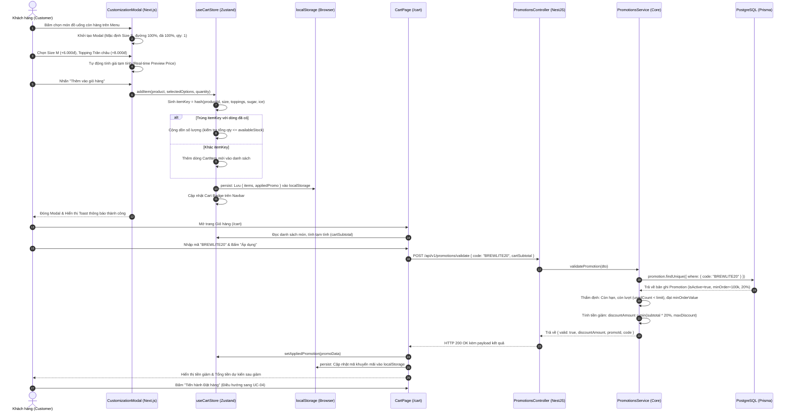

# BREWLITE – ĐẶC TẢ CHI TIẾT USE CASE TRỌNG TÂM: UC-02

- **Học phần:** Công nghệ Phần mềm (SWE 2026)
- **Đề tài:** BrewLite – Requirements to Deployment (Ver 1.0)
- **Tài liệu:** `docs/requirements/usecase-cart-promotion-spec.md`
- **Giai đoạn:** Task 1.3 – Đặc tả chi tiết Use Case Trọng tâm (Use Case Detailed Specification)
- **Mã Use Case:** `UC-02`
- **Tên Use Case:** **Tùy biến Đồ uống, Quản lý Giỏ hàng và Áp mã Khuyến mãi (`Promotion`)**
- **Thành viên phụ trách:** **2. Quỳnh (Dev Team)**
- **Phân hệ chức năng liên kết:** Chức năng 2 (`FR-03`, `FR-09`)
- **Truy vết hệ thống:** Kế thừa từ `context-and-scope.md` (MVP-02), `srs-summary.md` (`FR-03`, `FR-09`, `BR-03.1–8`, `BR-09.1–7`, `AC-03.01–12`, `AC-09.01–10`). Bàn giao trực tiếp dữ liệu đầu vào cho Chức năng 4 (Chiến – `UC-04: Đặt đơn hàng & Khóa kho nguyên vật liệu`).

---

## 1. Thông tin Định danh & Thuộc tính Use Case UC-02

| Thuộc tính | Chi tiết Đặc tả Nghiệp vụ & Kỹ thuật |
| :--- | :--- |
| **Mã Use Case** | **`UC-02`** |
| **Tên Use Case** | **Tùy biến Đồ uống, Quản lý Giỏ hàng và Áp mã Khuyến mãi (`Promotion`)** |
| **Phân hệ / Module** | Chức năng 2 (Tùy biến, Giỏ hàng Zustand & Khuyến mãi NestJS) |
| **Actor chính (Primary)** | **Khách hàng (`Customer / Guest`):** Bao gồm cả khách vãng lai chưa đăng nhập và khách hàng thành viên đã có tài khoản hệ thống. |
| **Actor hỗ trợ (Secondary)** | • **Next.js Client Presentation Layer:** Quản trị giao diện Modal tùy biến (`ProductCustomizationModal`) và trang Giỏ hàng (`/cart`).<br>• **Zustand Client Store (`useCartStore`):** Lưu trữ giỏ hàng trong bộ nhớ Client, tự động đồng bộ bền vững với `localStorage`.<br>• **NestJS Backend Promotions Module:** Cung cấp endpoint thẩm định mã `POST /api/v1/promotions/validate`.<br>• **PostgreSQL Database Engine:** Nguồn dữ liệu CSDL có thẩm quyền lưu trữ bảng `Product`, `Promotion`, bảng giá Size và Topping qua Prisma ORM. |
| **Mục tiêu Use Case (Goal)** | Cho phép khách hàng tùy biến khẩu vị món đồ uống theo ý muốn, quản lý số lượng và danh mục món trong giỏ hàng một cách mượt mà và bền vững, đồng thời thẩm định mã giảm giá hợp lệ để nắm rõ tổng tiền dự kiến trước khi chuyển giao sang bước Đặt hàng chính thức (`UC-04`). |
| **Trigger (Sự kiện kích hoạt)** | 1. Khách hàng nhấp chọn một món đồ uống bất kỳ còn hàng trên Thực đơn (Menu).<br>2. Khách hàng nhấp vào biểu tượng Giỏ hàng trên thanh điều hướng (Navbar / Header). |
| **Tiền điều kiện (Pre-conditions)** | 1. Món đồ uống được chọn đang mở bán (`isAvailable == true`) và còn số lượng phục vụ khả dụng (`stock > 0` hoặc nguyên vật liệu pha chế đủ định mức).<br>2. Trình duyệt của khách hàng hỗ trợ tính năng Web Storage (`localStorage`) để lưu trạng thái giỏ hàng.<br>3. Hệ thống Backend API hoạt động bình thường, endpoint `GET /api/v1/health` phản hồi mã `HTTP 200 OK`. |
| **Hậu điều kiện thành công (Post-conditions)** | 1. Giỏ hàng Client cập nhật danh mục món kèm đúng cấu hình (Size, Topping, Đường, Đá), số lượng nguyên dương, đơn giá và tạm tính hiển thị chuẩn xác.<br>2. Dữ liệu giỏ hàng được đồng bộ bền vững vào `localStorage` qua middleware `persist` của Zustand, không bị mất mát khi tải lại trang (F5) hoặc mở tab mới.<br>3. Huy hiệu số lượng (Cart Badge) trên thanh điều hướng cập nhật tức thời tổng số ly đồ uống ($\sum \text{quantity}$).<br>4. Nếu áp dụng Voucher hợp lệ: Hệ thống ghi nhận mã, hiển thị số tiền được giảm (`discountAmount`) và tổng tiền dự kiến sau chiết khấu.<br>5. Toàn bộ thông tin giỏ hàng được cấu trúc thành DTO chuẩn sẵn sàng chuyển giao cho quy trình Checkout (`UC-04: POST /api/v1/orders`). |
| **Bảo đảm khi thất bại (Failure Guarantees)** | 1. **Bảo toàn dữ liệu cục bộ:** Các thao tác lỗi (nhập voucher sai, mạng chập chờn khi gọi validate) tuyệt đối không làm mất các món đang có trong giỏ hàng.<br>2. **Không khóa tài nguyên sớm:** Ở cấp độ `UC-02`, hệ thống không khóa giữ chỗ tồn kho (No Cart Reservation) và không trừ lượt dùng của Voucher (`usedCount` giữ nguyên). Tài nguyên chỉ bị khóa an toàn trong Database Transaction ở `UC-04`.<br>3. **Chống sập ứng dụng (Crash-free):** Nếu dữ liệu trong `localStorage` bị hỏng cấu trúc, Zustand tự động dọn sạch về giỏ hàng rỗng an toàn mà không làm trắng trang. |

---

## 2. Bối cảnh Kiến trúc & Nguyên tắc Single Source of Truth

Hệ thống BrewLite áp dụng kiến trúc phân tầng với sự phân định ranh giới trách nhiệm rõ ràng giữa Client State và Server Business Logic:

```text
+----------------------------------------------------------------------------------------------------+
|                      TẦNG GIAO DIỆN CLIENT (Next.js 16 App Router & Zustand Store)                  |
|                                                                                                    |
|  [Khách hàng] ---> ProductCustomizationModal: Chọn Size S/M/L, Topping, Đường/Đá, Số lượng         |
|               ---> Tính giá tạm tính Tức thời (UI Optimistic Preview):                              |
|                    unitPrice = basePrice + sizePrice + sum(toppingPrices)                          |
|               ---> useCartStore (Zustand): Sinh composite itemKey, Gộp dòng thông minh             |
|               ---> persist Middleware: Ghi nhớ vào localStorage của trình duyệt                    |
|               ---> Cart Badge: Hiển thị tổng số ly trên Navbar theo thời gian thực                 |
|               ---> Trang Giỏ hàng (/cart): Nhập Voucher -> Gửi POST /api/v1/promotions/validate    |
+----------------------------------------------------------------------------------------------------+
                                                  |
                                                  | HTTP POST /api/v1/promotions/validate
                                                  | (Kiểm tra điều kiện & Tính tiền giảm dự kiến)
                                                  v
+----------------------------------------------------------------------------------------------------+
|                  TẦNG NGHIỆP VỤ MÁY CHỦ (NestJS Modular Monolith - Promotions Module)               |
|                                                                                                    |
|  PromotionsController ---> ValidationPipe (Kiểm tra DTO đầu vào)                                   |
|                       ---> PromotionsService (Business Logic Layer):                               |
|                            1. Đối soát mã trong PostgreSQL: isActive == true                       |
|                            2. Kiểm tra khoảng thời gian hiệu lực: startDate <= now <= endDate      |
|                            3. Kiểm tra giới hạn lượt dùng: usedCount < usageLimit                  |
|                            4. Kiểm tra đơn hàng tối thiểu: cartSubtotal >= minOrderValue           |
|                            5. Tính số tiền giảm: PERCENTAGE (trần maxDiscount) HOẶC FIXED_AMOUNT   |
|                            6. TUYỆT ĐỐI KHÔNG TĂNG usedCount (Read-only Calculation)               |
|                       ---> Trả về HTTP 200 OK kèm { discountAmount, valid: true }                 |
+----------------------------------------------------------------------------------------------------+
                                                  |
                                                  | Bấm "Tiến hành Đặt hàng" (Chuyển tiếp UC-04)
                                                  v
+----------------------------------------------------------------------------------------------------+
|                 CHUYỂN GIAO SANG UC-04: KHỞI TẠO ĐƠN HÀNG & KHÓA KHO NGUYÊN LIỆU (Chiến)           |
|                                                                                                    |
|  POST /api/v1/orders ---> Backend BỎ QUA mọi giá tiền Client gửi, tính lại 100% từ CSDL gốc        |
|                      ---> prisma.$transaction: Trừ kho Ingredient (Optimistic Lock)                |
|                      ---> Tăng usedCount Voucher & Tạo bản ghi Order (PENDING)                     |
+----------------------------------------------------------------------------------------------------+
```

> [!IMPORTANT]
> **Nguyên tắc Kiến trúc Bắt buộc (Server-Authoritative Pricing):** Mọi giá tiền hiển thị trên Modal và Giỏ hàng ở `UC-02` đều mang tính chất **Tạm tính (Preview)** phục vụ trải nghiệm người dùng. Khi chuyển sang `UC-04`, Backend NestJS độc lập truy vấn lại toàn bộ giá gốc, phụ thu và voucher từ CSDL bên trong một Database Transaction có Optimistic Locking.

---

## 3. Sơ đồ Use Case & Phân rã Use Case Thành phần

### 3.1 Sơ đồ Use Case (PlantUML Diagram)
- **Tệp mã nguồn PlantUML:** [`docs/diagrams/uc-02-cart-promotion.puml`](../diagrams/uc-02-cart-promotion.puml)
- **Tệp ảnh kết xuất SVG (Chuẩn đơn sắc Monochrome):** [`docs/diagrams/uc-02-cart-promotion.svg`](../diagrams/uc-02-cart-promotion.svg)


### 3.2 Bảng Phân rã Use Case Con & Quan hệ Phụ thuộc

| Thành phần Use Case | Tên Use Case / Hành động | Kiểu Quan hệ | Mô tả Ý nghĩa & Điều kiện Kích hoạt |
| :--- | :--- | :--- | :--- |
| **System Boundary** | **UC-02: Phân hệ Tùy biến đồ uống, Quản lý giỏ hàng và Khuyến mãi** | Boundary Box | Ranh giới hệ thống phân hệ Chức năng 2, bao bọc toàn bộ các Use Case thành phần. |
| **UC-02.1** | **Tùy biến đồ uống (Size, Topping, Đường, Đá)** | Primary Use Case | Khách hàng tương tác trực tiếp: tùy chọn kích cỡ, thành phần topping và khẩu vị cá nhân cho sản phẩm. |
| -- | *Tính giá tạm tính theo tùy chọn* | `<<include>>` (thuộc UC-02.1) | Bắt buộc tính lại giá tức thời trên modal mỗi khi khách hàng click đổi bất kỳ tùy chọn nào. |
| **Thêm món** | **Thêm món vào giỏ hàng** | `<<extend>>` (vào UC-02.1) | Điểm mở rộng sau khi tùy biến món khi [Khách hàng xác nhận thêm vào giỏ]. Tách riêng để phân biệt rõ hành vi tùy biến và hành vi lưu giỏ. |
| -- | *Kiểm tra tồn kho khả dụng* | `<<include>>` (thuộc Thêm món & UC-02.2) | Bắt buộc kiểm soát tổng số lượng đặt của món không vượt quá số lượng khả dụng. |
| **UC-02.2** | **Quản lý giỏ hàng (Xem giỏ, điều chỉnh số lượng, xóa món)** | Primary Use Case | Khách hàng tương tác trực tiếp: duyệt danh sách món, tăng/giảm số lượng hoặc xóa dòng sản phẩm. |
| **UC-02.3** | **Áp dụng mã khuyến mãi (`Promotion` Voucher)** | `<<extend>>` (vào UC-02.2) | Kích hoạt tại điểm mở rộng từ giỏ hàng khi [Khách hàng nhập mã khuyến mãi]. |
| -- | *Kiểm tra điều kiện khuyến mãi* | `<<include>>` (thuộc UC-02.3) | Bắt buộc thẩm định điều kiện hạn dùng, số lượt và giá trị tối thiểu từ CSDL. |
| **UC-02.4** | **Hủy áp dụng mã khuyến mãi** | `<<extend>>` (vào UC-02.2) | Kích hoạt tại điểm mở rộng từ giỏ hàng khi [Khách hàng yêu cầu hủy mã khuyến mãi]. |

---

## 4. Luồng Sự kiện Chi tiết (Flow of Events)

### 4.1 Luồng Sự kiện Chính (Main Success Scenario)



#### Các bước diễn tiến chi tiết:
1. **Khởi tạo tùy biến:** Khách hàng duyệt Thực đơn (`/menu`), nhấp chọn một món đồ uống còn bán (`isAvailable == true`) và còn số lượng phục vụ. Hệ thống mở cửa sổ giao diện `ProductCustomizationModal`.
2. **Cấu hình tùy chọn:** Giao diện hiển thị thông tin sản phẩm (Tên món, hình ảnh, mô tả, giá gốc). Khách hàng thực hiện các lựa chọn:
   - Chọn Kích cỡ (`Size`): **Size S** (+0đ), **Size M** (+6.000đ) hoặc **Size L** (+10.000đ). Mặc định chọn Size S.
   - Chọn `Topping`: Chọn một hoặc nhiều loại Topping (Trân châu trắng +8.000đ, Kem cheese +10.000đ, Thạch đào +7.000đ,...).
   - Chọn Khẩu vị: Điều chỉnh tỷ lệ Đường (0%, 30%, 50%, 70%, 100%) và Đá (0%, 30%, 50%, 70%, 100%).
   - Điều chỉnh số lượng: Mặc định là 1 ly.
3. **Cập nhật giá tức thời:** Giao diện tự động tính toán lại đơn giá theo công thức:
   $$\text{unitPrice} = \text{basePrice} + \text{sizePrice} + \sum \text{toppingPrices}$$
   $$\text{previewLineTotal} = \text{unitPrice} \times \text{quantity}$$
   Số tiền hiển thị trên nút bấm được cập nhật tức thời với độ trễ `< 50ms`.
4. **Xác nhận thêm vào giỏ:** Khách hàng nhấn nút **"Thêm vào giỏ hàng – [Số tiền]đ"**.
5. **Xử lý Store Zustand & Gộp dòng:** Store `useCartStore` tiếp nhận yêu cầu:
   - Sinh chuỗi khóa tổng hợp duy nhất: `itemKey = hash(productId, sizeId, sortedToppingIds, sugar, ice)`.
   - Kiểm tra tồn kho: Tính toán tổng số lượng của sản phẩm này trên toàn bộ giỏ hàng cộng với số lượng dự định thêm mới. Nếu $\le \text{availableStock}$, cho phép tiếp tục.
   - Nếu đã tồn tại dòng có cùng `itemKey`: Thực hiện cộng dồn số lượng: $\text{existingItem.quantity} += \text{quantity}$.
   - Nếu chưa tồn tại: Tạo bản ghi `CartItem` mới và đưa vào mảng `items`.
6. **Lưu trữ bền vững & Cập nhật UI:**
   - Middleware `persist` của Zustand tự động tuần tự hóa (serialize) state giỏ hàng và ghi xuống `localStorage` của trình duyệt.
   - Huy hiệu giỏ hàng (Cart Badge) trên Navbar cập nhật số hiển thị bằng tổng số ly ($\sum \text{item.quantity}$).
   - Modal đóng lại và hiển thị thông báo nhẹ (Toast) thành công.
7. **Truy cập giỏ hàng:** Khách hàng nhấp vào biểu tượng giỏ hàng trên thanh điều hướng để chuyển đến trang `/cart`.
8. **Hiển thị danh sách giỏ hàng:** Trang `/cart` hiển thị trực quan từng dòng món ăn kèm chi tiết Size, Topping, khẩu vị, số lượng, thành tiền từng dòng và tổng tiền tạm tính (`cartSubtotal`).
9. **Nhập mã khuyến mãi:** Khách hàng nhập mã giảm giá (ví dụ: `BREWLITE20`) vào ô nhập liệu và nhấn nút **"Áp dụng"**.
10. **Gọi API Thẩm định:** Giao diện hiển thị trạng thái đang xử lý (`Loading spinner`) trên nút bấm, vô hiệu hóa việc bấm liên tục và gửi yêu cầu:
    ```http
    POST /api/v1/promotions/validate HTTP/1.1
    Host: api.brewlite.com
    Content-Type: application/json

    {
      "code": "BREWLITE20",
      "cartSubtotal": 120000
    }
    ```
11. **Xử lý thẩm định tại Backend NestJS:**
    - `PromotionsController` tiếp nhận và kích hoạt `ValidationPipe`.
    - `PromotionsService` gọi Prisma truy vấn bảng `Promotion` theo `code` (không phân biệt chữ hoa thường).
    - Kiểm tra 4 điều kiện cốt lõi: `isActive == true`, thời gian hiện tại nằm trong $[\text{startDate}, \text{endDate}]$, số lượt đã dùng $\text{usedCount} < \text{usageLimit}$ và giá trị đơn hàng $\text{cartSubtotal} \ge \text{minOrderValue}$.
    - Tính toán số tiền chiết khấu theo loại `PERCENTAGE` hoặc `FIXED_AMOUNT`. Tuyệt đối không tăng cột `usedCount` (Validation là thao tác đọc thuần túy).
12. **Phản hồi và Cập nhật Chiết khấu:** API trả về mã thành công `HTTP 200 OK` kèm kết quả chiết khấu. Giao diện Client cập nhật thông tin mã đã áp dụng vào Zustand Store, hiển thị số tiền được giảm (`-24.000đ`) và tổng tiền dự kiến sau giảm (`96.000đ`).
13. **Kết thúc Use Case:** Khách hàng kiểm tra lại toàn bộ thông tin giỏ hàng và nhấn nút **"Tiến hành Đặt hàng"** để chuyển giao toàn bộ cấu hình sang màn hình Checkout (`UC-04`).

---

### 4.2 Các Luồng Thay Thế (Alternative Flows - AF)

#### AF-01: Thêm món có cùng cấu hình với dòng đã có trong giỏ hàng (Gộp số lượng)
- **Điểm rẽ:** Tại Bước 5 của Luồng chính, khi khách hàng thêm một món có `productId`, `size`, `toppings`, đường và đá hoàn toàn trùng khớp với một dòng sản phẩm đã tồn tại trong giỏ.
- **Xử lý:**
  1. Hệ thống phát hiện trùng `itemKey`.
  2. Hệ thống kiểm tra điều kiện tồn kho: $(\text{item.quantity} + \text{addedQty}) \le \text{availableStock}$.
  3. Hệ thống tăng số lượng của dòng sản phẩm đó: $\text{item.quantity} += \text{addedQty}$.
  4. Hệ thống cập nhật lại thành tiền của dòng và tạm tính giỏ hàng, không sinh thêm dòng mới trong danh sách.
  5. Luồng quay lại Bước 6 của Luồng chính.

#### AF-02: Thay đổi số lượng sản phẩm trực tiếp tại trang Giỏ hàng
- **Điểm rẽ:** Tại Bước 8 của Luồng chính, khách hàng bấm nút tăng (`+`) hoặc giảm (`-`) số lượng trên một dòng sản phẩm trong trang `/cart`.
- **Xử lý:**
  1. **Khi bấm `+`:** Hệ thống kiểm tra tổng số ly của món đó so với tồn kho. Nếu còn đủ, tăng số lượng thêm 1 (`quantity = quantity + 1`).
  2. **Khi bấm `-`:** Nếu số lượng hiện tại $> 1$, hệ thống giảm số lượng đi 1 (`quantity = quantity - 1`).
  3. Cập nhật thành tiền dòng, tổng tạm tính và đồng bộ xuống `localStorage`.
  4. Nếu giỏ hàng đang có mã khuyến mãi được áp dụng, hệ thống kích hoạt tự động kiểm tra lại điều kiện `minOrderValue` (Xem thêm AF-08).

#### AF-03: Giảm số lượng món về 0 (Xóa món có xác nhận)
- **Điểm rẽ:** Khi dòng sản phẩm đang có số lượng bằng 1 và khách hàng bấm nút giảm (`-`), hoặc khách hàng bấm vào biểu tượng thùng rác (Xóa món).
- **Xử lý:**
  1. Hệ thống không xóa ngay mà hiển thị hộp thoại cảnh báo: *"Bạn có chắc chắn muốn xóa món này khỏi giỏ hàng?"*.
  2. Nếu khách hàng bấm **"Hủy bỏ"**: Hộp thoại đóng lại, dòng sản phẩm được giữ nguyên.
  3. Nếu khách hàng bấm **"Xác nhận xóa"**:
     - Hệ thống loại bỏ hoàn toàn `CartItem` đó ra khỏi mảng `items`.
     - Cập nhật lại Cart Badge trên Navbar.
     - Nếu giỏ hàng trở nên rỗng (`items.length == 0`), hệ thống xóa mã voucher đang lưu và hiển thị trạng thái Giỏ hàng rỗng.
     - Đồng bộ trạng thái mới xuống `localStorage`.

#### AF-04: Xóa toàn bộ giỏ hàng (Clear Cart)
- **Điểm rẽ:** Khách hàng bấm nút "Xóa tất cả" tại trang giỏ hàng.
- **Xử lý:**
  1. Hệ thống hiển thị hộp thoại xác nhận dọn sạch giỏ hàng.
  2. Sau khi xác nhận, Zustand store thực thi `clearCart()`: mảng `items` trở về rỗng `[]`, `appliedPromotion` trở về `null`.
  3. Xóa dữ liệu trong `localStorage` và hiển thị màn hình Empty Cart.

#### AF-05: Khách hàng chủ động Hủy áp dụng mã khuyến mãi (Remove Voucher)
- **Điểm rẽ:** Khách hàng đang có mã khuyến mãi được áp dụng thành công nhưng đổi ý muốn gỡ mã (bấm nút "Hủy mã" hoặc biểu tượng dấu X cạnh tên mã).
- **Xử lý:**
  1. Giao diện Client gọi action `removePromotion()` của `useCartStore`.
  2. Thuộc tính `appliedPromotion` được gán về `null`, số tiền giảm giá đưa về `0đ`.
  3. Tổng tiền dự kiến được tính lại bằng đúng giá trị tạm tính `cartSubtotal`.
  4. Cập nhật `localStorage` và thông báo cho người dùng: *"Đã hủy áp dụng mã khuyến mãi"*.

#### AF-06: Khách hàng Thay đổi sang một Mã khuyến mãi khác
- **Điểm rẽ:** Giỏ hàng đang có mã voucher A hợp lệ, khách hàng nhập mã voucher B vào ô và bấm "Áp dụng".
- **Xử lý:**
  1. Hệ thống gửi yêu cầu thẩm định mã B lên API `POST /api/v1/promotions/validate`.
  2. Nếu mã B hợp lệ: Hệ thống ghi đè mã B vào store, tính lại số tiền giảm theo mã B và hủy bỏ mã A (Không cộng dồn 2 mã).
  3. Nếu mã B không hợp lệ: Hệ thống báo lỗi mã B và **giữ nguyên** mã A hợp lệ trước đó.

#### AF-07: Người dùng Tải lại trang (F5) hoặc Mở lại trình duyệt (Hydratation)
- **Điểm rẽ:** Người dùng nhấn F5 tại bất kỳ trang nào hoặc tắt trình duyệt rồi truy cập lại.
- **Xử lý:**
  1. Khi ứng dụng Next.js khởi tạo tại Client, Zustand Middleware đọc dữ liệu đã serialize từ `localStorage`.
  2. Hệ thống nạp lại đầy đủ danh sách món, cấu hình Size, Topping và mã voucher đang áp dụng.
  3. Giao diện Cart Badge và Giỏ hàng hiển thị đầy đủ thông tin cũ mà không bị mất dữ liệu.

---

### 4.3 Các Luồng Ngoại Lệ (Exception Flows - EF)

#### EF-01: Sản phẩm đã Hết hàng hoặc Ngừng kinh doanh khi mở Modal
- **Điều kiện kích hoạt:** Khách hàng bấm chọn một món đồ uống trên Menu nhưng tại thời điểm đó món có `stock == 0` hoặc bị quản trị viên đặt `isAvailable = false`.
- **Xử lý:**
  1. Nút chọn món trên Menu đã bị vô hiệu hóa kèm nhãn **"Hết hàng"** từ Chức năng 1 (FR-01).
  2. Nếu khách hàng cố tình can thiệp mở modal qua URL/Script, modal hiển thị thông báo lỗi: *"Sản phẩm hiện đang tạm ngưng phục vụ"* và khóa nút "Thêm vào giỏ hàng".
  3. Use Case kết thúc, không thêm món vào giỏ.

#### EF-02: Tăng số lượng vượt quá Tồn kho khả dụng của sản phẩm
- **Điều kiện kích hoạt:** Khách hàng bấm nút `+` trên modal hoặc trong giỏ hàng khi tổng số lượng của sản phẩm đó đã bằng đúng `availableStock`.
- **Xử lý:**
  1. Hệ thống chặn thao tác tăng số lượng, giữ nguyên số lượng hiện tại.
  2. Nút `+` chuyển sang trạng thái vô hiệu hóa (`disabled`).
  3. Hệ thống hiển thị thông báo cảnh báo (Toast hoặc Alert): *"Rất tiếc, chỉ còn X sản phẩm trong kho"*.

#### EF-03: Mã khuyến mãi Không tồn tại hoặc Bị vô hiệu hóa (`isActive == false`)
- **Điều kiện kích hoạt:** Khách hàng nhập mã voucher không có trong CSDL hoặc mã đã bị Admin tắt kích hoạt.
- **Xử lý:**
  1. API `POST /api/v1/promotions/validate` truy vấn không thấy bản ghi hoặc bản ghi có `isActive == false`.
  2. API trả về mã lỗi `HTTP 400 Bad Request`:
     ```json
     {
       "statusCode": 400,
       "message": "Mã khuyến mãi không tồn tại hoặc đã bị vô hiệu hóa.",
       "error": "Bad Request"
     }
     ```
  3. Giao diện Client hiển thị viền đỏ quanh ô nhập liệu và hiển thị thông điệp lỗi rõ ràng. Mức giảm giá giữ nguyên 0đ.

#### EF-04: Mã khuyến mãi Chưa đến ngày áp dụng hoặc Đã hết hạn sử dụng
- **Điều kiện kích hoạt:** Thời điểm gửi request `serverNow < startDate` hoặc `serverNow > endDate`.
- **Xử lý:**
  1. `PromotionsService` đối soát thời gian của máy chủ API với khoảng hiệu lực của mã.
  2. API trả về mã lỗi `HTTP 400 Bad Request`:
     ```json
     {
       "statusCode": 400,
       "message": "Mã khuyến mãi đã hết hạn sử dụng.",
       "error": "Bad Request"
     }
     ```
  3. Giao diện Client thông báo mã đã hết hạn sử dụng, không áp dụng chiết khấu.

#### EF-05: Mã khuyến mãi Đã hết lượt sử dụng trên toàn hệ thống
- **Điều kiện kích hoạt:** Cột `usedCount >= usageLimit` trong bảng `Promotion`.
- **Xử lý:**
  1. `PromotionsService` phát hiện số lượt dùng thực tế đã chạm ngưỡng cho phép của chiến dịch.
  2. API trả về lỗi `HTTP 400 Bad Request` kèm thông báo: *"Mã khuyến mãi đã hết lượt sử dụng."*.
  3. Client hiển thị thông báo lỗi và không áp dụng giảm giá.

#### EF-06: Giỏ hàng Chưa đạt Giá trị Đơn hàng Tối thiểu (`minOrderValue`)
- **Điều kiện kích hoạt:** Giá trị tạm tính `cartSubtotal` nhỏ hơn giá trị `minOrderValue` của mã voucher.
- **Xử lý:**
  1. `PromotionsService` phát hiện $\text{cartSubtotal} < \text{minOrderValue}$.
  2. API trả về lỗi `HTTP 400 Bad Request`:
     ```json
     {
       "statusCode": 400,
       "message": "Đơn hàng tối thiểu phải từ 100.000đ để áp dụng mã khuyến mãi này.",
       "error": "Bad Request"
     }
     ```
  3. Giao diện hiển thị cảnh báo hướng dẫn: *"Bạn cần mua thêm X đ để sử dụng mã này"*.

#### EF-07: Giỏ hàng Biến động làm Mất tính Hợp lệ của Mã đang áp dụng (Auto Invalidation)
- **Điều kiện kích hoạt:** Khách hàng đã áp mã `BREWLITE20` thành công (yêu cầu đơn tối thiểu 100.000đ khi tạm tính đang là 110.000đ). Sau đó, khách hàng xóa bớt một món đồ uống làm tạm tính giảm xuống còn 75.000đ.
- **Xử lý:**
  1. Zustand store lắng nghe biến động của `items` và tự động kích hoạt hàm đối soát `revalidatePromotion()`.
  2. Hệ thống nhận diện $\text{newSubtotal} < \text{appliedPromo.minOrderValue}$.
  3. Hệ thống tự động gỡ bỏ mã khuyến mãi (`appliedPromotion = null`), đưa tiền giảm về 0đ.
  4. Hiển thị thông báo cảnh báo màu vàng cho người dùng: *"Mã khuyến mãi BREWLITE20 đã tự động bị hủy do đơn hàng không còn đủ giá trị tối thiểu 100.000đ"*.

#### EF-08: Sự cố Kết nối Mạng hoặc Máy chủ API Gặp lỗi (`HTTP 500 / Network Error`)
- **Điều kiện kích hoạt:** Thiết bị khách hàng mất kết nối Internet hoặc dịch vụ Backend NestJS gặp sự cố khi đang bấm "Áp dụng" mã.
- **Xử lý:**
  1. Thư viện gọi API (Fetch/Axios) bắt lỗi timeout hoặc lỗi kết nối.
  2. Nút "Áp dụng" thoát khỏi trạng thái loading.
  3. Giao diện hiển thị thông báo: *"Không thể kết nối đến máy chủ. Vui lòng kiểm tra đường truyền và thử lại."*.
  4. Giỏ hàng và các món ăn đã chọn được giữ nguyên vẹn 100%, không bị ảnh hưởng.

#### EF-09: Dữ liệu Giỏ hàng trong `localStorage` bị Lỗi Cú pháp hoặc Hỏng Cấu trúc
- **Điều kiện kích hoạt:** Người dùng hoặc tiện ích mở rộng trình duyệt vô tình chỉnh sửa giá trị chuỗi JSON trong key lưu trữ của Zustand thành định dạng không hợp lệ.
- **Xử lý:**
  1. Middleware `persist` của Zustand khi thực hiện `JSON.parse` phát hiện ngoại lệ cú pháp (`SyntaxError`).
  2. Cơ chế bọc lỗi (`onRehydrateStorage`) bắt ngoại lệ và tự động xóa key bị lỗi trong `localStorage`.
  3. Hệ thống khởi tạo lại giỏ hàng rỗng sạch sẽ (`items: [], appliedPromotion: null`).
  4. Ứng dụng hoạt động bình thường, không xảy ra hiện tượng Crash giao diện hoặc màn hình trắng (White Screen).

---

## 5. Hợp đồng Dữ liệu & Thiết kế Kỹ thuật Chi tiết

### 5.1 Client Domain Model (TypeScript Interfaces – Zustand Store)

```typescript
// apps/web/src/store/useCartStore.ts

export type SizeOption = 'S' | 'M' | 'L';

export interface ToppingOption {
  id: string;
  name: string;
  price: number;
}

export interface CustomizationOptions {
  size: SizeOption;
  sizePrice: number; // S: 0, M: 6000, L: 10000
  toppings: ToppingOption[];
  sugarLevel: number; // 0, 30, 50, 70, 100
  iceLevel: number; // 0, 30, 50, 70, 100
}

export interface CartItem {
  itemKey: string; // Hash duy nhất của cấu hình
  productId: string;
  productName: string;
  productImage: string;
  basePrice: number;
  options: CustomizationOptions;
  unitPrice: number; // basePrice + sizePrice + sum(toppings)
  quantity: number;
  lineSubtotal: number; // unitPrice * quantity
}

export interface AppliedPromotion {
  id: string;
  code: string;
  discountType: 'PERCENTAGE' | 'FIXED_AMOUNT';
  discountValue: number;
  minOrderValue: number;
  maxDiscountAmount: number | null;
  calculatedDiscount: number;
}

export interface CartStoreState {
  items: CartItem[];
  appliedPromotion: AppliedPromotion | null;
  
  // Actions
  addItem: (product: any, options: CustomizationOptions, quantity: number) => void;
  updateQuantity: (itemKey: string, delta: number) => void;
  removeItem: (itemKey: string) => void;
  clearCart: () => void;
  applyPromotion: (promotion: AppliedPromotion) => void;
  removePromotion: () => void;
  
  // Computed Getters
  getCartSubtotal: () => number;
  getDiscountAmount: () => number;
  getFinalTotal: () => number;
  getTotalItemsCount: () => number;
}
```

### 5.2 Backend Domain Entity (NestJS / Prisma Schema – Promotion Entity)

```prisma
// apps/api/prisma/schema.prisma

enum DiscountType {
  PERCENTAGE
  FIXED_AMOUNT
}

model Promotion {
  id                String       @id @default(uuid())
  code              String       @unique
  description       String?
  discountType      DiscountType
  discountValue     Decimal      @db.Decimal(10, 2)
  minOrderValue     Decimal      @default(0) @db.Decimal(10, 2)
  maxDiscountAmount Decimal?     @db.Decimal(10, 2)
  usageLimit        Int          @default(100)
  usedCount         Int          @default(0)
  startDate         DateTime
  endDate           DateTime
  isActive          Boolean      @default(true)
  createdAt         DateTime     @default(now())
  updatedAt         DateTime     @updatedAt

  orders            Order[]
}
```

### 5.3 Chi tiết Hợp đồng Endpoint API: Thẩm định Khuyến mãi (`POST /api/v1/promotions/validate`)

#### Yêu cầu gửi lên (Request Specification):
- **URL:** `/api/v1/promotions/validate`
- **Method:** `POST`
- **Content-Type:** `application/json`
- **Request DTO Body:**
  ```json
  {
    "code": "BREWLITE20",
    "cartSubtotal": 120000
  }
  ```

#### Phản hồi thành công (HTTP 200 OK):
```json
{
  "valid": true,
  "promoId": "8f9a2b1c-3d4e-5f6a-7b8c-9d0e1f2a3b4c",
  "code": "BREWLITE20",
  "description": "Giảm 20% cho đơn hàng từ 100.000đ (Tối đa 30.000đ)",
  "discountType": "PERCENTAGE",
  "discountValue": 20,
  "discountAmount": 24000,
  "previewTotal": 96000
}
```

#### Phản hồi lỗi nghiệp vụ (HTTP 400 Bad Request):
```json
{
  "statusCode": 400,
  "message": "Đơn hàng tối thiểu phải từ 100.000đ để áp dụng mã khuyến mãi này.",
  "error": "Bad Request"
}
```

---

## 6. Ràng buộc Kỹ thuật, Hiệu năng & Tiêu chuẩn Phi chức năng

1. **Hiệu năng Giao diện (Client-side Latency):** Thao tác bấm đổi Size, chọn Topping và cập nhật giá tạm tính trên Modal phải hoàn thành hiển thị trong vòng **dưới 50ms**.
2. **Hiệu năng Máy chủ (Server Latency):** Thời gian phản hồi của endpoint `POST /api/v1/promotions/validate` (bao gồm truy vấn CSDL PostgreSQL và tính toán chiết khấu) phải đạt **dưới 200ms** ở mức tải tiêu chuẩn.
3. **Tiết kiệm Dung lượng Lưu trữ (Storage Efficiency):** Payload lưu trữ trạng thái giỏ hàng trong `localStorage` được tinh gọn tối đa (chỉ lưu các trường định danh và cấu hình thiết yếu), đảm bảo kích thước lưu trữ luôn **dưới 50KB** (rất an toàn so với hạn mức 5MB của trình duyệt).
4. **Chuẩn hóa Đầu vào:** Chuỗi ký tự mã khuyến mãi tự động được loại bỏ khoảng trắng thừa (`trim()`) và chuyển sang chữ hoa (`toUpperCase()`) trước khi gửi lên máy chủ hoặc thẩm định.
5. **Độ tin cậy Bền vững:** Không bị phụ thuộc vào phiên đăng nhập; khách hàng chưa đăng nhập (`Guest`) vẫn có thể tùy biến món và lưu giỏ hàng bình thường. Khi chuyển sang bước Checkout yêu cầu đăng nhập, giỏ hàng vẫn được bảo toàn nguyên vẹn sau khi đăng nhập thành công nhờ cơ chế chuyển hướng `redirect=/checkout`.

---

## 7. Ma trận Truy vết Toàn diện (Full Traceability Matrix)

| Yêu cầu Nghiệp vụ (SRS) | Quy tắc Nghiệp vụ (BR) | Tiêu chí Chấp nhận (AC) | Kịch bản / Luồng Use Case | Thành phần Code Hiện thực (Sprint 2) |
| :--- | :--- | :--- | :--- | :--- |
| **FR-03.1, FR-03.2** | BR-03.1 (Đơn giá/Size) | AC-03.01, AC-03.02 | Luồng chính (Bước 1, 2) | `apps/web/src/components/ProductCustomizationModal.tsx` |
| **FR-03.3, FR-03.4** | BR-03.1 (Topping/Khẩu vị) | AC-03.02 | Luồng chính (Bước 2, 3) | `apps/web/src/components/ProductCustomizationModal.tsx` |
| **FR-03.5** | BR-03.1 (Tạm tính tức thời) | AC-03.02 | Luồng chính (Bước 3) | `apps/web/src/components/ProductCustomizationModal.tsx` |
| **FR-03.6, FR-03.7** | BR-03.2 (Composite Key) | AC-03.04, AC-03.05, AC-03.06 | Luồng chính (Bước 5), AF-01 | `apps/web/src/store/useCartStore.ts` |
| **FR-03.8, FR-03.9** | BR-03.6 (Số lượng $\ge 1$) | AC-03.08, AC-03.09 | AF-02, AF-03 | `apps/web/src/app/cart/page.tsx`, `useCartStore.ts` |
| **FR-03.10** | BR-03.3 (Tồn kho khả dụng) | AC-03.07 | EF-02 | `apps/web/src/store/useCartStore.ts` |
| **FR-03.11** | BR-03.4 (Zustand Persist) | AC-03.10, AC-03.12 | Luồng chính (Bước 6), AF-07, EF-09 | `apps/web/src/store/useCartStore.ts` |
| **FR-03.12** | BR-03.7 (Cart Badge) | AC-03.03, AC-03.04 | Luồng chính (Bước 6) | `apps/web/src/components/Navbar.tsx` |
| **FR-09.1, FR-09.2** | BR-09.1 (Nhập Promo) | AC-09.01 | Luồng chính (Bước 9, 10) | `apps/web/src/app/cart/page.tsx` |
| **FR-09.3, FR-09.4** | BR-09.2, BR-09.3 (Validate) | AC-09.01, AC-09.02 | Luồng chính (Bước 11) | `apps/api/src/promotions/promotions.service.ts` |
| **FR-09.5** | BR-09.3 (Hiển thị chiết khấu)| AC-09.01, AC-09.02 | Luồng chính (Bước 12) | `apps/web/src/app/cart/page.tsx` |
| **FR-09.6** | BR-09.2 (Báo lỗi cụ thể) | AC-09.03, 04, 05, 06 | EF-03, EF-04, EF-05, EF-06 | `apps/api/src/promotions/promotions.service.ts` |
| **FR-09.7** | BR-09.1 (Hủy mã) | AC-09.07 | AF-05 | `apps/web/src/store/useCartStore.ts` |
| **FR-09.8** | BR-09.4 (Auto Invalidate) | AC-09.08 | EF-07 | `apps/web/src/store/useCartStore.ts` |
| **FR-09.9** | BR-09.5 (Không tăng usedCount)| AC-09.10 | Luồng chính (Bước 11) | `apps/api/src/promotions/promotions.service.ts` |
| **FR-09.10** | BR-09.1 (1 Voucher duy nhất)| AC-09.01 | AF-06 | `apps/web/src/store/useCartStore.ts` |

---

## 8. Hướng dẫn Kiểm thử & Tiêu chí Nghiệm thu Hoàn thành (DoD)

### 8.1 Bộ Tiêu chí Hoàn thành (Definition of Done - DoD cho Task 1.3)
1. **Đầy đủ Cấu trúc Đặc tả Use Case chuẩn quốc tế:** Tài liệu bao gồm đầy đủ Metadata, Tiền điều kiện, Hậu điều kiện, Failure Guarantees, Sơ đồ Use Case, Luồng chính từng bước, Luồng thay thế (AF-01 đến AF-07), Luồng ngoại lệ (EF-01 đến EF-09), Hợp đồng Dữ liệu DTO và Ma trận truy vết.
2. **Sơ đồ Use Case hợp chuẩn UML 2.5:** Sơ đồ được vẽ chi tiết bằng PlantUML (`.puml`), kết xuất file vector `.svg` chất lượng cao, thể hiện chính xác các mối quan hệ `<<include>>` và `<<extend>>`.
3. **Phân định rõ ranh giới Kiến trúc:** Giải trình rõ ràng nguyên tắc Giá Client chỉ là tạm tính (Preview Non-Authoritative) và việc khóa tồn kho / trừ lượt dùng voucher chỉ được thực hiện ở Backend trong Database Transaction tại `UC-04`.
4. **Tính tương thích và Không xung đột:** Tài liệu phân tách độc lập, sẵn sàng tích hợp với `usecase-checkout-spec.md` (Chiến – `UC-04`) và `usecase-auth-spec.md` (Hiếu – `UC-03`).
