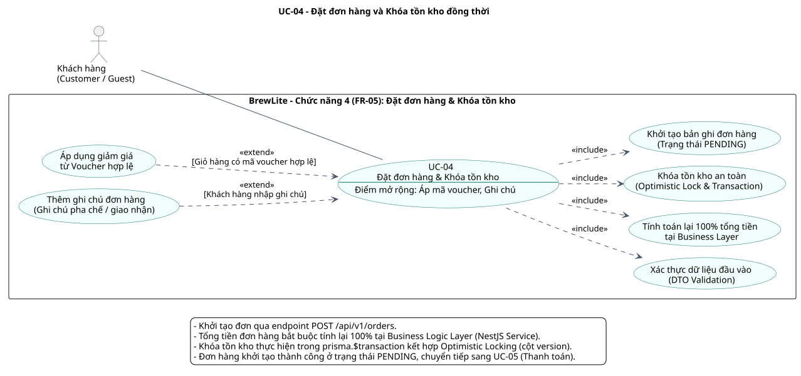

# BrewLite – Đặc tả Use Case Trọng tâm Quy trình Checkout (UC-04 & UC-05)

- **Dự án:** BrewLite – Hệ thống Đặt đồ uống Trực tuyến (Mobile-first / PWA)
- **Tài liệu:** `docs/requirements/usecase-checkout-spec.md`
- **Giai đoạn:** Task 1.3 – Đặc tả Use Case Quy trình Trọng tâm (Checkout Flow)
- **Thành viên phụ trách:**
  - **4. Chiến (Dev Team):** Chủ trì nửa đầu UC trọng tâm – **Mục 4: UC-04: Đặt đơn hàng & Khóa tồn kho đồng thời** (Mục 4.1 & 4.2).
  - **5. Quang (Dev Team):** Chủ trì nửa sau UC trọng tâm – **Mục 5: UC-05: Thanh toán đơn hàng & Chống trừ tiền trùng lặp (`Idempotency-Key`)** (Mục 5.1 & 5.2).
- **Truy vết:** Kế thừa từ `context-and-scope.md` (MVP-04, MVP-05) và `srs-summary.md` (FR-05, FR-06).

---

## Tổng quan Quy trình Checkout Cốt lõi (End-to-End)

Quy trình Checkout trong hệ thống BrewLite là luồng giao dịch có rủi ro nghiệp vụ cao nhất, quyết định doanh thu và trải nghiệm người dùng. Luồng này được thiết kế theo 2 giai đoạn kế thừa tuần tự:

```text
+----------------------------------------------------------------------------------------------------+
|                                GIAI ĐOẠN 1: KHỞI TẠO ĐƠN & KHÓA KHO                                |
|                                       (Chiến phụ trách - UC-04)                                     |
|  [Giỏ hàng] ---> POST /api/v1/orders ---> Validate DTO ---> Tính lại 100% tiền tại Business Layer  |
|                                       ---> prisma.$transaction: Trừ kho (Optimistic Lock)          |
|                                       ---> Lưu Order (PENDING) & OrderItems                         |
+----------------------------------------------------------------------------------------------------+
                                                  |
                                                  v
+----------------------------------------------------------------------------------------------------+
|                                GIAI ĐOẠN 2: THANH TOÁN & CHỐNG TRÙNG LẶP                            |
|                                       (Quang phụ trách - UC-05)                                     |
|  [Đơn PENDING] ---> POST /api/v1/payments ---> Kiểm tra Idempotency-Key UUID                        |
|                                            ---> Mock Payment (Ví điện tử / Thẻ)                     |
|                                            ---> Cập nhật PAID (Thành công) HOẶC CANCELLED & Restock |
+----------------------------------------------------------------------------------------------------+
```

---

## Mục 4: Chức năng 4 – UC-04: Đặt đơn hàng & Khóa tồn kho đồng thời (Chiến)

### 4.1 Sơ đồ Use Case (Use Case Diagram)

- **Actor chính:** Khách hàng (`Customer / Guest`) – Người dùng ứng dụng web BrewLite (bao gồm cả khách vãng lai và thành viên đã đăng nhập).
- **Ranh giới hệ thống:** `BrewLite - Chức năng 4 (FR-05): Đặt đơn hàng & Khóa tồn kho`. Toàn bộ quá trình tính giá, khóa kho và lưu trữ được thực hiện nội bộ trong API Server và Cơ sở dữ liệu PostgreSQL.
- **Tệp nguồn PlantUML:** [`docs/diagrams/uc-04-create-order.puml`](../diagrams/uc-04-create-order.puml)
- **Tệp ảnh kết xuất SVG:** [`docs/diagrams/uc-04-create-order.svg`](../diagrams/uc-04-create-order.svg)

#### Bảng thành phần Use Case và Quan hệ:

| Mã Use Case | Tên Use Case / Thành phần | Kiểu quan hệ | Ý nghĩa nghiệp vụ |
| :--- | :--- | :--- | :--- |
| **UC-04** | **Đặt đơn hàng & Khóa tồn kho đồng thời** | Base Use Case | Điểm vào chính khi khách hàng bấm xác nhận đặt đơn từ màn hình Giỏ hàng / Checkout. |
| **UC-04.1** | **Xác thực dữ liệu đầu vào (DTO Validation)** | `<<include>>` | Bắt buộc kiểm tra tính hợp lệ của danh sách món, số lượng nguyên dương, thông tin giao nhận theo chuẩn `CreateOrderDto`. |
| **UC-04.2** | **Tính toán lại 100% tổng tiền tại Business Layer** | `<<include>>` | Bắt buộc tính lại toàn bộ đơn giá, phụ thu size/topping và voucher discount tại tầng Business Logic Layer (NestJS Service) dựa vào DB gốc, tuyệt đối không dùng giá Client gửi lên. |
| **UC-04.3** | **Khóa tồn kho an toàn (Optimistic Lock & Transaction)** | `<<include>>` | Bắt buộc kiểm tra và trừ tồn kho các món trong `prisma.$transaction` với cơ chế Optimistic Locking (cột `version`) để ngăn chặn bán âm kho (`stock < 0`) khi nhiều khách cùng mua món cuối. |
| **UC-04.4** | **Khởi tạo bản ghi đơn hàng (Trạng thái PENDING)** | `<<include>>` | Bắt buộc sinh mã đơn `#BL-YYYYMMDD-XXXX`, ghi nhận các dòng `OrderItem` và chuyển đơn sang trạng thái `PENDING` sẵn sàng thanh toán. |
| **UC-04.5** | **Áp dụng giảm giá từ Voucher hợp lệ** | `<<extend>>` | Điểm mở rộng: Chỉ kích hoạt khi giỏ hàng có đính kèm `voucherCode` hợp lệ, còn hạn, còn lượt và đạt giá trị đơn tối thiểu. |
| **UC-04.6** | **Thêm ghi chú đơn hàng (Ghi chú pha chế / giao nhận)** | `<<extend>>` | Điểm mở rộng: Kích hoạt khi khách hàng nhập thêm ghi chú đặc biệt cho quán (tối đa 255 ký tự). |

#### Hiển thị Sơ đồ UC-04:



---

### 4.2 Đặc tả chi tiết Use Case UC-04

#### 4.2.1 Thông tin chung (General Information)

| Thuộc tính | Nội dung quy định |
| :--- | :--- |
| **Mã Use Case** | **UC-04** |
| **Tên Use Case** | **Đặt đơn hàng và Khóa tồn kho đồng thời** |
| **Truy vết yêu cầu** | `FR-05.1` đến `FR-05.12`; `BR-05.1` đến `BR-05.8`; `AC-05.01` đến `AC-05.12`; Phạm vi `MVP-04`. |
| **Actor chính** | Khách hàng (`Customer / Guest`). |
| **Actor hỗ trợ / Hệ thống** | NestJS OrdersService (Business Layer), PostgreSQL Database Engine qua Prisma ORM. |
| **Mục tiêu Use Case** | Chuyển đổi giỏ hàng thành một đơn hàng chính thức với trạng thái `PENDING`, tổng tiền được tính toán chuẩn xác từ nguồn dữ liệu có thẩm quyền của CSDL và số lượng tồn kho được khóa/trừ an toàn ngay lập tức. |
| **Trigger (Sự kiện kích hoạt)** | Khách hàng nhấn nút **"Đặt hàng" / "Xác nhận thanh toán"** tại giao diện Giỏ hàng / Màn hình Checkout (`/checkout`). |
| **Tiền điều kiện (Pre-conditions)** | 1. Giỏ hàng phía Client có ít nhất một món hợp lệ (`items.length > 0`).<br>2. Khách hàng đã cung cấp đủ thông tin người nhận (`customerName`, `customerPhone`) và phương thức nhận hàng (`deliveryAddress` hoặc Nhận tại quầy).<br>3. Hệ thống Backend API hoạt động bình thường và kết nối được PostgreSQL Database. |
| **Hậu điều kiện thành công (Post-conditions)** | 1. Đơn hàng mới được tạo trong bảng `Order` với mã đơn dạng `#BL-YYYYMMDD-XXXX`, trạng thái là `PENDING`.<br>2. Các dòng sản phẩm chi tiết được lưu vào bảng `OrderItem` (bao gồm `productId`, `size`, `unitPrice`, `quantity`, `subtotal`, ghi nhận danh sách `toppings`).<br>3. Số lượng tồn kho của các sản phẩm tương ứng trong bảng `Product` bị giảm đi đúng bằng số lượng đặt mua (`stock = stock - quantity`) và cột `version` tăng thêm 1 (`version = version + 1`) trong cùng một Transaction.<br>4. Nếu có Voucher: Số lượt dùng của voucher tăng thêm 1 (`usedCount = usedCount + 1`) và gắn vào đơn hàng.<br>5. Giỏ hàng Zustand ở Client được làm rỗng (`clearCart`).<br>6. Hệ thống trả về `orderId`, `orderCode`, `totalAmount`, `paymentDeadline` để chuyển tiếp sang màn hình thanh toán (UC-05). |
| **Bảo đảm khi thất bại (Failure Guarantees)** | 1. **Rollback toàn diện:** Toàn bộ thao tác kiểm tra giá, trừ kho và tạo đơn được bọc trong một Database Transaction duy nhất (`prisma.$transaction`). Nếu có bất kỳ lỗi nào (hết kho, xung đột version, voucher lỗi, đứt mạng CSDL), giao dịch tự động Rollback 100%.<br>2. **Bảo toàn dữ liệu người dùng:** Không tạo đơn hàng rác, tồn kho không bị giảm sai, giỏ hàng phía Client được giữ nguyên trạng thái kèm thông báo lỗi rõ ràng để khách hàng kịp thời điều chỉnh. |

---

#### 4.2.2 Luồng sự kiện chính (Main Success Scenario)

1. **Khách hàng** kiểm tra giỏ hàng trên màn hình Checkout, điền đầy đủ họ tên, số điện thoại, địa chỉ nhận hàng (hoặc chọn nhận tại quầy) và bấm nút **"Đặt hàng"**.
2. **Giao diện Client (Next.js)** thực hiện tiền kiểm tra dữ liệu form, vô hiệu hóa nút bấm đặt đơn để chống gửi kép (Double Submit) và gửi yêu cầu `POST /api/v1/orders` kèm payload `CreateOrderDto` chứa danh sách món (`items`), thông tin người nhận và mã `voucherCode` (nếu có).
3. **Presentation Layer (NestJS OrdersController)** tiếp nhận yêu cầu, kích hoạt `ValidationPipe` để xác thực kiểu dữ liệu đầu vào.
4. **OrdersController** gọi sang tầng nghiệp vụ `OrdersService.createOrder(dto, userId?)`.
5. **Business Logic Layer (OrdersService)** khởi tạo một giao dịch CSDL độc lập: `prisma.$transaction(async (tx) => { ... })`.
6. **Bên trong Transaction – Bước tính giá Server-Authoritative:**
   - Hệ thống truy vấn thông tin mới nhất từ CSDL cho tất cả `productId` trong đơn hàng, bao gồm `basePrice`, `isAvailable`, `stock`, `version`, và bảng giá Topping.
   - Kiểm tra trạng thái món: Nếu món đang ngừng bán (`isAvailable == false`), ngắt giao dịch.
   - Tính toán lại đơn giá từng dòng:
     $$\text{itemPrice} = \text{basePrice} + \text{sizePrice} + \sum \text{toppingPrices}$$
     $$\text{itemSubtotal} = \text{itemPrice} \times \text{quantity}$$
     $$\text{rawTotal} = \sum \text{itemSubtotal}$$
   - *Tuyệt đối bỏ qua và không sử dụng các trường giá tiền do Client gửi lên.*
7. **Bên trong Transaction – Bước áp dụng Voucher (nếu có):**
   - Truy vấn thông tin Voucher từ CSDL theo `voucherCode`.
   - Xác thực: Voucher tồn tại, `isActive == true`, thời gian hiện tại nằm trong khoảng `[startDate, endDate]`, `usedCount < maxUsage`, và `rawTotal >= minOrderValue`.
   - Tính toán số tiền giảm giá `discountAmount` (theo tỷ lệ phần trăm kèm chặn trần tối đa `maxDiscount`, hoặc theo số tiền cố định).
   - Xác định tổng tiền thanh toán cuối cùng:
     $$\text{finalTotal} = \max(0, \text{rawTotal} - \text{discountAmount})$$
8. **Bên trong Transaction – Bước khóa tồn kho bằng Optimistic Locking:**
   - Đối với từng sản phẩm trong đơn hàng, hệ thống kiểm tra số lượng tồn kho hiện tại:
     $$\text{stock} \ge \text{quantity}$$
   - Thực thi câu lệnh cập nhật có điều kiện kiểm tra phiên bản (Optimistic Concurrency Control):
     ```sql
     UPDATE "Product"
     SET "stock" = "stock" - :quantity,
         "version" = "version" + 1
     WHERE "id" = :productId
       AND "version" = :currentVersion
       AND "stock" >= :quantity;
     ```
   - Nếu số bản ghi bị ảnh hưởng bằng 0 (`affectedRows === 0`), hệ thống ném ra ngoại lệ `OptimisticLockException` hoặc `OutOfStockException` khiến Transaction lập tức `ROLLBACK`.
9. **Bên trong Transaction – Bước tạo đơn hàng và chi tiết:**
   - Sinh mã đơn hàng theo quy tắc chuẩn: `#BL-YYYYMMDD-XXXX` (trong đó `XXXX` là số ngẫu nhiên hoặc sequence tăng dần).
   - Tạo bản ghi mới trong bảng `Order` với `totalAmount = finalTotal`, `status = PENDING`, `paymentDeadline = now() + 15 phút`.
   - Tạo các bản ghi chi tiết trong bảng `OrderItem` và lưu danh sách topping đã chọn vào `OrderItemTopping`.
   - Cập nhật số lượt sử dụng voucher: `usedCount = usedCount + 1`.
10. **Transaction `COMMIT` thành công:**
    - OrdersService trả về thông tin đơn hàng vừa tạo (`orderId`, `orderCode`, `totalAmount`, `status: 'PENDING'`).
    - Client nhận mã phản hồi `201 Created`, xóa sạch giỏ hàng trong Zustand (`clearCart()`) và tự động điều hướng sang màn hình Thanh toán (UC-05).

---

#### 4.2.3 Các luồng thay thế (Alternative Flows)

| Mã luồng | Tình huống kích hoạt | Các bước xử lý của hệ thống | Điểm quay lại luồng chính |
| :--- | :--- | :--- | :--- |
| **A1** | **Khách hàng không dùng mã giảm giá** | Tại Bước 2, giỏ hàng không có `voucherCode`. Tại Bước 7, hệ thống bỏ qua bước tra cứu Voucher, gán `discountAmount = 0`, tổng tiền `finalTotal = rawTotal`. | Tiếp tục Bước 8 luồng chính. |
| **A2** | **Khách hàng chọn Nhận tại quầy (Pick-up)** | Tại Bước 1, khách hàng tick chọn hình thức nhận tại quầy. Trường `deliveryAddress` được gán mặc định là `"Tại quầy cửa hàng BrewLite"`. Đơn hàng không yêu cầu điền địa chỉ nhà riêng. | Tiếp tục Bước 3 luồng chính. |
| **A3** | **Đính kèm ghi chú đơn hàng** | Khách hàng điền thông tin vào ô "Ghi chú pha chế" (ví dụ: *"Giao trước 11h, nhiều đá riêng"*). Hệ thống lưu nội dung ghi chú vào trường `note` của bảng `Order` (cắt ngắn tối đa 255 ký tự). | Tiếp tục Bước 9 luồng chính. |
| **A4** | **Khách hàng đã đăng nhập tài khoản (Authenticated)** | Request gửi lên kèm HTTP Header `Authorization: Bearer <JWT>`. OrdersService trích xuất `userId` từ token và gán trực tiếp vào trường `userId` của bảng `Order`. Đơn hàng được liên kết với lịch sử tài khoản của khách và sẵn sàng tích điểm Loyalty sau khi thanh toán. | Tiếp tục Bước 6 luồng chính. |

---

#### 4.2.4 Các luồng ngoại lệ (Exception Flows)

| Mã lỗi | Điểm phát sinh | Nguyên nhân & Điều kiện | Xử lý của Hệ thống & Phản hồi | Hướng xử lý của Khách hàng |
| :--- | :--- | :--- | :--- | :--- |
| **E1** | Bước 3 | DTO Validation thất bại: Giỏ hàng rỗng (`items: []`), số lượng âm/bằng 0, số điện thoại không đúng định dạng. | Controller ngắt xử lý, không mở Transaction. Trả về HTTP `400 Bad Request` kèm thông báo lỗi chi tiết theo từng trường dữ liệu vi phạm. | Khách hàng kiểm tra lại thông tin trên form và giỏ hàng trước khi gửi lại. |
| **E2** | Bước 6 | Món trong giỏ đã bị Quản lý tắt bán (`isAvailable == false`). | Transaction tự động ROLLBACK. Trả về HTTP `409 Conflict` với thông báo: *"Món [Tên sản phẩm] hiện đã ngừng kinh doanh. Vui lòng xóa món khỏi giỏ hàng."* | Giao diện đánh dấu món bị ngừng bán, khách hàng xóa món và đặt lại. |
| **E3** | Bước 8 | Hết hàng hoặc tồn kho không đủ (`stock < quantity`). | Transaction tự động ROLLBACK. Trả về HTTP `409 Conflict` với mã lỗi `INSUFFICIENT_STOCK`: *"Món [Tên sản phẩm] chỉ còn X ly trong kho, không đủ số lượng bạn yêu cầu."* | Giỏ hàng được giữ nguyên; khách hàng giảm số lượng hoặc chọn món khác. |
| **E4** | Bước 8 | Xung đột đồng thời Optimistic Locking (`version mismatch` do có đơn khác vừa chốt cùng món). | Transaction tự động ROLLBACK. Trả về HTTP `409 Conflict` với mã lỗi `CONCURRENCY_CONFLICT`: *"Hệ thống đang phục vụ nhiều đơn hàng cùng lúc. Vui lòng bấm đặt lại để cập nhật tồn kho mới nhất."* | Khách hàng bấm lại nút "Đặt hàng" để hệ thống kiểm tra tồn kho phiên bản mới. |
| **E5** | Bước 7 | Mã giảm giá không còn hợp lệ (Hết hạn, hết lượt, hoặc giỏ hàng không đạt giá trị tối thiểu). | Transaction tự động ROLLBACK. Trả về HTTP `400 Bad Request` với mã `INVALID_VOUCHER`: *"Mã khuyến mãi không hợp lệ hoặc đã hết lượt sử dụng."* | Giao diện hủy áp dụng mã voucher lỗi và đề xuất khách đặt đơn không dùng mã hoặc nhập mã khác. |
| **E6** | Bất kỳ bước nào trong Transaction | Mất kết nối CSDL PostgreSQL hoặc lỗi hệ thống nội bộ. | Database Transaction tự động `ROLLBACK` triệt để. Hệ thống ghi log lỗi và trả về HTTP `500 Internal Server Error`: *"Hệ thống gián đoạn tạm thời. Đơn hàng của bạn chưa được tạo và chưa bị trừ tiền/tồn kho."* | Khách hàng thử lại sau vài giây; dữ liệu giỏ hàng phía Client được bảo toàn nguyên vẹn. |

---

#### 4.2.5 Ranh giới kiến trúc, Thiết kế giao dịch và Ràng buộc phi chức năng

##### 1. Phân định trách nhiệm kiến trúc phân tầng 3-Tier (Architectural Separation):

```text
+-----------------------+     POST /api/v1/orders      +-----------------------------------------+
|   Presentation Layer  | ---------------------------> |         Business Logic Layer            |
| (OrdersController)    |                              |           (OrdersService)               |
| - Parse JSON Body     | <--------------------------- | - Recalculate 100% pricing from DB      |
| - Validate DTO        |       Order Created (201)    | - Validate Voucher & Business Rules     |
| - Return HTTP Status  |                              | - Manage Transaction & Optimistic Lock  |
+-----------------------+                              +-----------------------------------------+
                                                                    |                 ^
                                                 prisma.$transaction|                 | Data Records
                                                                    v                 |
                                                       +-----------------------------------------+
                                                       |           Data Access Layer             |
                                                       |       (PostgreSQL via Prisma ORM)       |
                                                       | - Table Product (stock, version)        |
                                                       | - Table Order (status, totalAmount)     |
                                                       | - Table OrderItem & OrderItemTopping    |
                                                       +-----------------------------------------+
```

##### 2. Cơ chế Optimistic Locking chống bán âm kho (Concurrency Strategy):
- Mỗi bản ghi `Product` sở hữu trường số nguyên `version` (mặc định khởi tạo là `1`).
- Khi đọc dữ liệu món, service lấy ra cả `stock` và `currentVersion`.
- Khi cập nhật trừ kho, câu lệnh SQL bắt buộc kiểm tra `version = currentVersion` và `stock >= quantity`:
  ```typescript
  const updatedProduct = await tx.product.updateMany({
    where: {
      id: item.productId,
      version: currentVersion,
      stock: { gte: item.quantity },
    },
    data: {
      stock: { decrement: item.quantity },
      version: { increment: 1 },
    },
  });

  if (updatedProduct.count === 0) {
    throw new ConflictException('Sản phẩm đã có biến động tồn kho hoặc không đủ số lượng.');
  }
  ```
- Kỹ thuật này không giữ khóa dòng dài (Non-blocking), mang lại thông lượng xử lý cao vượt trội so với Pessimistic Locking trong các kịch bản đọc nhiều hơn ghi.

##### 3. Quy định Hạn thời gian thanh toán và Hoàn kho tự động (Timeout & Restock Rollback):
- Khi đơn hàng tạo thành công ở trạng thái `PENDING`, trường `paymentDeadline` được thiết lập là **15 phút** kể từ thời điểm tạo.
- Nếu sau 15 phút, khách hàng không thực hiện thanh toán (hoặc thanh toán thất bại tại UC-05), tiến trình nền (Scheduled Cron Job / Event) sẽ chuyển trạng thái đơn hàng sang `CANCELLED` và tự động hoàn trả số lượng tồn kho (`Restock`):
  ```sql
  UPDATE "Product"
  SET "stock" = "stock" + :quantity,
      "version" = "version" + 1
  WHERE "id" = :productId;
  ```

##### 4. Ràng buộc hiệu năng (Performance Constraints):
- Thời gian xử lý trọn vẹn của endpoint `POST /api/v1/orders` (bao gồm cả DTO Validation, Recalculate giá, Optimistic Lock check và Commit Transaction) phải đạt **dưới 300ms** ở mức tải tiêu chuẩn 50 yêu cầu đồng thời trên môi trường thử nghiệm Docker.

---

## Mục 5: Chức năng 5 – UC-05: Thanh toán đơn hàng & Chống trừ tiền trùng lặp (`Idempotency`) (Quang)

> **Ghi chú phân công:** Phần nội dung Mục 5.1 (Sơ đồ `uc-05-payment.puml / .svg`) và Mục 5.2 (Đặc tả chi tiết Use Case UC-05) do thành viên **5. Quang (Dev Team)** chủ trì xây dựng và tích hợp vào tài liệu này thông qua Pull Request riêng của nhánh `docs/task1-quang` hoặc tương ứng.

*(Nội dung do **Quang** cập nhật...)*
