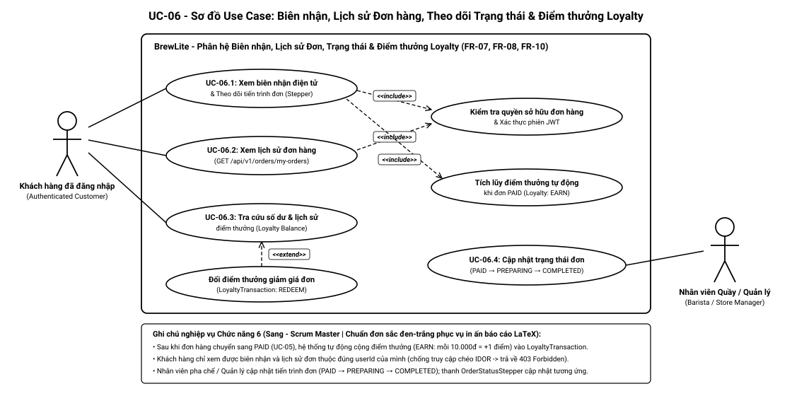

# TASK 1.3 – ĐẶC TẢ USE-CASE CHI TIẾT: PHÂN HỆ BIÊN NHẬN, LỊCH SỬ ĐƠN HÀNG, TRẠNG THÁI & ĐIỂM THƯỞNG LOYALTY (UC-06)

- **Học phần:** Công nghệ Phần mềm (SWE 2026–2027)
- **Đề tài:** BrewLite – Requirements to Deployment (Ver 1.0)
- **Tài liệu:** `docs/requirements/usecase-checkout-spec.md`
- **Giai đoạn:** Task 1.3 – Đặc tả chi tiết Use Case (Use Case Specification)
- **Thành viên thực hiện:** **6. Sang (Scrum Master – SM)**
- **Phân hệ phụ trách:** **Mục 6: Chức năng 6 – `UC-06`: Xem Biên nhận Điện tử, Theo dõi Tiến trình Đơn hàng, Tra cứu Lịch sử Đơn & Tích lũy / Quy đổi Điểm thưởng (`LoyaltyTransaction`)** (`FR-07`, `FR-08`, `FR-10`)
- **Liên kết tài liệu truy vết:**
  - [Bối cảnh, Stakeholder và Phạm vi (Task 1.1)](./context-and-scope.md)
  - [Tóm tắt Yêu cầu Phần mềm SRS (Task 1.2)](./srs-summary.md)
  - [Sơ đồ Use Case UC-06 (PUML)](../diagrams/uc-06-history-loyalty.puml) | [Ảnh Vector SVG](../diagrams/uc-06-history-loyalty.svg)

---

## 1. Vị trí của UC-06 trong Chuỗi Quy trình Nghiệp vụ End-to-End

Trong chuỗi nghiệp vụ xuyên suốt của hệ thống BrewLite, sau khi cụm Use Case trọng tâm **`UC-04` (Chiến – Khởi tạo đơn hàng & Khóa tồn kho nguyên liệu theo `RecipeItem`)** và **`UC-05` (Quang – Thanh toán Sandbox/Webhook 2 bước & Chống trừ tiền trùng lặp `Idempotency-Key`)** hoàn tất chuyển trạng thái đơn hàng sang `PAID`, hệ thống lập tức chuyển giao sang **`UC-06` (Sang – Biên nhận, Lịch sử đơn, Trạng thái & Điểm thưởng Loyalty)** để khép kín vòng đời phục vụ khách hàng:

```text
[UC-04: Khởi tạo Đơn PENDING & Khóa kho Nguyên liệu (Chiến)]
                           │
                           ▼
[UC-05: Thanh toán Sandbox & Webhook Callback -> Order = PAID (Quang)]
                           │
                           ▼
┌──────────────────────────────────────────────────────────────────────────────────┐
│ UC-06: BIÊN NHẬN, LỊCH SỬ ĐƠN, THEO DÕI TRẠNG THÁI & LOYALTY (Sang phụ trách)    │
│ • Tự động cộng điểm thưởng tích lũy (LoyaltyTransaction: EARN) khi đơn PAID      │
│ • Hiển thị Biên nhận điện tử (/checkout/success) & Thanh OrderStatusStepper     │
│ • Tra cứu lịch sử đơn hàng cá nhân (/orders/my-orders) có bảo vệ chống IDOR     │
│ • Nhân viên cập nhật trạng thái pha chế: PAID -> PREPARING -> COMPLETED          │
│ • Tra cứu số dư & đổi điểm thưởng giảm giá (LoyaltyTransaction: REDEEM)          │
└──────────────────────────────────────────────────────────────────────────────────┘
```

---

## 2. Sơ đồ Use Case Phân hệ Chức năng 6 (`uc-06-history-loyalty`)



### Bảng Giải thích Các Thành phần Use Case & Quan hệ UML

| Mã thành phần | Tên Use Case / Tác nhân | Loại phần tử / Quan hệ | Ý nghĩa nghiệp vụ trong hệ thống |
| :--- | :--- | :---: | :--- |
| **Actor 1** | **Khách hàng đã đăng nhập (`Authenticated Customer`)** | Primary Actor | Người dùng sở hữu JWT Token hợp lệ, thực hiện xem biên nhận, theo dõi trạng thái đơn, tra cứu lịch sử đơn hàng và quản lý điểm thưởng cá nhân. |
| **Actor 2** | **Nhân viên Quầy / Quản lý (`Barista / Store Manager`)** | Secondary Actor | Nhân sự vận hành tại cửa hàng (`role = STAFF / ADMIN`), tiếp nhận đơn hàng đã thanh toán (`PAID`) và cập nhật tiến trình pha chế (`PREPARING` → `COMPLETED`). |
| **UC-06.1** | **Xem biên nhận điện tử & Theo dõi tiến trình đơn (`OrderStatusStepper`)** | Base Use Case | Hiển thị hóa đơn điện tử chi tiết sau thanh toán và thanh tiến trình 4 bước trạng thái đơn hàng theo thời gian thực. |
| **UC-06.2** | **Xem lịch sử đơn hàng cá nhân (`GET /api/v1/orders/my-orders`)** | Base Use Case | Liệt kê danh sách các đơn hàng thuộc sở hữu của khách hàng theo thứ tự mới nhất đến cũ nhất. |
| **UC-06.3** | **Tra cứu số dư & lịch sử điểm thưởng (`GET /api/v1/loyalty/balance`)** | Base Use Case | Hiển thị tổng điểm tích lũy hiện có (`User.loyaltyPoints`) và danh sách các giao dịch biến động điểm (`EARN`, `REDEEM`, `REFUND`). |
| **UC-06.4** | **Cập nhật trạng thái đơn hàng (`PAID` → `PREPARING` → `COMPLETED`)** | Base Use Case | Cho phép nhân viên pha chế chuyển trạng thái đơn hàng theo đúng trình tự máy trạng thái hữu hạn. |
| **Include 1** | **Kiểm tra quyền sở hữu đơn hàng & Xác thực phiên JWT** | `<<include>>` (từ `UC-06.1`, `UC-06.2`) | Bắt buộc kiểm tra chữ ký JWT và xác minh `order.userId === currentUser.sub` trước khi trả dữ liệu đơn hàng về cho Client. |
| **Include 2** | **Tích lũy điểm thưởng tự động khi đơn `PAID` (`Loyalty: EARN`)** | `<<include>>` (từ `UC-06.1`) | Tự động ghi nhận bản ghi cộng điểm thưởng ($\lfloor \text{finalAmount} / 10.000 \rfloor$) ngay khi đơn hàng hoàn tất thanh toán. |
| **Extend 1** | **Đổi điểm thưởng giảm giá đơn hàng (`LoyaltyTransaction: REDEEM`)** | `<<extend>>` (vào `UC-06.3`) | Mở rộng khi khách hàng có số dư điểm dương và chọn sử dụng điểm để khấu trừ vào giá trị đơn hàng tiếp theo. |

---

## 3. Đặc tả Chi tiết Use Case UC-06 (Use Case Specification)

### 3.1 Bảng Thông tin Định danh & Thuộc tính Use Case

| Thuộc tính | Nội dung đặc tả chi tiết |
| :--- | :--- |
| **Mã & Tên Use Case** | **UC-06 – Xem biên nhận, Theo dõi lịch sử đơn hàng, Cập nhật trạng thái và Tích lũy / Đổi điểm thưởng (Loyalty)** |
| **Mã yêu cầu liên kết** | `FR-07` (`FR-07.1`–`FR-07.4`), `FR-08` (`FR-08.1`–`FR-08.2`), `FR-10` (`FR-10.1`–`FR-10.6`); `BR-06.1`–`BR-06.5`; `AC-06.01`–`AC-06.08`. |
| **Actor chính (Primary)** | Khách hàng đã đăng nhập (`Authenticated Customer`). |
| **Actor phụ (Secondary)** | Nhân viên pha chế / Quản lý cửa hàng (`Barista / Store Manager`). |
| **Trigger (Sự kiện kích hoạt)** | 1. Đơn hàng của khách vừa được xác nhận thanh toán thành công (`Order.status = PAID`) và hệ thống tự động chuyển hướng sang `/checkout/success?orderId=:id`.<br>2. Khách hàng bấm vào mục **"Lịch sử đơn hàng & Điểm thưởng"** trên thanh điều hướng.<br>3. Nhân viên quầy bấm cập nhật trạng thái chế biến đơn hàng trên màn hình quản lý đơn. |
| **Tiền điều kiện (Pre-conditions)** | 1. Người dùng đã đăng nhập thành công và gửi kèm chuỗi `accessToken` (JWT) hợp lệ trong Header `Authorization: Bearer <token>`.<br>2. Hệ thống Backend API (`OrdersModule`, `LoyaltyModule`) và cơ sở dữ liệu PostgreSQL đang hoạt động bình thường. |
| **Hậu điều kiện thành công (Post-conditions)** | 1. Khách hàng xem được đầy đủ thông tin biên nhận điện tử, danh sách lịch sử đơn hàng cá nhân và tiến trình trạng thái đơn trên thanh `OrderStatusStepper`.<br>2. Điểm thưởng tích lũy (`EARN`) hoặc điểm thưởng quy đổi (`REDEEM`) được ghi nhận chính xác vào bảng `LoyaltyTransaction` và đồng bộ tức thời với cột `User.loyaltyPoints` trong cùng một Database Transaction.<br>3. Trạng thái đơn hàng được cập nhật đúng quy tắc chuyển trạng thái (`PENDING` → `PAID` → `PREPARING` → `COMPLETED`). |
| **Bảo đảm khi thất bại (Failure Guarantees)** | 1. Không tiết lộ thông tin đơn hàng của người dùng khác dưới bất kỳ hình thức nào (chặn đứng lỗi IDOR với `HTTP 403 Forbidden`).<br>2. Tuyệt đối không cho phép số dư điểm thưởng của khách hàng bị âm (`User.loyaltyPoints >= 0` trong mọi tình huống) hoặc cộng điểm thưởng 2 lần cho cùng một `orderId`. |

---

### 3.2 Luồng Sự kiện Chính (Main Success Scenario)

| Bước | Tác nhân / Thành phần | Hành động xử lý chi tiết |
| :---: | :--- | :--- |
| **1** | **NestJS Backend (`PaymentsService` & `LoyaltyService`)** | Ngay khi nhận được Webhook Callback xác nhận đơn hàng chuyển sang trạng thái `PAID` (từ `UC-05`), bên trong cùng một `prisma.$transaction()`, hệ thống tính số điểm thưởng được cộng theo công thức $\text{earnedPoints} = \lfloor \text{Order.finalAmount} / 10.000 \rfloor$, tạo bản ghi `LoyaltyTransaction (type = 'EARN', points = +earnedPoints, orderId)` và cộng dồn vào `User.loyaltyPoints`. |
| **2** | **Next.js UI (`/checkout/success`)** | Trình duyệt điều hướng khách hàng tới màn hình Biên nhận điện tử (`/checkout/success?orderId=:id`) và gửi request `GET /api/v1/orders/:id` kèm Header `Authorization: Bearer <token>`. |
| **3** | **NestJS (`OrdersController` & `OrdersService`)** | `JwtAuthGuard` xác thực token; `OrdersService` truy vấn đơn hàng kèm `items` và `payment`, kiểm tra điều kiện quyền sở hữu `order.userId === currentUser.sub`, sau đó trả về `HTTP 200 OK` kèm `OrderDetailResponseDto`. |
| **4** | **Next.js UI (`OrderStatusStepper`)** | Giao diện hiển thị biên nhận sắc nét gồm mã đơn `#BL-YYYYMMDD-XXXX`, danh sách món (Size, Topping, đơn giá), tổng tiền đã thanh toán, số điểm thưởng vừa được cộng và thanh tiến trình `OrderStatusStepper` đang ở mốc **`PAID (Đã thanh toán)`**. |
| **5** | **Nhân viên Quầy (`Barista`)** | Nhân viên quầy tiếp nhận đơn hàng mới, bắt đầu pha chế và gửi request `PATCH /api/v1/orders/:id/status` với `{ "status": "PREPARING" }`, và sau khi pha xong cập nhật thành `{ "status": "COMPLETED" }`. |
| **6** | **Khách hàng (`/orders/my-orders`)** | Khách hàng mở trang **Lịch sử đơn hàng & Điểm thưởng**; giao diện gọi đồng thời 2 API: `GET /api/v1/orders/my-orders` và `GET /api/v1/loyalty/balance`. |
| **7** | **NestJS (`OrdersService` & `LoyaltyService`)** | Hệ thống truy vấn danh sách đơn hàng của `userId` sắp xếp theo `createdAt DESC` cùng số dư `loyaltyPoints` và lịch sử biến động `LoyaltyTransaction[]`, trả về `HTTP 200 OK` để giao diện hiển thị trọn vẹn cho khách hàng. |

---

### 3.3 Các Luồng Thay thế (Alternative Flows)

- **AF-01 (Tại Bước 6 – Khách hàng sử dụng điểm thưởng `REDEEM` cho đơn hàng mới):**
  1. Khi khách hàng đang có số dư điểm dương (`User.loyaltyPoints > 0`) và nhập số điểm muốn dùng (`pointsToRedeem`) tại bước đặt hàng:
  2. Hệ thống kiểm tra điều kiện `0 < pointsToRedeem <= user.loyaltyPoints`, quy đổi thành số tiền giảm $\text{loyaltyDiscount} = \text{pointsToRedeem} \times 1.000\text{đ}$.
  3. Bên trong Database Transaction tạo đơn hàng, hệ thống trừ `User.loyaltyPoints = User.loyaltyPoints - pointsToRedeem` và ghi nhận bản ghi `LoyaltyTransaction (type = 'REDEEM', points = -pointsToRedeem, orderId)`.
- **AF-02 (Tại Bước 6 – Tài khoản mới chưa có đơn hàng nào):**
  1. Khi khách hàng mới đăng ký mở trang `/orders/my-orders`, API trả về mảng rỗng `orders: []` và `loyaltyBalance: 0`.
  2. Giao diện hiển thị component `EmptyState` (*"Bạn chưa có đơn hàng nào tại BrewLite"*) kèm nút bấm điều hướng về `/menu`.

---

### 3.4 Các Luồng Ngoại lệ (Exception Flows)

- **EF-01 (Tại Bước 3 – Truy cập trái phép đơn hàng của người dùng khác / Lỗi IDOR):**
  - *Điều kiện kích hoạt:* Khách hàng A thay đổi `orderId` trên thanh địa chỉ URL để cố tình xem biên nhận của Khách hàng B (`order.userId !== currentUser.sub`).
  - *Xử lý của hệ thống:* `OrdersService` phát hiện không khớp chủ sở hữu, lập tức ném ngoại lệ `ForbiddenException` (`HTTP 403 Forbidden` – *"Bạn không có quyền xem thông tin đơn hàng này"*). Giao diện hiển thị thông báo từ chối truy cập và nút quay về trang Lịch sử đơn của mình.
- **EF-02 (Tại Luồng AF-01 – Nhập số điểm quy đổi vượt quá số dư hiện có):**
  - *Điều kiện kích hoạt:* Khách hàng nhập `pointsToRedeem > user.loyaltyPoints` hoặc nhập số âm / số thập phân.
  - *Xử lý của hệ thống:* Backend chặn yêu cầu và trả về mã lỗi `HTTP 400 Bad Request` (*"Số dư điểm thưởng không đủ để thực hiện quy đổi"*), giữ nguyên số dư điểm hiện tại, tuyệt đối không để xảy ra âm điểm.
- **EF-03 (Tại Bước 5 – Chuyển trạng thái đơn hàng sai quy trình State Machine):**
  - *Điều kiện kích hoạt:* Request gọi `PATCH /api/v1/orders/:id/status` cố tình chuyển một đơn hàng đang `PENDING` (chưa thanh toán) hoặc đã `CANCELLED` sang `PREPARING` / `COMPLETED`.
  - *Xử lý của hệ thống:* `OrdersService` kiểm tra bảng chuyển trạng thái hợp lệ (`BR-06.1`), từ chối thực thi và trả về mã lỗi `HTTP 400 Bad Request` (*"Không thể chuyển trạng thái đơn hàng từ trạng thái hiện tại"*).
- **EF-04 (Hoàn trả điểm thưởng khi đơn hàng bị hủy – `REFUND`):**
  - *Điều kiện kích hoạt:* Đơn hàng có sử dụng điểm thưởng (`loyaltyPointsUsed > 0`) nhưng thanh toán thất bại tại `UC-05` hoặc hết hạn thanh toán 15 phút dẫn đến `Order.status = CANCELLED`.
  - *Xử lý của hệ thống:* Bên trong cùng Transaction hủy đơn và hoàn kho nguyên liệu, `LoyaltyService` cộng trả lại đúng `loyaltyPointsUsed` vào `User.loyaltyPoints` và tạo bản ghi `LoyaltyTransaction (type = 'REFUND', points = +loyaltyPointsUsed, orderId)`.
